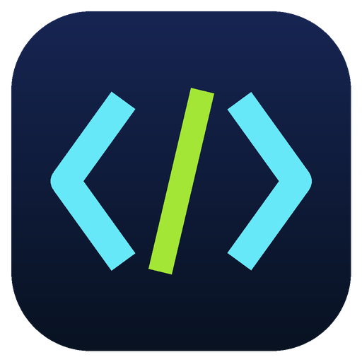

<div align="center">



# CodeBuddy

**面向 Windows 的桌面 AI 开发助手：分析项目、修改代码、运行测试、检查 Git 变更。**

[简体中文](README.md) · [繁體中文](documentation/codebuddy/GITHUB_OVERVIEW_ZH_TW.md) · [English](documentation/codebuddy/GITHUB_OVERVIEW_EN.md)

</div>

## 当前版本

2026-11-04 本地累计改进、提交关系、Windows 启动问题复盘及验证边界见[远端合并说明](docs/reconstruction/2026-11-04-merge-preparation.zh-CN.md)。

CodeBuddy 将项目分析、代码修改、命令执行、Git 审查、项目记忆和工具扩展放在同一个桌面工作区。应用版本以 [ui/desktop/package.json](ui/desktop/package.json) 为准；近期图片操作、历史加载、滚动、插话与相关验证见[桌面交互开发说明](docs/reconstruction/2026-10-25-desktop-ux-and-history.zh-CN.md)。源码构建、自动测试和实际产品验收分别记录，不代表所有功能或平台均已通过。

Windows 使用仓库根目录的 `start-preview.ps1` 启动开发版。开发版和安装版默认数据根统一为 `~/.CodeBuddy`，默认新工作区位于其中的 `workspaces`；模型、历史、宠物、日志和缓存均保存在数据根下。文件菜单提供“打开 CodeBuddy 数据目录”。`CODEBUDDY_HOME` 可指定整个数据根，`CODEBUDDY_WORKSPACE_ROOT` 可单独指定工作区；自动化测试必须显式使用隔离数据目录。历史 `.preview-data` 和 `.CodeBuddy-Harness` 不会在启动时自动导入或覆盖，迁移须先退出应用、备份并校验。安装版首次启动空数据目录时预置 `http://192.168.9.101:8001` 的 Gemma-4 和 `http://192.168.9.120:8001` 的 Qwen Flash、FP4 与 CyberSecurity 局域网模型，用户仍可在设置中添加自己的模型；已有配置不被覆盖。详见[安装版默认模型](docs/installation-model-defaults.zh-CN.md)。详见[存储目录说明](docs/storage-layout.zh-CN.md)。

Git 仅保存源码、依赖锁文件和许可证，不包含本机凭据、聊天数据、运行载荷和构建产物。首次克隆需要准备开发依赖及独立工具，详见下文。

## macOS 开发与本机验收

macOS Apple Silicon 原生构建、签名 DMG 安装、电脑控制及独立 MCP 关键路径已完成本机验收，范围与源码版本见 [Mac 版开发说明](docs/macos.zh-CN.md)。本批使用开发证书；公开分发公证、真实模型对话及最新桌面宠物改动不在本批通过范围内。

繁體：[Mac 開發與本機驗收](docs/macos.zh-TW.md)。English: [Mac development and local acceptance](docs/macos.en.md).

## Windows 构建

使用已有 Node.js 24+ 和项目依赖，在仓库根目录执行：

```powershell
node scripts/build-harness-windows.cjs --installer=inno
```

产物为 `ui/desktop/out/make/inno.windows/x64/CodeBuddy-Setup.exe`。打开安装包先选择安装范围。「仅为我安装」默认使用 `%LOCALAPPDATA%\Programs\CodeBuddy`。「为此电脑上的所有用户安装」需要管理员授权，默认使用 `%ProgramFiles%\CodeBuddy`。随后可选择安装目录，在完成页选择快捷方式及是否启动应用。快捷方式、链接协议和卸载入口跟随安装范围。

用户数据位置不在安装时选择：新安装使用 `~/.CodeBuddy`，升级保留已保存的位置；此前保存的数据位置继续沿用，设置中不再提供存储管理。

安装界面采用原生浅色布局，统一标题、间距和按钮尺寸；完成页以左侧标识、右侧说明与选项排列。进度条上方直接显示当前操作和正在处理的组件，不再使用展开链接或日志框。内部路径和依赖文件名仅保留在诊断日志。界面与隔离验收说明见[安装器界面](docs/windows-installer-ui.zh-CN.md)。

Inno 再次安装沿用所选范围的历史目录。安装前检查 CodeBuddy 和安装目录内的后台进程，要求用户退出后再继续。卸载个人安装时默认保留个人数据，也可确认清理聊天历史或个人数据；工作区及已登记项目保留。全机卸载与静默卸载都保留个人数据。详见[安装器界面与清理范围](docs/windows-installer-ui.zh-CN.md)。

向导使用已有 Inno Setup 6.7+（或 7.x），不自动安装编译工具。安装官方编译器后，将其 `ISCC.exe` 路径通过 `CODEBUDDY_ISCC` 指定，或使用当前用户／Program Files 下的标准安装位置。简体中文翻译使用 [Inno Setup 6.7.3 的 ChineseSimplified.isl](https://github.com/jrsoftware/issrc/blob/is-6_7_3/Files/Languages/Unofficial/ChineseSimplified.isl)，放在编译器 `Languages/` 目录，或通过 `CODEBUDDY_INNO_ZH_CN` 指定。工具准备及载荷下载需先获授权。

旧 Squirrel 兼容入口仍为 `node scripts/build-harness-windows.cjs`（也可显式指定 `--installer=squirrel`），产物保留在 `ui/desktop/out/make/squirrel.windows/x64/CodeBuddy-Setup.exe`。两种安装器不自动互相卸载或合并安装目录；用户数据目录保持同一产品规则。

构建先暂存、校验运行时、适配层、配方类型、Office 载荷和独立 MCP 工具，由 Electron Forge 打包桌面，再交给选定的安装器封装。包内包含 Node 24 与许可证，应用运行不依赖系统 Node。Windows MSI 未在 Node 旁附带 `LICENSE` 时，使用 `runtime/tools/licenses/node-v<当前 Node 版本>-LICENSE.txt` 中与官方版本匹配的完整许可文件；不修改系统 Node 目录。项目开发所需的语言工具链仍按项目自身要求准备。

首次准备 Office 环境请阅读 [Office 构建器说明](scripts/office-builder/README.md)，生成 `runtime/py` 和 `runtime/office`。该准备步骤涉及下载；正常打包只复制和验证已有载荷，不修改系统 Python。短目录和构建前路径检查用于避免 Windows 安装路径超长。

独立 MCP 工具按 `runtime/tools/provenance.json` 准备到 `runtime/tools/bin`。本机离线构建命令：

```powershell
cargo build --offline -p goose-mcp --features rustls-tls --bin codebuddy-tools --jobs 1
```

更新工具产物时须同步核对 `runtime/tools/provenance.json`、`runtime/builtin-artifacts.mjs` 中的大小和 SHA256。运行依赖以 `runtime/harness/package-lock.json` 为准。

Windows 暂存还会从已准备的 Python 载荷复制正式版 `vcruntime140.dll` 及上游许可证到工具目录，避免独立工具依赖开发机的系统 VC 运行库。缺少文件时构建失败；不自动下载或安装。暂存校验会核对副本与原载荷一致，不能用开发机上的一次调用成功替代此检查。

同批源码、同一暂存目录且应用已完整构建时，才可使用 `node scripts/build-harness-windows.cjs <stage-directory> --make-only` 接续安装包生成。NuGet 已完成、仅 Squirrel 封装中断时可使用 `--finalize-only`；脚本先验证 NuGet 内应用与当前产物一致。源码变更后必须重新构建，不复用旧暂存目录。

第三方组件的许可证、版权及来源记录保留在对应许可文件与 `runtime/harness/PROVENANCE.json`。当前文档与近期交接见[文档索引](docs/README.zh-CN.md)。旧架构文档、早期验收流水及上游文档站已移入 Git 历史；历史记录中的版本名与测试结论仅适用于当时产物。

## 功能

| 能力               | 使用方式                                       |
| ------------------ | ---------------------------------------------- |
| 项目分析与开发     | 选择目录，用自然语言要求读取、解释或修改代码   |
| 命令与测试         | 运行项目已有测试，查看命令、退出码与输出       |
| Git 版本控制       | 查看状态、差异，并使用任务面板的审查入口       |
| 项目记忆与历史     | 管理记忆，通过历史记录返回已有对话             |
| 素材库             | 汇总生成图片和视频，支持时间／工作区视图、容量统计、预览及多选删除；[使用说明](docs/media-library.zh-CN.md) |
| 自定义智能体       | 从六个默认模板添加或自行配置，在当前聊天选用、切换或撤销；附带按需读取的 Skill；[使用与验证说明](docs/custom-agents.zh-CN.md)（语音暂未实现） |
| 工具与扩展         | 按任务配置内置能力、MCP 服务和技能             |
| Windows 电脑控制   | 支持桌面操作；复杂软件任务仍需逐项核对实际结果 |
| 自动任务           | 直接填写任务与时间，每次新会话或跟进当前聊天   |

自动任务创建时可直接填写任务内容与时间，默认每次新会话；在聊天中从侧栏打开自动任务后，也可选择“当前聊天跟进”，表单会显示绑定的聊天名称。跟进沿用该聊天的历史、当前模型与权限，忙碌时跳过本次，删除聊天后暂停任务。每次新会话模式可继续导入旧模板；旧任务保持原有行为。新建任务通过“测试并启用”先执行一次，成功后开始定时运行。CodeBuddy 必须保持运行，休眠或关闭期间错过的次数不会在重启时补跑。

## 环境准备

- Windows 10/11 x64、Git for Windows。
- Node.js 24.10 或兼容的 24.x 版本。
- pnpm：以 [ui/package.json](ui/package.json) 的 packageManager 为准，当前 11.9.0。
- 可访问的模型服务及凭据，例如本地 Ollama、Ollama Cloud 或应用支持的其他提供商。

仅在需要本地编译原生 npm 模块或重建 Rust 工具时准备相应 C++/Rust 工具链；Rust 版本以 `rust-toolchain.toml` 为准，桌面启动不需要编译完整工具集。

## 首次准备依赖

以下命令在仓库根目录的 PowerShell 中执行，保持现有锁文件版本：

```powershell
node --version
corepack pnpm --dir .\ui install --frozen-lockfile
Push-Location .\runtime
npm ci --ignore-scripts --no-audit --no-fund
Pop-Location
Push-Location .\runtime\harness
npm ci --ignore-scripts --no-audit --no-fund
Pop-Location
.\start-preview.ps1
```

已有匹配版本 pnpm 时，可将 `corepack pnpm` 替换为 `pnpm.cmd`。UI、兼容服务和 Harness 是不同依赖目录；任一步失败先查看该步错误，不直接进入启动。不为绕过安装错误修改依赖版本或锁文件。

以后依赖未变化时直接运行 `.\start-preview.ps1`。窗口未出现时，先检查数据根下的 `logs/preview/launch.json`、`prepare.log`、`runtime.log` 和 `electron.log`；进程启动成功不等于真实模型对话或工具已经验收。

预览入口会在启动后端和桌面前，复用运行时规则检查独立工具的文件类型、路径、大小和 SHA256。Windows 在 SDK 准备前检查；Mac 在现有原生工具准备完成后检查。工具缺失或不匹配时，终端和 `launch.json` 会记录具体文件、校验失败原因、预期大小及哈希，并停止启动。

Git 不同步 `runtime/tools/bin`，所以拉取新源码后，旧 EXE 可能仍留在本机。遇到该提示时，先备份旧工具，再按上文独立 MCP 工具准备说明，从与当前源码匹配的已核验载荷恢复文件，或离线构建并核对来源和产物登记；完成后重新启动。不要只修改大小或哈希来绕过检查。启动检查不自动下载、安装或替换工具，也不代替真实工具调用验收。

## 第一次使用

1. **连接模型**：在设置中配置提供商、服务地址、API Key 和实际可用模型。本地服务需要先启动。
2. **选择项目**：点击新任务，使用默认工作区或选择项目文件夹。初次试用使用可恢复的测试项目。
3. **先只读分析**：发送下面的第一条提示词，确认模型与项目连接正常。
4. **再执行修改**：说明具体目标、允许修改的范围和验收条件。
5. **核对结果**：检查文件差异、工具回执、测试命令和退出码，不仅看模型的“完成”文案。
6. **继续任务**：在原对话补充要求或输入“继续”。恢复失败时保留会话和错误用于排查。

“API 基础路径（可选）”使用开关控制。新建兼容 API 连接默认关闭：保留 API 地址中的路径，只追加 `/chat/completions`、`/models` 等协议端点，不自动补 `/v1`。开启后显示自定义路径输入框并沿用版本补齐规则；OpenAI、Ollama 预设会填写各自所需路径。旧连接缺省保持原行为，可编辑后关闭开关。Google 兼容地址可填写 `https://generativelanguage.googleapis.com/v1beta/openai/`；Google 的请求会省略不支持的 `store` 字段。

### 提示词示例

```text
只读取当前项目，说明主要功能、入口文件和启动步骤，不修改文件。
```

```text
检查当前 Git 差异，指出具体文件、行号和问题原因，不提交、不推送。
```

```text
修复这个函数的边界错误，运行对应测试，报告修改文件、测试结果和未验证部分。
```

## Git、工具和授权

- Git 操作以当前选择的项目为准。写入或远端操作前确认仓库、分支和变更。
- 使用版本控制/任务面板的审查入口，检查实际返回的问题列表。
- 启用工具不等于连接成功，更不等于所有功能已验收。外部 MCP 需要单独配置与测试。
- 电脑控制明确指定软件、目标和完成条件；发信、删除等操作需要准确对象与内容。
- API Key 只填写在应用配置中，不写入源码或提交到 Git。

## 常见问题

**启动报找不到模块**：确认三个依赖目录均已按锁文件准备，查看 `runtime.log` 中具体缺失的模块。不要改用旧 Rust 启动脚本掩盖 Harness 错误。

**模型能回答但工具失败**：检查模型工具调用支持、工具启用状态、服务连接与权限。
记录具体工具错误，不能用另一项工具成功替代本次验收。

**磁盘空间下降**：Rust target、前端依赖和打包产物占用空间较大。
停止构建后再检查可再生成目录；保留源码、会话和未验收证据。

**没有安装包**：可按上文从源码启动或使用本地构建入口生成安装包。GitHub Release 中的文件以具体发布内容为准；仓库不承诺每次提交都有已签名的正式安装包。

## 开发与测试

从仓库根目录按受影响组件选择现有检查或相关用例：

```powershell
corepack pnpm --dir .\ui\desktop run typecheck
corepack pnpm --dir .\ui\desktop run test:run
corepack pnpm --dir .\ui\desktop run lint:check
npm --prefix .\runtime test
npm --prefix .\runtime\harness test
```

在仓库根目录执行：

```powershell
cargo fmt --check
cargo test --offline -p goose-mcp --features rustls-tls --lib --jobs 1
cargo clippy --offline -p goose-mcp --features rustls-tls --all-targets --jobs 1 -- -D warnings
```

部分内部 crate、包和协议保留兼容名称，不能直接全局替换。

| 路径                       | 内容                    |
| -------------------------- | ----------------------- |
| ui/desktop                 | Electron 界面           |
| ui/sdk                     | 通信 SDK                |
| crates/goose-mcp            | 独立文档、图表、查询工具 |
| runtime/harness            | 执行服务与必要适配 |
| scripts                    | 启动、构建和验证脚本    |
| documentation/codebuddy | 产品文档与第三方声明    |
| docs                       | 设计和开发计划          |

## 项目体积与本地文件

- `target/` 是可重新生成的 Rust 编译产物，不属于提交到 GitHub 的源码。
- `node_modules/`、安装包输出、本地验收记录和临时夹具也不应提交。
- 先停止构建再整理缓存；源码、配置、会话及未完成工作的证据需要保留。

## 反馈与许可

使用本仓库 [Issues](https://github.com/erjinyi-bool/CodeBuddy-v1/issues) 反馈问题，
提供版本、复现步骤、预期与实际结果，去除密钥和个人信息。

[贡献指南](CONTRIBUTING.md) · [维护者](MAINTAINERS.md) ·
[Apache-2.0 许可证](LICENSE) · [第三方软件与修改声明](documentation/codebuddy/THIRD_PARTY_NOTICE.md)
