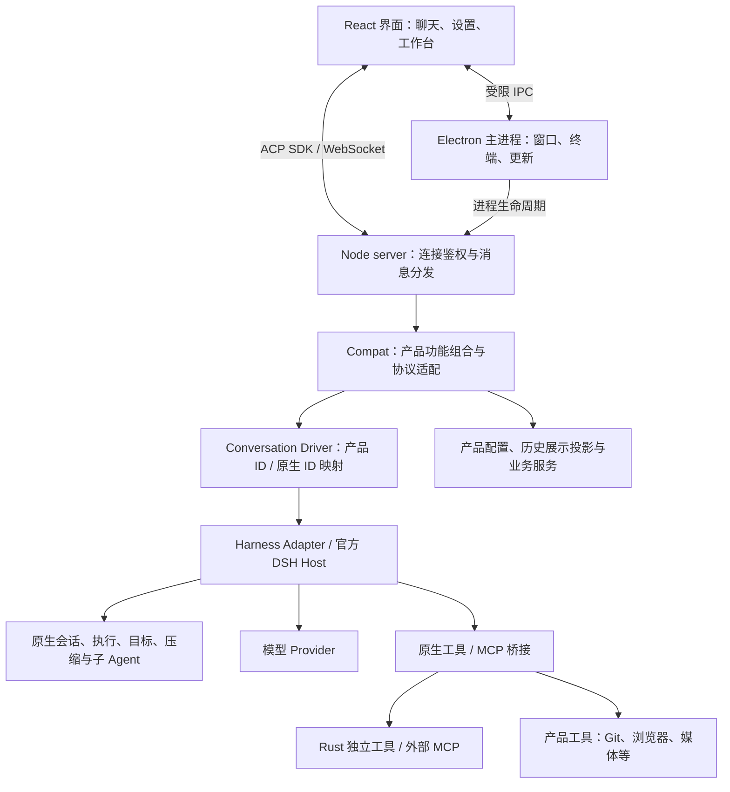

# CodeBuddy 架构简析与模块耦合

> 分析日期：2026-10-29。源码基线：`main` / `78f199aaa3d044d37f65b8dcf2889fcfe0e7960b`，分析开始时工作区干净。本文基于入口、导入关系及关键实现的静态检查，不代表运行测试或产品 E2E 通过。

## 1. 整体架构

项目是 **Electron/React 桌面 + Node.js 本地服务 + 现有 Agent 执行引擎 执行核心 + 独立 MCP 工具**。它属于本地分层应用；功能模块多数仍组合在同一个运行时中，并非独立部署的微服务。

Harness 当前锁定 `@deepseek-ai/dsh@0.2.1-alpha.2`。Agent 循环、原生会话、子 Agent、目标与压缩走 Harness；CodeBuddy 提供产品交互、协议适配、配置与工具接线。Rust workspace 当前只包含 `goose-mcp`，不承担 Agent 或模型 Provider 核心。

图中箭头表示主要调用或通信方向，不表示每个模块是独立进程。预览版由启动脚本组织服务和桌面；安装版通过 Electron 的 `harnessService.ts` 启动随包 Node 运行时。

## 2. 按功能划分

| 功能模块 | 主要位置 | 职责与边界 |
| --- | --- | --- |
| 桌面交互与工作台 | `ui/desktop/src/App.tsx`、`components/`、`hooks/`、`workspace-panel/`、`pets/` | 聊天、工具回执、项目文件、设置、宠物等交互；消费执行结果，不拥有 Agent 完成判定。 |
| 桌面宿主与系统集成 | `ui/desktop/src/main.ts`、`preload.ts`、`harnessService.ts`、`update/` | 窗口与 IPC、后台服务生命周期、终端及更新安装协调。更新与运行时停止/保存有跨进程合同。 |
| 通信与界面状态适配 | `ui/sdk/schema/`、`ui/sdk/src/goose-client.ts`、`ui/desktop/src/acp/`、`types/` | ACP 标准方法及产品扩展、请求与通知、审批表单、重连和聊天展示状态。`Goose` 命名仍用于兼容接口。 |
| 本地服务与产品组合层 | `runtime/server.mjs`、`compat.mjs` | 本地鉴权、WebSocket、请求分发、服务装配；组合会话、设置、历史、工具、审查、定时任务等产品功能。 |
| 会话身份与编辑 | `runtime/conversation-driver.mjs`、`conversation-editing.mjs`、`subagent-conversations.mjs` | 产品聊天 ID 与原生会话 ID 映射、操作互斥、fork/编辑、子会话只读观察。身份转换集中在 driver。 |
| Agent 执行与模型接入 | `runtime/harness/index.mjs`、`profile.mjs`、`compaction.mjs`；`runtime/providers.mjs`、`model-settings.mjs`、`vision-routing.mjs` | 启动官方插件、接入模型配置与能力、转换事件；Harness 原生控制器负责实际执行、取消、恢复及压缩。 |
| 权限、安全与扩展管理 | `runtime/tool-policy.mjs`、`safety-policy.mjs`、`session-extensions.mjs`、`tool-session-approval.mjs`；`harness/mcp-*.mjs` | 产品持有连接、工具启用、可信定义和授权绑定；编译到原生权限/审批边界，MCP 桥负责连接与工具接入。 |
| 历史、配置与项目记忆 | `runtime/store.mjs`、`transcripts.mjs`、`history.mjs`、`memory.mjs`、`secrets.mjs` | 产品配置与会话元数据、ACP 展示日志、历史导入导出、凭据保护；项目记忆通过 driver 使用 Harness 存储能力。 |
| 任务面板、审查、配方与自动任务 | `runtime/codepro.mjs`、`codepro-review.mjs`、`library.mjs`、`recipe-execution.mjs`、`schedules.mjs`、`workspaces.mjs` | 展示原生任务状态、组织审查、复用技能/配方、管理定时触发与工作区。定时服务触发执行，不替代 Harness 的 Agent 调度。 |
| 具体工具能力 | `runtime/git-extension.mjs`、`browser-tool.mjs`、`comfyui-*.mjs`、`desktop-pet-tool.mjs`；`crates/goose-mcp/` | Git、浏览器、图像/视频和宠物等产品工具；Rust 工具入口提供 `commonqueries`、`computercontroller`、`autovisualiser` 三类 MCP 服务。并非所有工具都由 Rust 实现。 |
| 启动与交付 | `start-preview.ps1`、`scripts/start-harness-preview.cjs`、`scripts/build-harness-windows.cjs`、`runtime/builtin-artifacts.mjs` | 编译已有 SDK/语言资源、校验工具载荷、启动开发环境或打包；依赖和载荷准备与普通启动分开。 |

## 3. 一次请求如何流转

1. 用户在桌面发送消息，前端 ACP 层通过 `GooseClient` 和 WebSocket 连接本地服务。
2. `server.mjs` 处理连接鉴权与协议分发；`Compat` 结合模型、工作区、扩展和权限配置准备请求。
3. `conversation-driver.mjs` 解析原生会话 ID，协调同一聊天内互斥操作；Harness Adapter 调用官方 `sessionController.prompt`。
4. Harness 运行模型与工具循环，通过原生工具、MCP 或产品接入的工具完成动作。审批请求通过产品协议返回 UI，再交回原生审批链。
5. 原生事件经适配成为 ACP 通知、聊天内容及任务面板投影；桌面据此更新可见状态。历史展示日志与原生执行历史承担不同职责。

关键区别：`store.mjs` 的 `state.json` 保存产品数据；`transcripts.mjs` 保存可持久化的 ACP 展示投影；Harness 原生日志持有执行历史。`codepro.mjs` 对新 Harness 运行缓存展示事实，仍保留旧事件的历史解释，不能据此认为旧 DAG 核心仍在执行。

## 4. 模块耦合情况

以下“高/中/低”是按接口覆盖面、共享状态及变更传播范围作出的定性判断，不是自动化评分，也不等于已确认缺陷。

| 模块关系 | 程度 | 已观察到的连接 | 影响 |
| --- | --- | --- | --- |
| Compat ↔ 产品功能服务 | **高** | `compat.mjs` 同时构造设置、历史、记忆、安全、审查、库、调度与会话编辑服务，并持有连接和活动请求状态。 | 产品能力增删容易触及中心文件；会话、配置或关闭流程变更需检查多个服务的回调与失效行为。 |
| Harness Adapter ↔ 官方 DSH | **高** | `harness/index.mjs` 导入多项 DSH 插件，使用原生 session controller、scope、storage 和事件机制；另有锁定版本的返回合同兼容适配。 | 上游升级不能只改版本号，需要复核内部接口、事件及兼容补丁。执行权威集中是优点，但版本绑定较强。 |
| 前端 ACP ↔ runtime ↔ SDK schema | **中高** | 界面通过标准 ACP 与产品扩展通信，同时依赖通知结构、审批、任务快照和历史投影语义。 | 进程隔离降低直接代码依赖，但字段/通知含义变更会跨 SDK、服务、前端传播。 |
| 产品会话 ↔ 原生会话 ↔ 展示历史 | **中高** | driver 映射 `nativeSessionId`；编辑/fork、历史和子会话观察围绕同一身份链运行。 | 修改 fork、恢复、重连或会话切换时必须同步核对投影归属，不能让展示缓存成为第二套执行权威。 |
| runtime ↔ UI 构建与依赖布局 | **高（构建层面）** | `schedules.mjs`、`library.mjs`、`recipe-execution.mjs` 导入 `ui/sdk/dist/generated/zod.gen.js`；部分模块通过 `ui/desktop/package.json` 定位并加载依赖。 | 运行时不是完全自包含的包：SDK 必须先构建，桌面依赖位置也影响部分后端能力。 |
| Electron ↔ 本地服务 | **中高（生命周期）** | 主进程组织服务启动、退出和更新；服务停止需要处理进行中的请求及持久化。 | 升级或退出策略变更会同时影响 UI、终端、调度和数据保存；普通界面样式变更不具有同等传播范围。 |
| 多个产品服务 ↔ Store | **中高（数据层面）** | 多服务共享 store 的读写及产品状态结构。 | 字段语义、迁移、提交失败与原子性具有跨模块影响；逻辑上分文件并不等于数据隔离。 |
| Harness/MCP ↔ Rust 工具 | **低至中** | `codebuddy-tools.rs` 是仅工具的 MCP 入口，不依赖 Agent、ACP 或调度器。 | 实现语言和进程较独立；工具名称、参数、返回格式及载荷哈希仍构成合同和交付耦合。 |

中心文件规模也支持“职责集中”的判断：当前 `compat.mjs` 约 2,974 行，`harness/index.mjs` 约 1,270 行，桌面 `main.ts` 约 3,537 行。行数本身不是缺陷证据，应结合上表中的职责和状态连接评估。

## 5. 结论与后续关注

**总体：执行核心边界比较明确，产品组合层与上游适配层耦合偏高。** 独立 MCP 工具的隔离较好；ACP 建立了通信边界，但产品扩展和展示语义仍需前后端共同维护。

若后续安排重构，优先考虑：

1. 按已有功能边界拆分 Compat 的路由与装配代码，保持原有 owner、协议和状态语义，避免再造执行状态机。
2. 梳理 runtime 对 UI 编译产物、桌面依赖目录及 DSH 内部路径的依赖；需要改变包边界时先明确迁移方案。
3. 集中验证会话身份、权限、原生事件到展示投影的合同，重点覆盖 fork/恢复、子会话观察、审批和退出保存。

这些是静态分析提出的维护方向，本轮未实施重构，也未证实存在对应运行故障。

## 6. 阅读入口与核验范围

- [启动、构建和测试说明](../README.md)
- [事实权威与模块职责（含历史章节，需结合后续覆盖规则阅读）](../documentation/codebuddy/CODEPRO_FACT_AUTHORITY_ZH_CN.md)
- [本地服务入口](../runtime/server.mjs)、[产品组合层](../runtime/compat.mjs)、[会话身份适配](../runtime/conversation-driver.mjs)
- [Harness 适配入口](../runtime/harness/index.mjs)、[插件配置](../runtime/harness/profile.mjs)、[锁定版本与来源](../runtime/harness/PROVENANCE.json)
- [桌面 ACP 连接](../ui/desktop/src/acp/acpConnection.ts)、[SDK 客户端](../ui/sdk/src/goose-client.ts)、[Rust 工具入口](../crates/goose-mcp/src/bin/codebuddy-tools.rs)

本轮仅使用 Git 状态查询、`rg` 搜索和源码读取进行静态调查，并检查本文引用与格式；没有安装依赖、启动桌面、调用模型、构建或执行自动测试。现有测试文件的存在不代表本轮已通过测试。
