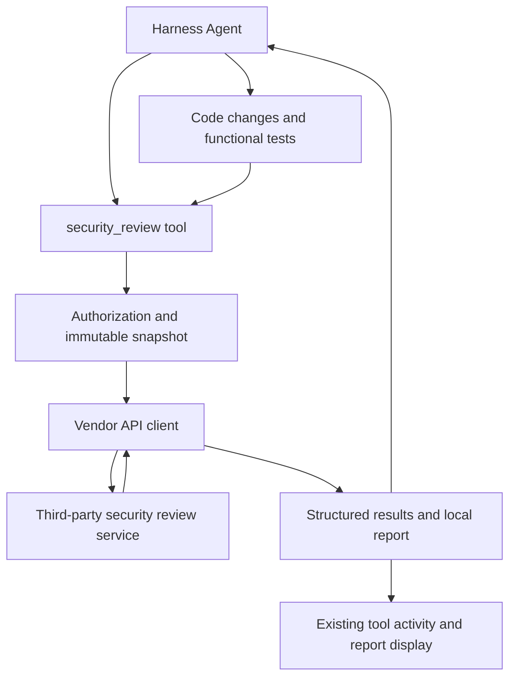

# Integrating a third-party code security review API into CodeBuddy

Date: 2026-10-23. Other editions: [简体中文 (default)](secvibe-api-integration-design.zh-CN.md) · [繁體中文](secvibe-api-integration-design.zh-TW.md).

Source reference: `D:\CodeBuddy-v1`, branch `main`, revision `09b0219`, with pre-existing uncommitted changes. This is an implementation design. No runtime integration, source upload, or real audit API call has been performed for this document.

## 1. What to build

**Add a backend security-review tool to CodeBuddy. Submit an approved, immutable code snapshot to the vendor API, retrieve structured findings, and let the existing Harness Agent perform repairs and rechecks.** The vendor analyzes code. Harness remains authoritative for Agent execution, tool invocation, permissions, context compaction, and task completion.

Example: the user asks for a login endpoint with a security review. CodeBuddy writes and tests it, creates an approved snapshot, starts a vendor review, retrieves findings with locations and evidence, fixes the local code, reruns functional tests, and reviews a new snapshot. Delivery includes the code, reviewed scope, fixed and outstanding issues, and reports.

This design applies to another company's equivalent service. For SecVibe specifically, a supported external audit endpoint, authentication contract, and schemas have **not yet been confirmed**. Model-provider API keys in its web settings are not established audit-service credentials. Browser cookies and internal web requests should not become the production integration contract.

## 2. Architecture and transport choice



| Vendor delivery | Integration |
| --- | --- |
| Official MCP with authentication and structured output | Prefer the existing MCP configuration, bridge, and discovery. Do not build a redundant HTTP-to-MCP service. |
| Supported HTTP API | Add a thin client and register a host tool through the existing Harness path. This is the main design below. |
| Noninteractive CLI with structured output | Consider a controlled subprocess adapter after verifying exit codes, cancellation, and licensing. Do not invent CLI flags. |
| Interactive website only | Obtain a supported API/MCP/CLI contract before treating it as an automated review integration. |

Credentials stay in the backend. The frontend receives connection status and redacted results. Uploading code is an outbound data operation even if analysis does not modify files; a read-only label does not grant upload authorization. Treat recommendations as untrusted data, not executable instructions.

If the vendor only supports synchronous reviews, use its synchronous contract and explicit deadline. If it supports real asynchronous jobs, persist job identifiers and query their results. A background JavaScript Promise is not evidence of vendor-side asynchronous support.

## 3. Concrete CodeBuddy integration points

“Proposed” means not implemented or created by this documentation task.

| File | Work and ownership |
| --- | --- |
| `runtime/compat.mjs` | Add the tool to session `tools`, matching existing capability switches, permission allowlists, and settings. |
| `runtime/harness/index.mjs` | Reuse `settings.tools` → `scoped.tools.register`. This path already forwards `sessionId`, `signal`, and `callId`; do not create another Agent loop. |
| `runtime/harness/tool-discovery.mjs` | Make the tool discoverable on demand. Avoid injecting its full rules and reports into every model request. |
| `runtime/security-review-tool.mjs` (proposed) | Expose `start/status/result/cancel`; enforce authorization and session/job ownership. |
| `runtime/security-review-client.mjs` (proposed) | Own vendor authentication, endpoint mapping, response validation, and error normalization. |
| `runtime/security-review-snapshot.mjs` (proposed) | Collect approved files, enforce boundaries, and create immutable snapshots and hash manifests. |
| `runtime/settings.mjs`, `runtime/secrets.mjs` | Reuse configuration and `protectSecret/revealSecret`; keep credentials out of prompts, tool arguments, logs, reports, and Git. |
| `runtime/tests/` | Add protocol, state, authorization, snapshot, and recovery regressions. |
| Existing settings/toolbox | Add enablement, connection checks, and upload scope using existing layouts where possible. |

Tool registration alone does not prove that data egress is approved. Before implementation, trace whether native host-tool execution passes through the existing approval mechanism. If upload authorization is missing, connect it at the adapter boundary rather than relying on tool-description text.

The MCP option reuses `runtime/harness/mcp-bridge.mjs` and `mcp-tasks.mjs`. Use Tasks only after actual support negotiation; otherwise retain the configurable timeout mechanism, currently defaulting to 300 seconds. For HTTP, configure individual request timeouts separately from the total review deadline; do not automatically impose the MCP fallback limit on every asynchronous review.

## 4. Required vendor handoff

Request:

1. Test environment, audit-service authentication and permissions, and commercial integration terms.
2. Input formats: file arrays, archives, Git references, or diffs; language, size, and dependency-manifest limits.
3. Documented create/status/result/cancel operations. If callbacks exist, require signature and replay-protection specifications.
4. JSON findings with location, severity, rule, evidence, recommendation, coverage, and partial-failure semantics.
5. Rate limits, idempotency guarantees, pricing, retention/deletion, and downstream model-provider processing.

Suggested request to the vendor:

> We plan to integrate your code security review capability into our development Agent. The intended workflow is snapshot submission, structured findings, local remediation, and re-review. Please provide the supported API or MCP documentation, test credential application process, input format, asynchronous job and cancellation contract, example findings, and data-processing, retention, pricing, and commercial integration terms.

SecVibe's privacy page states that project code is processed in the cloud and relevant content may be sent to the selected model provider. Confirm whether the eventual API uses the same deployment and contractual boundaries or offers a separate/private deployment. [Official privacy policy](https://secvibe.gcsa.com/privacy/zh-CN/)

## 5. Illustrative HTTP contract

**All domains, paths, authentication choices, and fields in this section are proposed examples, not verified SecVibe endpoints.** Replace and map them inside the vendor client after obtaining its official contract. `vendor.example` is an example domain.

| Operation | Example | Required semantics |
| --- | --- | --- |
| Create | `POST https://security-api.vendor.example/v1/reviews` | Return a job ID; use an idempotency key only if officially supported. |
| Status | `GET /v1/reviews/{id}` | Return queued/running/completed/failed/cancelled facts. |
| Result | `GET /v1/reviews/{id}/result` | Return structured findings and coverage. |
| Cancel | `POST /v1/reviews/{id}/cancel` | Return a real acknowledgement; explicitly record unsupported cancellation. |

Illustrative submission, potentially replaced with the official file-upload protocol:

```json
{
  "clientRequestId": "LOCAL_REQUEST_ID",
  "snapshotId": "sha256:SNAPSHOT_DIGEST",
  "files": [
    {"path": "src/auth/login.ts", "sha256": "FILE_DIGEST", "content": "APPROVED_SOURCE_TEXT"}
  ],
  "contextFiles": ["package.json", "package-lock.json"],
  "checks": ["code_security", "dependencies", "secrets"]
}
```

Referenced context files must also be included in the approved uploaded snapshot. Request only checks the vendor really supports. Changed files can define the trigger, but call chains, authorization configuration, and dependency context may be necessary; a diff alone is not guaranteed sufficient.

Normalize results into an internal structure such as:

```json
{
  "reviewId": "LOCAL_REVIEW_ID",
  "snapshotId": "sha256:SNAPSHOT_DIGEST",
  "status": "completed",
  "coverage": {
    "analyzedFiles": ["src/auth/login.ts"],
    "skippedFiles": [],
    "partial": false
  },
  "findings": [{
    "id": "VENDOR_FINDING_ID",
    "ruleId": "VENDOR_RULE_ID",
    "severity": "high",
    "path": "src/auth/login.ts",
    "startLine": 42,
    "title": "Example: missing authorization check",
    "evidence": "Vendor-provided evidence",
    "recommendation": "Vendor-provided recommendation"
  }],
  "errors": []
}
```

Keep missing vendor fields unknown; the primary model must not invent them. `completed` means review execution ended, not that the code is secure. Zero findings means none detected in the reviewed scope. Invalid results, insufficient coverage, or failed API requests must never render as a security pass. If local files no longer match the snapshot, mark the report stale and do not apply its line numbers directly to changed code.

## 6. Wiring the tool and client

Use the existing host-tool shape, `{name, description, inputSchema, execute}`. The complete illustrative JavaScript factory is shared in [section 6 of the default edition](secvibe-api-integration-design.zh-CN.md#6-给开发人员的接线示例). Its adapter methods still require implementation against the vendor contract; it is not a production-ready integration.

Add a proposed entry in the session's existing `tools` array:

```js
...(securityReviewEnabled
  ? [securityReviewTool({ adapter: securityReviewAdapter, sessionId: s.id, cwd: s.cwd })]
  : []),
```

These variables are proposed, not existing objects. Do not register it a second time in `harness/index.mjs`; the current `settings.tools` path already does that. Add capability enablement, allowlist integration, and deferred discovery alongside this entry.

Implement the adapter/client in this order:

1. Read the fixed vendor endpoint and credential from protected configuration. Model tool arguments contain scope/job IDs, never arbitrary URLs or keys.
2. Check upload authorization and real paths; reject workspace escapes and unapproved symlink traversal. Create an immutable staging snapshot.
3. Hash approved content and record the base commit, if any, plus dirty and newly created files. HEAD alone does not identify working code.
4. Send requests using official authentication, cap response size, and validate JSON fields. Reject cross-origin redirects for credential-bearing requests. Validate official upload URLs separately according to the vendor protocol rather than forwarding credentials freely.
5. Persist the local review/vendor job mapping. All status, result, and cancellation operations must verify session/project ownership before contacting the vendor.
6. Distinguish 401/403, 429, network timeouts, and vendor failures. Respect supported retry rules and `Retry-After`. A timed-out creation request may have succeeded remotely: without idempotency or a reconciliation lookup, record an unknown submission outcome rather than blindly creating a duplicate paid job.

Exclude `.git`, dependency directories, build artifacts, and credential files by default, documenting coverage gaps. For secret-leak checks, prefer redacted locations/features; if the vendor genuinely requires original sensitive content, agree on that upload scope and processing contract first.

## 7. Long-running jobs, cancellation, and recovery

Use the existing data directory and atomic persistence conventions for the minimal external-job record:

```text
reviewId, sessionId, workspaceIdentity, snapshotId, providerJobId,
submissionState, providerStatus, createdAt, updatedAt, lastError
```

This is an external-job mapping, not another Agent scheduler. Vendor status comes from structured receipts. The client owns bounded protocol retries; Harness owns whether the Agent continues, retrieves a result, or asks for a user decision.

- After restart, query the recorded job rather than resubmitting it; report expiry truthfully.
- Aborting local HTTP does not cancel remote analysis. Call a supported cancellation endpoint and confirm its result. Otherwise report that remote work and billing may continue.
- Preserve the actual outcome of cancel/complete races; “cancel requested” is not “cancelled.”
- Store full JSON and reports locally. Return compact counts, severity, coverage, and paginated retrieval references to Harness.
- Recover job IDs and results through tools after compaction instead of relying on chat memory.
- Every changed-code recheck receives a new snapshot ID and links to the prior review. Establish remediation from new evidence, not merely a reduced finding count.

## 8. Delivery stages and acceptance

| Stage | Deliverable and passing evidence |
| --- | --- |
| Vendor contract | Supported docs and test access; a real small submission returns parseable results. |
| Read-only MVP | Settings, snapshot, client, tool, and report; approved scope is analyzed and evidence displayed without modifying application code. |
| Repair loop | Harness repairs a known defect, functional tests pass, and re-review is bound to the new snapshot. |
| Long jobs | Restart does not duplicate submission; cancellation is accurate; repeated compaction preserves retrievable job and scope. |

Automated regressions should cover path traversal, symlinks, dirty/new files, snapshot changes, credential redaction, cross-session access, malformed output, partial coverage, 401/403/429, unknown creation outcomes, supported idempotency, cancellation races, and restart recovery.

For real acceptance, use an independent project containing known defects, a fixed version, and benign controls. Include editing a file after review submission. First test the supported API directly, then invoke it from an actual CodeBuddy conversation and verify report/snapshot/UI consistency. Record false positives and missed findings. Mock tests are not evidence of vendor detection quality.

Initially trigger reviews when the user explicitly requests them. Mandatory review after every coding task, or blocking completion on high-severity findings, needs an agreed scope, threshold, exception process, and cost budget. Implement such policy through the existing authoritative completion mechanism; prompt reminders are not enforcement.

## 9. Current delivery and next step

This task delivers a practical design checked against current registration, discovery, credential, and MCP integration points. It does not establish a working SecVibe API integration or real detection acceptance. Obtain the vendor handoff in section 4, implement the read-only MVP, and then add remediation. Estimate implementation time after the actual contract, upload format, and asynchronous capabilities are known.

References: [prior research](secvibe-integration-research.en.md), [SecVibe website](https://secvibe.gcsa.com/), [official release manifest](https://secvibe.gcsa.com/downloads/latest.json), [MCP Tools specification](https://modelcontextprotocol.io/specification/2025-11-25/server/tools). The MCP specification describes integration mechanics; it does not prove SecVibe offers MCP.
