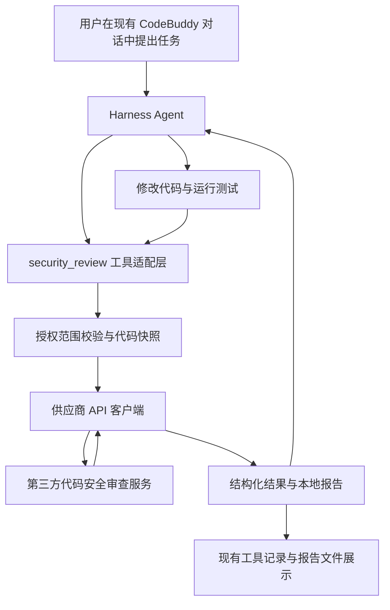

# 第三方代码安全审查 API 接入 CodeBuddy：实施设计

日期：2026-10-23。默认语言：简体中文。其他版本：[繁體中文](secvibe-api-integration-design.zh-TW.md) · [English](secvibe-api-integration-design.en.md)。

源码参考：`D:\CodeBuddy-v1`，`main`，`09b0219`，包含既有未提交修改。本文件是实施方案，尚未修改运行代码、提交源码给供应商或调用真实审查 API。

## 1. 这件事具体怎么做

**在 CodeBuddy 后端增加一个“安全审查工具”：把获准提交的代码快照交给第三方 API，取回漏洞清单，再由现有 Harness Agent 修复和复检。** 第三方服务负责分析代码，Harness 继续负责 Agent 的执行、工具调用、权限、上下文压缩及任务完成。

例如用户要求“开发一个登录接口并做安全检查”：

1. CodeBuddy 写代码，运行项目原有测试。
2. Harness 调用安全审查工具，工具收集此次修改及必要上下文，建立不可变快照。
3. 后端调用供应商 API，获得审查任务编号。
4. 查询任务完成情况，取回包含文件、位置、严重度、证据和修复建议的结果。
5. Harness 根据结果修改本地代码，运行测试，再提交新的快照复检。
6. 最后展示“检测范围、已修复问题、遗留问题、测试结果和报告”。

本方案可用于另一家公司提供的同类服务。针对 SecVibe，**接入方式已经可以设计，真实接口地址、认证和字段仍需供应方提供**。官网有安全审计产品，并不等于已确认开放第三方审查 API。不要把模型服务商 API、浏览器登录 Cookie 或网页内部请求直接当成正式审查接口。

## 2. 接入后的结构



密钥仅由后端读取；前端接收连接状态和脱敏结果。源码上传属于单独的数据出站行为，即使工具不修改文件，也不能据此标记为“无副作用”。审查返回的建议作为不可信数据处理，不执行其中夹带的命令或系统指令。

### 接入方式选择

| 供应方实际交付 | CodeBuddy 接法 | 建议 |
| --- | --- | --- |
| 官方 MCP，提供结构化结果及认证说明 | 使用现有 MCP 配置、桥接和工具发现 | 优先复用，不再额外造 HTTP 转 MCP 服务 |
| 正式 HTTP API | 新增轻量 API 客户端，通过现有宿主工具入口注册 | 本文重点，最适合你提出的“API 接入” |
| 仅 CLI，支持非交互结构化输出 | 受控子进程适配，核实退出码、取消、许可 | 备选，不能假设有未公开的命令参数 |
| 仅交互网页 | 先索取 API/MCP/CLI 合同 | 不作为稳定的自动化审查接口交付 |

供应商若只提供同步审查，使用其同步合同和明确的请求时限；若提供异步任务接口，按以下方案保存任务编号、查询结果。不要把一个本地后台 Promise 冒充供应商异步任务。

## 3. 本项目具体改哪些地方

以下“已有”是源码中实际存在的机制；“新增”是待实施设计，不表示文件已经创建。

| 文件 | 计划工作 | 职责边界 |
| --- | --- | --- |
| `runtime/compat.mjs`（已有） | 在会话 `tools` 组装处按设置注册 `securityReviewTool(...)` | 与现有浏览器、图像、Git 等工具采用相同入口；同步现有能力开关与权限允许列表 |
| `runtime/harness/index.mjs`（已有） | 复用 `settings.tools` → `scoped.tools.register` 链路 | 已转发 `sessionId`、`signal`、`callId`，不另写 Agent 循环 |
| `runtime/harness/tool-discovery.mjs`（已有） | 将工具加入可按需发现集合，保留正确能力描述 | 不在每轮上下文注入完整审查规则和报告 |
| `runtime/security-review-tool.mjs`（拟新增） | 暴露 `start/status/result/cancel` 操作，执行权限与会话绑定检查 | 不自行调度主 Agent、不把自然语言建议当完成判定 |
| `runtime/security-review-client.mjs`（拟新增） | 认证、供应商请求、响应校验、错误映射 | 唯一理解供应商端点和字段的模块 |
| `runtime/security-review-snapshot.mjs`（拟新增） | 收集授权文件、生成哈希清单、限定上传范围 | 支持未提交修改及获准新增文件，防止路径越界 |
| `runtime/settings.mjs`、`runtime/secrets.mjs`（已有） | 复用配置保存与 `protectSecret/revealSecret`，增加供应商配置 | 密钥不进入提示词、工具参数、报告或 Git |
| `runtime/tests/`（已有目录） | 新增边界、协议、任务恢复与闭环回归 | 模拟接口通过与真实供应商通过分别记载 |
| 现有设置/工具箱入口 | 提供启用、连接测试、数据上传范围配置 | 首版复用既有布局；确有缺口再增加最小字段 |

原生 HTTP 工具需要在调用前明确接入现有权限流程。注册工具本身不等于已经获得代码上传授权；实现前核对该工具是否会经过现有批准机制，缺失时在适配边界补齐，不能默认放行。

MCP 路线直接复用 `runtime/harness/mcp-bridge.mjs` 和 `mcp-tasks.mjs`。仅在真实协商支持 Tasks 时使用异步任务；否则使用已有可配置超时机制（当前默认 300 秒）。HTTP 路线的单次请求超时与整项审查时限单独配置，不把这 300 秒机械套给所有异步审查。

## 4. 先向供应商要什么

开发前需要对方给出以下可执行合同：

1. 测试环境地址、认证方式与调用权限；这是审查服务凭据，不是聊天模型凭据。
2. 如何提交代码：文件列表、ZIP、Git 仓库引用，或者增量差异；文件大小、语言与依赖清单限制。
3. 创建任务、查询状态、读取结果、取消任务的正式文档；如支持回调，提供签名与重放防护规范。
4. 结果 JSON 样例：漏洞位置、严重度、证据、规则编号、覆盖范围、部分失败如何表达。
5. 超时、限流、幂等性、任务保留与删除规则、计费、商业集成许可、源码是否转交其他模型服务商。

发给供应方的话可以直接用：

> 我们计划在自有开发 Agent 中集成贵方代码安全审查能力。请提供面向第三方调用的 API 或 MCP 文档、测试凭据申请方式、代码提交格式、异步任务及取消接口、结构化审查结果样例，以及源码处理、留存、费用和商业集成条款。我们的目标流程为“提交代码快照 → 获取漏洞结果 → 本地修复 → 复检”。

SecVibe 官方隐私页面说明云端会处理项目代码，并可能将相关内容发送到所选模型服务商。因此还需确认正式 API 是否采用相同数据边界、是否提供私有部署或不同合同安排。[官方隐私协议](https://secvibe.gcsa.com/privacy/zh-CN/)

## 5. HTTP API 如何调用：示范合同

**本节域名、路径、认证方式及字段均为说明用的拟议合同，不是已核实的 SecVibe API，不能直接复制后声称已经接通。** 拿到官方文档后，仅在 `security-review-client.mjs` 中替换和映射。`vendor.example` 为示例域名。

| 行为 | 示例请求 | 期望语义 |
| --- | --- | --- |
| 创建 | `POST https://security-api.vendor.example/v1/reviews` | 返回任务编号；供应方明确支持时才使用幂等键 |
| 查询 | `GET /v1/reviews/{id}` | 返回排队、运行、完成、失败或取消状态 |
| 结果 | `GET /v1/reviews/{id}/result` | 返回结构化结果与检查覆盖范围 |
| 取消 | `POST /v1/reviews/{id}/cancel` | 返回真实取消回执；若不支持，记录此限制 |

示例创建请求，真实上传可能需改用官方的文件上传协议：

```json
{
  "clientRequestId": "LOCAL_REQUEST_ID",
  "snapshotId": "sha256:SNAPSHOT_DIGEST",
  "files": [
    { "path": "src/auth/login.ts", "sha256": "FILE_DIGEST", "content": "APPROVED_SOURCE_TEXT" }
  ],
  "contextFiles": ["package.json", "package-lock.json"],
  "checks": ["code_security", "dependencies", "secrets"]
}
```

这里 `contextFiles` 指向的文件也必须包含在获准上传的快照中；`checks` 只能选供应商真实支持的能力。可以按变更文件触发审查，但相关调用链、鉴权配置和依赖上下文可能影响判断，不能保证只上传 diff 即可可靠审查。

建议规范化为以下内部结果。供应商不提供的字段应保留未知，不能由主 Agent 猜成事实：

```json
{
  "reviewId": "LOCAL_REVIEW_ID",
  "snapshotId": "sha256:SNAPSHOT_DIGEST",
  "status": "completed",
  "coverage": {
    "analyzedFiles": ["src/auth/login.ts"],
    "skippedFiles": [],
    "partial": false
  },
  "findings": [
    {
      "id": "VENDOR_FINDING_ID",
      "ruleId": "VENDOR_RULE_ID",
      "severity": "high",
      "path": "src/auth/login.ts",
      "startLine": 42,
      "title": "示例：缺少必要的权限检查",
      "evidence": "供应商提供的证据",
      "recommendation": "供应商提供的修复建议"
    }
  ],
  "errors": []
}
```

`completed` 仅表示审查流程完成；`findings=[]` 仅表示该范围内未检出。结果为空、解析失败、覆盖不足、API 失败都不能显示“安全通过”。仓库当前内容与快照不一致时，显示“基于旧快照”，不能把旧行号直接应用到新代码。

## 6. 给开发人员的接线示例

以下 JavaScript 是适配层的**接口骨架**：`adapter` 方法仍需依据供应商合同实现，不是可直接投入使用的完整功能。权限检查必须在 `adapter` 方法内部或其统一调用边界完成；不要依赖描述文字约束模型。

```js
// 拟放入 runtime/security-review-tool.mjs
export function securityReviewTool({ adapter, sessionId, cwd }) {
  return {
    name: 'security_review',
    description: 'Review an approved code snapshot; fetch status/results or cancel a review.',
    inputSchema: {
      type: 'object',
      properties: {
        operation: { type: 'string', enum: ['start', 'status', 'result', 'cancel'] },
        reviewId: { type: 'string', minLength: 1 },
        paths: { type: 'array', items: { type: 'string', minLength: 1 }, minItems: 1 }
      },
      required: ['operation'],
      additionalProperties: false
    },
    async execute(input, { signal, sessionId: caller } = {}) {
      if (caller !== sessionId) throw new Error('Review session mismatch');
      if (input.operation === 'start') {
        if (!input.paths?.length) throw new Error('Explicit review scope is required');
        return adapter.start({ sessionId, cwd, paths: input.paths, signal });
      }
      if (!input.reviewId) throw new Error('reviewId is required');
      // Must verify that reviewId belongs to this session/project before contacting vendor.
      const args = { sessionId, reviewId: input.reviewId, signal };
      switch (input.operation) {
        case 'status': return adapter.status(args);
        case 'result': return adapter.result(args);
        case 'cancel': return adapter.cancel(args);
        default: throw new Error('Unsupported operation');
      }
    }
  };
}
```

在 `runtime/compat.mjs` 当前会话 `tools` 数组中加入类似下面的条目，同时接入工具开关、允许列表和按需发现：

```js
...(securityReviewEnabled
  ? [securityReviewTool({ adapter: securityReviewAdapter, sessionId: s.id, cwd: s.cwd })]
  : []),
```

这里的 `securityReviewEnabled` 和 `securityReviewAdapter` 是拟新增变量，不是现有对象。不要再在 `harness/index.mjs` 手工注册一遍：现有 `settings.tools` 注册路径已经会把该工具交给 Harness。

API 客户端实际实现顺序：

1. 从受保护配置读取固定供应商地址和凭据。模型工具参数只包含范围/任务编号，不接受任意 URL 或密钥。
2. 校验当前会话授权；对文件 `realpath` 校验、拒绝越界及不允许的符号链接，生成不可变暂存快照。
3. 对获准文件内容计算哈希，记录基准提交（如有）、未提交和新增文件；仅依赖 HEAD 不能标识用户正在开发的代码。
4. 通过官方认证方式发送请求，限制响应大小、逐项校验 JSON。凭据请求拒绝跨域重定向；官方上传地址另按供应商协议验证，不能携带认证头随意跳转。
5. 保存本地 `reviewId` 与供应方任务编号的映射，再返回结构化状态；查询与取消只允许操作绑定当前会话/项目的任务。
6. 遇到 401/403 报认证/权限问题，429 按供应方合同与 `Retry-After` 退避，网络超时与供应方失败分别处理。创建请求超时后可能已经创建远端任务：无幂等键或查询凭据时标为“提交结果待确认”，不要盲目重试产生重复收费。

快照默认排除 `.git`、依赖目录、构建产物和凭据文件；被排除内容计入覆盖说明。密钥泄露检查优先提交脱敏位置/特征；如第三方检测确实要求原始敏感内容，应事先明确该上传范围和处理合同，不能借“查密钥”把本地凭据全部传出。

## 7. 长任务、取消与恢复

异步审查可以比一次 HTTP 请求更久。后端保存以下最小记录，使用现有数据目录和原子持久化模式，不另造主任务调度系统：

```text
reviewId, sessionId, workspaceIdentity, snapshotId, providerJobId,
submissionState, providerStatus, createdAt, updatedAt, lastError
```

外部任务状态以供应商结构化回执为准；本地映射仅记录提交、关联、轮询和报告缓存。API 客户端负责有上限的协议重试，Harness 负责是否继续任务、调用结果工具或请求用户选择。

- 应用重启：读取已有任务编号并查询状态，不重新上传相同任务；供应商任务已过期时如实显示。
- 用户取消：中止本地请求不等于取消远端审查。若支持取消接口，调用后确认远端状态；否则明确远端可能继续运行并计费。
- 完成与取消竞态：保留真实最终状态；不得把“发送了取消请求”写成“已经取消”。
- 长报告：存本地完整 JSON/报告文件，向 Harness 先返回数量、最高严重度、覆盖摘要及分页定位方式。按需读取具体问题，避免把整份报告挤入上下文。
- 多次压缩：外部任务编号和报告不依赖聊天记忆；压缩后通过工具查回同一记录。
- 多次复检：每次代码变化生成新 `snapshotId`；保留前次关联，修复状态依据新证据，不仅比较告警数量。

## 8. 实施批次与验收标准

| 批次 | 交付物 | 通过条件 |
| --- | --- | --- |
| 1：供应商合同确认 | 文档、测试凭据、能力/费用/数据边界清单 | 真实测试环境能提交小型示例并返回可解析结果 |
| 2：只读审查 MVP | 设置、客户端、快照、按需工具、报告 | Agent 能审查授权文件、展示证据；不修改业务代码 |
| 3：修复闭环 | Harness 调用审查 → 修改 → 测试 → 复检 | 修复已知缺陷后功能测试通过，复检结果关联新快照 |
| 4：长任务与恢复 | 状态持久化、取消、分页、恢复 | 重启不重复提交，多次压缩后仍取回同一任务和范围 |

自动化回归至少覆盖：路径穿越/符号链接、未提交文件、快照变化、凭据脱敏、跨会话任务访问、非法结果结构、部分覆盖、401/403/429、超时后状态未知、幂等重试、取消竞态、重启恢复。

真实验收准备一个独立小项目：已知漏洞样本、修复版本、正常对照，以及一次“提交后继续改文件”的场景。先手动调用正式 API，再从真实 CodeBuddy 对话调用工具，确认报告中的快照、位置和界面状态一致。以实际检出结果记录误报/漏报，不能用固定假结果证明供应商有效。

首版建议由用户明确提出审查后触发。若后续要“每次开发结束强制审查”或“高危问题阻止完成”，需要另行确定覆盖范围、严重度门槛、例外处理和费用预算，并接入现有权威完成流程；提示词中的“务必审查”不能充当强制门禁。

## 9. 现在能交付什么，下一步是什么

本次交付是这份可分工实施的设计，已核对当前工具注册、发现、凭据和 MCP 复用入口。**尚未验证 SecVibe 的正式审查 API，也未完成产品集成或真实检测验收。**

下一步由供应商提供第 4 节的合同资料；随后开发人员先实现第 8 节的只读 MVP，再扩展修复闭环。实际开发工期应在接口稳定性、上传格式与异步能力明确后评估，避免把网页可用误认为接口已具备。

参考：[本项目先前调研与事实依据](secvibe-integration-research.zh-CN.md) · [SecVibe 官网](https://secvibe.gcsa.com/) · [官方发布清单](https://secvibe.gcsa.com/downloads/latest.json) · [MCP 官方 Tools 协议](https://modelcontextprotocol.io/specification/2025-11-25/server/tools)。MCP 协议说明结构化工具如何接入，不代表 SecVibe 已提供 MCP 服务。
