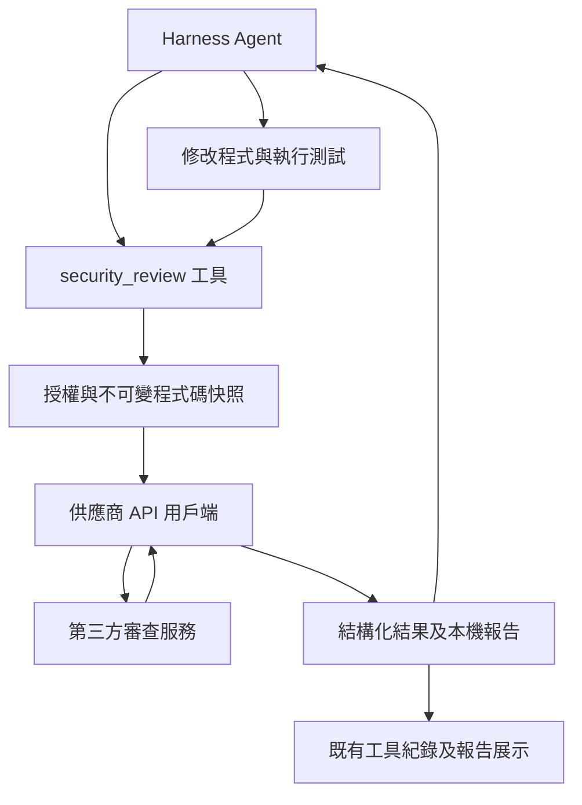

# 第三方程式碼安全審查 API 接入 CodeBuddy：實作設計

日期：2026-10-23。其他版本：[简体中文（默认）](secvibe-api-integration-design.zh-CN.md) · [English](secvibe-api-integration-design.en.md)。

原始碼參考：`D:\CodeBuddy-v1`，`main`，`09b0219`，包含既有未提交修改。本文件為實作方案；尚未修改執行程式、上傳原始碼或呼叫真實審查 API。

## 1. 接入目標

**在 CodeBuddy 後端新增安全審查工具：將獲准提交的程式碼快照交給第三方 API，取回弱點清單，再由既有 Harness Agent 修復及複檢。** 第三方服務負責分析；Harness 保留 Agent 執行、工具呼叫、權限、上下文壓縮及任務完成的權威。

例如開發登入介面：先撰寫程式與執行測試，建立審查快照，呼叫供應商取得任務編號，取得弱點位置與證據，讓 Harness 修復，再執行測試與新快照複檢。最後交付程式、檢查範圍、已修復及遺留問題。

針對 SecVibe，目前尚未確認正式對外審查 API 的位址、認證及欄位。網站中的模型供應商 API 金鑰不是已確認的審查服務憑證。瀏覽器登入 Cookie、網頁內部請求也不應當成穩定公開合同。

## 2. 架構與方式



| 對方提供的能力 | 接入方式 |
| --- | --- |
| 正式 MCP | 優先使用既有 MCP 設定、橋接及按需發現，不額外建立 HTTP 轉 MCP 服務 |
| 正式 HTTP API | 新增薄層 API 用戶端，透過既有宿主工具註冊；本文主要方案 |
| 非互動、結構化輸出的 CLI | 核實退出碼、取消及授權後，以受控子程序接入 |
| 僅互動網頁 | 先向供應商取得穩定的 API/MCP/CLI 合同 |

金鑰由後端讀取，前端只顯示狀態與脫敏結果。上傳程式碼屬於資料出站操作，不能因為審查是唯讀而省略上傳授權。供應商建議視為不可信資料，不直接執行回傳內容中的命令。

## 3. 本專案修改位置

「擬新增」表示計畫，並非本次已建立的模組。

| 位置 | 實作內容 |
| --- | --- |
| `runtime/compat.mjs` | 在會話 `tools` 陣列註冊工具，同步能力開關、權限允許清單 |
| `runtime/harness/index.mjs` | 重用 `settings.tools` → `scoped.tools.register`；已有 `sessionId/signal/callId` 傳遞，不另造 Agent 迴圈 |
| `runtime/harness/tool-discovery.mjs` | 加入按需發現，避免每輪注入完整規則與報告 |
| `runtime/security-review-tool.mjs`（擬新增） | 提供 `start/status/result/cancel`，檢查授權、會話與任務歸屬 |
| `runtime/security-review-client.mjs`（擬新增） | 唯一映射供應商認證、端點、回應及錯誤的模組 |
| `runtime/security-review-snapshot.mjs`（擬新增） | 授權檔案收集、路徑限制、不可變快照與雜湊清單 |
| `runtime/settings.mjs`、`runtime/secrets.mjs` | 重用設定及 `protectSecret/revealSecret`，保護服務憑證 |
| `runtime/tests/` | 協定、狀態、路徑、恢復及閉環回歸測試 |
| 既有設定與工具箱 | 啟用、連線檢查、上傳範圍；優先保留既有版面 |

工具註冊不等於獲得上傳權限。實作時須追蹤原生工具是否經過現有核准鏈路；若未涵蓋資料上傳，在適配邊界接入，不能只靠工具描述文字。

MCP 路線重用 `mcp-bridge.mjs`、`mcp-tasks.mjs`。只有實際協商支援 Tasks 才使用其非同步任務；否則沿用可設定逾時（現有預設 300 秒）。HTTP 路線分開設定單次請求逾時與整體審查時限，不以本機背景 Promise 冒充遠端非同步任務。

## 4. 向供應商索取的合同

1. 測試環境、審查服務認證、權限與商業整合條款。
2. 程式碼提交格式：檔案、ZIP、Git 引用或差異；語言、檔案大小與相依清單限制。
3. 建立、查詢、取結果、取消介面；若有回呼，提供簽章與重放防護規範。
4. 結果 JSON：位置、嚴重度、規則、證據、建議、覆蓋範圍與部分失敗。
5. 限流、冪等性、費用、保存及刪除期限，以及是否轉交其他模型服務商。

可直接傳給對方：

> 我們計畫在自有開發 Agent 中整合貴方程式碼安全審查能力，流程為「提交快照 → 取得弱點結果 → 本機修復 → 複檢」。請提供 API 或 MCP 文件、測試憑證申請方式、提交格式、非同步任務及取消介面、結構化結果範例，以及資料處理、留存、費用與商業整合條款。

SecVibe 隱私頁面說明雲端處理專案程式碼，且可能傳給所選模型服務商；須確認正式 API 的實際部署與合同邊界。[官方隱私協議](https://secvibe.gcsa.com/privacy/zh-CN/)

## 5. HTTP 合同範例

**以下網域、路徑、認證及欄位是提案範例，不是已核實的 SecVibe API。** 取得官方合同後，只在用戶端模組替換並映射。

| 操作 | 示例 |
| --- | --- |
| 建立 | `POST https://security-api.vendor.example/v1/reviews` |
| 狀態 | `GET /v1/reviews/{id}` |
| 結果 | `GET /v1/reviews/{id}/result` |
| 取消 | `POST /v1/reviews/{id}/cancel` |

```json
{
  "clientRequestId": "LOCAL_REQUEST_ID",
  "snapshotId": "sha256:SNAPSHOT_DIGEST",
  "files": [{"path": "src/auth/login.ts", "sha256": "FILE_DIGEST", "content": "APPROVED_SOURCE_TEXT"}],
  "contextFiles": ["package.json", "package-lock.json"],
  "checks": ["code_security", "dependencies", "secrets"]
}
```

`contextFiles` 也須納入獲准的上傳快照；檢查類型必須是供應商實際支援項目。只提交 diff 可能缺乏呼叫鏈、鑑權設定或相依上下文。

內部結果建議：

```json
{
  "reviewId": "LOCAL_REVIEW_ID",
  "snapshotId": "sha256:SNAPSHOT_DIGEST",
  "status": "completed",
  "coverage": {"analyzedFiles": ["src/auth/login.ts"], "skippedFiles": [], "partial": false},
  "findings": [{
    "id": "VENDOR_FINDING_ID", "ruleId": "VENDOR_RULE_ID", "severity": "high",
    "path": "src/auth/login.ts", "startLine": 42,
    "title": "範例：缺少必要權限檢查", "evidence": "供應商證據", "recommendation": "供應商建議"
  }],
  "errors": []
}
```

供應商沒有提供的欄位保持未知。`completed` 表示流程完成，不表示安全通過；零告警僅代表本次範圍未檢出。解析失敗、覆蓋不足或 API 失敗不可顯示通過。原始碼已改變時標示舊快照，不直接將舊行號套入新程式碼。

## 6. 程式接線及 API 用戶端

工具採現有 `{name, description, inputSchema, execute}` 格式。實作骨架與 `start/status/result/cancel` 的完整 JavaScript 範例見[簡體版第 6 節](secvibe-api-integration-design.zh-CN.md#6-给开发人员的接线示例)；程式識別字在三個語言版本一致。

會話 `tools` 陣列擬加入：

```js
...(securityReviewEnabled
  ? [securityReviewTool({ adapter: securityReviewAdapter, sessionId: s.id, cwd: s.cwd })]
  : []),
```

以上變數與適配器均待實作。不要同時在 Harness 註冊入口再註冊一次。適配器處理以下事項：

1. 從受保護設定讀取固定服務位址與憑證，工具參數不接受任意 URL 或金鑰。
2. 核對上傳授權，驗證 `realpath` 及檔案邊界，拒絕越界或不允許的符號連結。
3. 建立不可變暫存快照，記錄檔案內容雜湊、基準提交、未提交及新增檔案；不能只記 HEAD。
4. 按正式認證方式呼叫 API，限制回應大小並驗證 JSON。帶憑證請求拒絕跨域重新導向；正式上傳 URL 另按供應商規範驗證。
5. 保存本機與供應商任務編號的映射；所有查詢與取消均檢查當前會話/專案歸屬。
6. 區分 401/403、429、網路逾時及供應商失敗。429 按合同和 `Retry-After` 退避；建立請求逾時可能已在遠端成功，若缺少冪等或查詢機制，標示提交待確認，避免重複計費。

預設排除 `.git`、相依套件、產物及憑證檔，並記錄覆蓋限制。憑證洩漏檢查優先提交脫敏位置/特徵；若必須傳送原始敏感內容，先明確其授權範圍與處理合同。

## 7. 長任務與恢復

沿用現有資料目錄與原子持久化模式保存：

```text
reviewId, sessionId, workspaceIdentity, snapshotId, providerJobId,
submissionState, providerStatus, createdAt, updatedAt, lastError
```

這是外部任務映射，不是另一套 Agent 排程器。外部狀態以供應商結構化回執為準，Harness 保留是否繼續執行的權威。

- 重啟查回既有編號，不重新提交相同任務；過期時明確報告。
- 中止本機 HTTP 請求不代表遠端已取消。呼叫正式取消介面並核對回執；不支援時說明遠端可能繼續執行和計費。
- 保留取消與完成競態的實際結果，不能把「已發送取消」寫成「已取消」。
- 完整結果保存為本機檔案；模型先取得摘要與分頁定位，按需讀取問題。
- 壓縮後透過工具重新取得任務與報告，不依賴對話記憶。
- 修復後產生新快照，保留前次關聯；複檢不能只比較告警數量。

## 8. 實作順序與驗收

| 階段 | 交付與驗收 |
| --- | --- |
| 合同確認 | 取得正式文件與測試憑證，小型樣本真實提交並取得可解析結果 |
| 唯讀 MVP | 設定、快照、API、工具與報告；只讀取授權檔案，能顯示證據 |
| 修復閉環 | Harness 修復已知缺陷、功能測試通過、新快照複檢可追溯 |
| 長任務 | 重啟不重複提交、取消狀態正確、多次壓縮仍能取回任務 |

自動回歸涵蓋路徑穿越、符號連結、未提交檔案、快照變更、憑證脫敏、跨會話存取、異常 JSON、部分覆蓋、401/403/429、提交結果未知、冪等、取消競態及重啟。

真實驗收使用獨立專案中的已知弱點、修復版本及正常對照，另測提交後繼續改檔。先驗正式 API，再透過真實 CodeBuddy 對話呼叫，核對報告、快照與可見狀態。模擬測試與真實供應商結果分開記錄，誤報、漏報如實保存。

首版由使用者明確要求時觸發。若後續要求每次開發必審或高風險阻止完成，另行確認範圍、門檻、例外及費用，接入既有權威完成流程；提示詞提醒不是強制門檻。

## 9. 本次狀態及下一步

本次完成實作設計與既有接入點核對，未完成正式 SecVibe API 驗證或產品整合。下一步取得第 4 節文件，先交付唯讀 MVP，再擴展修復閉環；工期待實際合同與上傳格式明確後評估。

參考：[先前調研](secvibe-integration-research.zh-TW.md) · [SecVibe 官網](https://secvibe.gcsa.com/) · [官方發布清單](https://secvibe.gcsa.com/downloads/latest.json) · [MCP Tools 規範](https://modelcontextprotocol.io/specification/2025-11-25/server/tools)。MCP 規範本身不代表 SecVibe 已提供 MCP。
