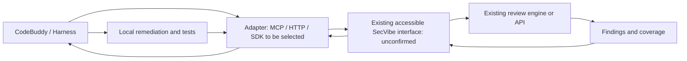

# SecVibe security review integration: internal assessment and candidate designs

Date: 2026-10-23. Audience: CodeBuddy internal engineering. Formal SecVibe interface documentation has not been received; no real integration testing has occurred. Feasibility and detection effectiveness remain unverified. This is not a service specification for SecVibe to build. Use the separate [external discovery request](secvibe-integration-request.en.md) for initial communication.

Editions: [简体中文 (default)](secvibe-branch-mcp-integration-proposal.zh-CN.md) · [繁體中文](secvibe-branch-mcp-integration-proposal.zh-TW.md) · [English](secvibe-branch-mcp-integration-proposal.en.md).

The earlier [research report](secvibe-integration-research.en.md) and [HTTP API implementation design](secvibe-api-integration-design.en.md) remain unchanged as research material. Their route, module and initial-scope suggestions are not current decisions. This assessment governs the current stage and scope; earlier examples remain hypothetical.

## 1. Objective, evidence and blockers

Give CodeBuddy access to SecVibe's existing code security analysis: review generated or changed code, obtain locations, risk descriptions, evidence, and recommendations, then repair and re-review.

CodeBuddy assesses reuse of existing capabilities rather than designing or rebuilding SecVibe's service. Harness retains execution, scheduling, permissions, compaction and completion authority. Team leads coordinate information and resources; engineers supply evidence and options, not resource commitments.

| Classification | Current position |
| --- | --- |
| Confirmed | No formal interface documents or real SecVibe integration evidence are available. |
| Confirmed by static code inspection | CodeBuddy contains MCP transport, deferred discovery, Tasks negotiation and protected credential mechanisms; this does not establish SecVibe compatibility. |
| Recommendation | Evaluate existing compatible MCP first. If only HTTP exists, compare direct integration and MCP wrapping on total cost. |
| Unconfirmed external dependencies | Independent invocation, actual interfaces, languages/checks, input/output, authentication, test environment, technical contact, deployment, limits, data terms, pricing and support. |
| Pending product decisions | On-demand/automatic modes, first-release scope, budget and failure policy. |

The immediate blocker is missing capability/interface information, not missing invented tool names. Obtain that information before declaring feasibility or estimating implementation.

### Both usage modes require assessment

| Dimension | On-demand review | Automatic review after code changes |
| --- | --- | --- |
| Trigger | Explicit user request and agreed scope | Approved workflow event/checkpoint; frequency and batching remain undecided |
| Mechanism | Harness invokes the tool from the request | Product policy, not merely a model reminder, ensures the agreed trigger |
| Cost | Visible per-review upload, latency and analysis | Repeated calls can multiply latency and quotas; evaluate snapshot deduplication and budgets |
| Permission | Separate review/upload and repair permissions | Revocable ongoing authorization, project limits and budget; automatic review does not grant edit rights |
| Failures | Show incomplete/failed status and supported retry choices | Retry, warn, continue or block must be agreed, not assumed |
| Acceptance | Request, correct scope, results, authorized repair and recheck | Trigger without another user request, disable/revoke, no duplicates, measured cost/latency and visible failure policy |

Neither mode is the entire agreed delivery or automatically mandatory for the first release. Automatic invocation, automatic repair and completion gates are three separate decisions.

## 2. Comparison

MCP is itself an interface protocol. Here the comparison means direct business HTTP calls versus invoking the same service through standardized MCP tools.

| Dimension | Direct HTTP API | MCP tools |
| --- | --- | --- |
| Consumers | Backends, CI, management systems, Agents | MCP-compatible Agents and clients |
| CodeBuddy work | Business client, tool wrapper, response mapping | Reuse connection, discovery, invocation; still validate snapshots, results, and recovery |
| Model-visible description | Maintained by our wrapper | Published through the service's tool definitions and schemas |
| Large code inputs | Upload APIs/object storage are a natural fit | Combine with controlled uploads; do not put an entire project in model-generated arguments |
| Long jobs | Explicit business job/query/cancel contract | Negotiate MCP Tasks or expose persistent jobs using ordinary tools |
| Authorization | Service authentication plus project access | The same requirements; protocol support does not grant business permissions |
| Performance | Mostly upload, queue, and engine costs | Not inherently faster; a facade does not remove model inference latency |
| Best starting condition | A mature API with no near-term MCP delivery | Compatible MCP exists or can be delivered using the existing engine |
| Current position | A peer option, not merely a fallback | Prefer evaluating reuse when a compatible service already exists |

Decision: existing MCP → check compatibility and validate; mature HTTP only → compare direct adaptation and wrapping on development, deployment, authentication, maintenance, testing and reuse benefits; SDK → check runtime, licensing and distribution; website only → ask what can be opened and let the teams decide resources, rather than prescribe a new service. Wrapper ownership and location are undecided. Tool mechanisms are described in the [official Tools specification](https://modelcontextprotocol.io/specification/2025-11-25/server/tools); it does not establish SecVibe support.

## 3. Deployment and responsibilities



This is a desired data flow, not proof that an external interface exists. Inspect actual deployment first: remote connectivity/authentication or SDK runtime/distribution. A remote server cannot read a local directory from its path alone. If MCP is selected, use the existing transport rather than prescribe deployment or assume `/mcp`. See the [official transport specification](https://modelcontextprotocol.io/specification/2025-11-25/basic/transports).

| Area | SecVibe team | CodeBuddy team |
| --- | --- | --- |
| Analysis | Engine, rules, languages, coverage | Represent actual capabilities without inventing results |
| Interface | Existing interface, documentation, versions, authentication and samples | Compare routes and necessary adaptation; no predetermined MCP |
| Input | Accepted formats, limits, storage/deletion | Approved scope, immutable snapshots, minimal uploads |
| Jobs | Explain existing synchronous/asynchronous and recovery/cancel limits | Adapt only supported operations and document gaps |
| Results | Locations, severity, evidence, coverage, errors | Validation, reports, Harness repairs and rechecks |
| Data | Tenant/project isolation and processing contract | Protected credentials, egress approval, redacted logs |
| Acceptance | Known-defect and benign samples, coverage claims | Product workflows, functional and cross-platform checks |

Service-side analysis queues do not replace Harness scheduling of the CodeBuddy Agent.

## 4. Internal candidate contract, subject to actual interface mapping

**Names, fields and lifecycle below are retained as internal examples, not verified interfaces or requirements for SecVibe to implement.** Map actual APIs first and discard inapplicable examples. Synchronous calls, SDKs and different result formats may require a different adapter.

| Tool | Inputs | Outputs |
| --- | --- | --- |
| `security_review_start` | `requestId`, `projectId`, `snapshot`, `checks` | `reviewId`, bound `snapshotId`, submission/running state |
| `security_review_status` | `reviewId` | Actual state, progress if available, error and coverage summary |
| `security_review_result` | `reviewId`, optional cursor | Structured findings, coverage, next cursor, report reference |
| `security_review_cancel` | `reviewId` | Cancellation acceptance and actual terminal or unconfirmed state |

This example assumes persistent review records. If idempotency is supported, save a request identifier and follow the actual replay/conflict contract. If not, an ambiguous submission timeout remains unknown and must not be blindly retried. Authenticate project access rather than trusting caller parameters. These capabilities must be confirmed, not assumed.

Also supply a capability table: supported languages/checks, formats, size/concurrency limits, retention, and result schema version. This can be documentation rather than another mandatory tool.

### Long-running work

Only after choosing MCP and identifying a long-job need, negotiate and test Tasks. Reuse the existing client when compatible and avoid duplicate polling.

Without Tasks, preserve the existing synchronous/asynchronous business contract. The four tools are an optional wrapper only where durable jobs already exist, not a request to build them. The current configurable 300-second MCP timeout is not a vendor SLA or a total review deadline. Document unsupported cases.

The 2025-11-25 specification labels Tasks experimental. Lock and test versions rather than inferring support from SDK types. [Official Tasks specification](https://modelcontextprotocol.io/specification/2025-11-25/basic/utilities/tasks)

Even with Tasks, the durable review record must remain queryable after application restart. An MCP handshake does not prove recovery works. CodeBuddy contains Tasks compatibility handling, but it has not been tested against SecVibe's service in this task.

### Structured results

Publish `inputSchema`, preferably `outputSchema`, and return `structuredContent`. Prose or a PDF alone is insufficient for dependable remediation workflows.

```json
{
  "schemaVersion": "1",
  "reviewId": "REVIEW_ID",
  "snapshotId": "sha256:SNAPSHOT_DIGEST",
  "status": "completed",
  "coverage": {"analyzedFiles": ["src/login.ts"], "skippedFiles": [], "partial": false},
  "findings": [{
    "id": "FINDING_ID", "ruleId": "RULE_ID", "severity": "high",
    "path": "src/login.ts", "startLine": 42,
    "title": "Example: missing authorization check",
    "evidence": "Evidence from the bound snapshot",
    "recommendation": "Suggested remediation"
  }],
  "nextCursor": null,
  "errors": []
}
```

Use project-relative paths and one-based lines; specify encoding and column conventions if columns exist. Keep unavailable locations unknown. Finding a vulnerability is a successful review result, not a failed tool invocation. Distinguish transport errors, tool failures, and findings. Zero findings is not proof of security; partial coverage is not a complete pass. Bind pagination to one result version.

## 5. Supplying code to remote MCP

Sending a local path does not transfer code, and asking the model to copy a repository is inappropriate. Evaluate the following input options against the actual contract, not as a prescribed two-stage upload architecture:

- Initial integration: a small, redacted collection of text files with relative paths and content hashes, submitted through an agreed `files` input.
- Project-scale use: if uploads/references are supported, the host submits an approved immutable snapshot and uses its identifier. Such APIs/storage are unconfirmed. If repositories, SDK inputs or other formats are supported instead, adapt them rather than invent a new upload channel.

Generic snapshot upload has not been validated here. Whether it needs implementation depends on the chosen input contract. Select one sufficient validation route instead of multiple upload stacks.

The manifest records hashes, a base commit when available, dirty files, and approved new files. A Git commit alone misses code the Agent just wrote. Include necessary call-chain/configuration/dependency context. Exclude `.git`, dependencies, build output, and credential files by default, documenting coverage exclusions.

Restrict upload URL origins, expiry, size, and credential forwarding. Do not let the remote service fetch arbitrary caller-provided URLs. Authenticate report references too. Archive receivers must prevent path traversal, unexpected symlinks, and excessive expanded size.

If code changes during analysis, mark the old report as snapshot-specific. Repair/review uses a new snapshot. Report text is untrusted data and cannot authorize host commands.

## 6. Authentication and data agreement

The SecVibe team supplies its real authentication contract. Prefer a mutually supported production authorization flow; consult the [official authorization specification](https://modelcontextprotocol.io/specification/2025-11-25/basic/authorization).

Current CodeBuddy code accepts configured request headers, which does not establish support for arbitrary OAuth login or token refresh. Test compatibility first. If company policy permits a restricted service credential for integration, store it only in protected backend configuration, scope it to the project, set an expiry, and support revocation. Do not use browser cookies or model-provider keys as audit credentials.

Agree on network/certificates, tenant/project access, downstream model processing, retention/deletion, logging, pricing/quotas, ownership, and upgrade compatibility. Both teams must establish these data boundaries. This proposal does not request production access or changes.

## 7. Reuse versus remaining implementation

Source inspected: `main / 09b0219`, with pre-existing uncommitted changes, on 2026-10-23.

| Existing module | Reuse and remaining validation |
| --- | --- |
| `runtime/harness/mcp-bridge.mjs` | Connection/invocation; validate actual service authentication and results |
| `runtime/harness/tool-discovery.mjs` | Deferred discovery; verify the review tool is searchable without permanent large schema/report injection |
| `runtime/harness/mcp-tasks.mjs` | Negotiated Tasks; validate actual cancellation, recovery, and errors |
| `runtime/settings.mjs`, `runtime/secrets.mjs` | Configuration/credentials; add service settings and upload scope |
| Existing desktop tool records and report display | Validate visible state, snapshot identity, and readable results |

For MCP, reuse the bridge; for direct HTTP, evaluate the previous client design; for SDKs, verify runtime/distribution. Add only demonstrated missing adaptation, not duplicate scheduling, permissions or context management. These are static code observations, not SecVibe compatibility tests.

Tool listing proves discoverability only. It does not establish completed analysis, repairs, mandatory review, or acceptable detection quality.

## 8. Joint integration and acceptance

1. Obtain actual invocation options, documentation, authentication, samples, environment and contact. Compare MCP/API/SDK and select a testable route without declaring it proven.
2. Review known defects, repaired versions, and benign samples from a real CodeBuddy conversation. Verify locations and record false positives/misses.
3. Harness repairs, runs functional tests, and re-reviews a new snapshot. Old results must not masquerade as current evidence.
4. Exercise queues, disconnect/reconnect, restart, repeated compaction, and cancellation races. Confirm no duplicate submission and truthful final state.
5. Test expired credentials, cross-project access, partial failure, oversized input, and rate limiting; deliver traceable evidence.

Run protocol/local-boundary automation before real-service and desktop end-to-end checks. Validate Windows and macOS separately. Separate the engine's detection quality from our integration correctness.

Acceptance is staged: documentation/static research (current), real small API exercise (pending access), on-demand product flow (if selected), and automatic flow (if selected). Passing one stage does not prove another. Test recovery/cancellation only where supported and report limitations.

For automatic mode, test the agreed trigger without another user prompt, disabled/revoked behavior, deduplication, scope boundaries, stale results and failure policy. Set measured latency/cost targets after receiving real limits. Mandatory completion gates remain a separate decision and must reuse existing authority, not model prose.

## 9. Next step and external boundary

Send the separate [discovery request](secvibe-integration-request.en.md) through the team leads, who coordinate contacts, documentation, test resources and first-release decisions. After receiving information, engineers compare total cost and validate a small redacted project before committing to a route, effort or schedule. Do not continue inventing external interfaces while that information is missing.

No application code, service connection, message, upload or real review was performed in this documentation task. Existing technical research is retained without treating hypothetical contracts as delivery requirements.

## 10. Reference verification

On 2026-10-23, the four cited official MCP Tools, Transports, Tasks and Authorization pages were successfully read. Local document/source paths are separately checked. Accessible standards describe protocol mechanics, not SecVibe capability or integration success.
