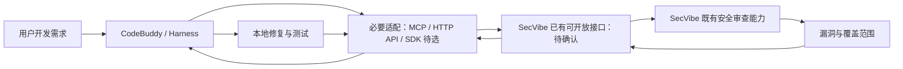

# SecVibe 安全审查能力接入 CodeBuddy：内部技术评估与候选方案

日期：2026-10-23。用途：CodeBuddy 内部技术研究。阶段：能力确认，尚未获得 SecVibe 正式接口文档，也未完成真实联调。**接入可行性、检测覆盖和效果均未验证；本文不是要求 SecVibe 实施的新服务规格。**

对外沟通使用独立的[技术对接需求简版](secvibe-integration-request.zh-CN.md)，不直接将本文的候选工具及字段作为对方开发要求。

版本：[简体中文（本文件）](secvibe-branch-mcp-integration-proposal.zh-CN.md) · [繁體中文](secvibe-branch-mcp-integration-proposal.zh-TW.md) · [English](secvibe-branch-mcp-integration-proposal.en.md)。

此前的[技术调研](secvibe-integration-research.zh-CN.md)和[HTTP API 实施设计](secvibe-api-integration-design.zh-CN.md)保持原样，作为研究资料保留。其中提前选择路线、模块或首版范围的内容不代表当前决定；本次阶段、范围与决策状态以本文为准。其接口示例仍非真实 SecVibe 接口。

## 1. 评估目标、证据状态与当前阻塞

目标是让 CodeBuddy 在生成或修改代码后，能够调用 SecVibe 已有的代码安全审查能力，获得漏洞位置、风险说明及修复建议，再完成修复和复检。

CodeBuddy 负责评估如何接入既有能力，Harness 保留执行、调度、权限、压缩与完成的权威；不替 SecVibe 设计或重建审查服务。跨团队沟通和资源安排由双方负责人推动。

| 分类 | 当前结论 | 证据与限制 |
| --- | --- | --- |
| 已确认事实 | 当前没有正式 SecVibe 接口资料，未完成真实联调 | 当前对接状态；网站功能声明不等于对外调用合同 |
| 已确认事实 | CodeBuddy 源码有 MCP 连接、按需发现、Tasks 协商及凭据存储机制 | 第 8 节列出源码；仅静态核对，不证明与 SecVibe 兼容 |
| 技术建议 | 已有兼容 MCP 时优先评估复用；已有 HTTP API 时比较直连与封装成本 | 不是预先要求新增 MCP Server |
| 待确认 | SecVibe 独立调用能力、接口、语言、检查类型、输入输出、认证、环境、联系人 | 取得资料后才能验证路线、效果并估算实施工作量 |
| 待确认 | 主动/自动审查模式、首版范围、预算与失败策略 | 两种模式都要评估，不提前确定取舍 |

**当前关键阻塞是外部能力与接口信息不足，不是缺少我们设计的工具名称。** 优先索取：是否可独立调用；是否已有正式 MCP/REST API/SDK；语言与检测范围；输入输出样例；文档、测试环境、鉴权方式及技术联系人。部署、限制、数据处理、费用、版本与维护支持也属于未确认外部依赖。

### 两种使用模式：并列评估，首版待定

| 维度 | 用户主动要求审查 | 生成或修改代码后自动审查 |
| --- | --- | --- |
| 触发 | 用户明确请求，确定本次文件/改动范围 | 产品策略在约定节点触发；节点、合并频率、是否每次修改均待确认 |
| 执行方式 | Harness 按请求调用工具；不能用关键词表替代理解 | 经批准的流程事件/策略触发；仅提示模型“记得审查”不保证执行 |
| 性能与费用 | 单次等待、上传与分析成本可见 | 反复调用可能放大耗时、配额和费用；按快照合并/去重及预算需评估 |
| 权限 | 本次数据出站与修复权限分别核对 | 需可撤销的持续授权、项目范围及费用限制；自动审查不自动获得修改权 |
| 异常 | 显示未完成/失败，允许按既有权限处理或重试 | 失败时重试、告警、允许继续或阻止完成均待确认；不默认为通过或强制阻塞 |
| 验收 | 请求 → 正确范围 → 结果 → 授权修复 → 复检 | 约定节点确实触发、禁用后不触发、不重复提交、延迟和费用符合双方指标、故障策略可见 |

两种模式都属于需求评估目标。既不能把主动审查当作全部交付，也不能认定自动审查必须首版上线。自动触发、自动修复和强制完成门槛是三个独立决策；验收和交付清单需注明选中哪些。

## 2. API 和 MCP 哪个更适合

MCP 本身也是接口协议。“API 对比 MCP”在这里具体指：CodeBuddy 团队自行调用供应商业务 HTTP API，或通过标准 MCP 工具调用其能力。两者可以共用同一后台业务逻辑，不是互相替代的两套审查引擎。

| 比较项 | 直接 HTTP API | MCP 工具接口 |
| --- | --- | --- |
| 典型使用者 | 后端、CI、管理平台、Agent 都可使用 | 主要面向支持 MCP 的 Agent/客户端 |
| CodeBuddy 接入量 | 编写业务客户端、工具包装、结果映射等 | 复用已有连接、发现、调用链；仍需快照、结果、恢复验收 |
| 工具描述 | CodeBuddy 团队维护模型可见的参数和描述 | SecVibe 通过工具清单及 Schema 提供描述 |
| 复用范围 | 适合非 Agent 系统和固定流水线 | 便于接入多个支持 MCP 的 Agent，但仍需逐个验证兼容性 |
| 大文件传输 | 普通上传 API/对象存储更成熟直接 | 不适合把整个大型项目塞进模型工具参数；可配合受控上传 |
| 长任务 | 业务任务 ID、查询、取消等自行约定 | 可协商 MCP Tasks；也可使用普通 MCP 工具暴露持久任务 |
| 安全与权限 | 明确服务认证、租户与项目授权 | 同样需要；MCP 不自动代替业务授权 |
| 响应速度 | 主要受上传、排队和审查引擎影响 | MCP 不保证更快；增加包装也不会消除模型推理耗时 |
| 实施成本 | 对方已有成熟 API 时可能最快 | 对方已有 MCP、CodeBuddy 团队已有客户端时改动通常更少 |
| 当前定位 | 与 MCP 同台比较的接入选项，不只是备用 | 已有兼容服务时优先评估复用，不预设新增服务 |

选择规则：已有 MCP → 核对兼容性并小样本验证；仅有成熟 HTTP API → 比较直连和封装 MCP 的总成本后决定；已有 SDK → 核对运行平台、授权、依赖与分发；只有网页 → 请求能力说明，由双方决定是否具备开放条件，不擅自布置新服务开发。

HTTP 直连与 MCP 封装的比较至少包括：双方开发量、认证/输入输出适配、部署运维、协议升级、测试、跨客户端复用收益及后续维护。封装若有收益，位置、负责人和交付方式另行商定；存在 API 不自动意味着要封装 MCP。资料不足时不填假工期或成本数字。

MCP 的工具发现、调用及结构化结果依据[官方 Tools 规范](https://modelcontextprotocol.io/specification/2025-11-25/server/tools)。表中工作量和适配建议是结合本项目源码作出的工程判断，不是协议对工期或效果的保证。

## 3. 与协议无关的候选执行流程



上述仅描述期望的数据流，不表示图中的对外接口已存在。先取得部署信息：远程服务需要网络与认证兼容；SDK/本地工具需要运行环境及分发评估。采用远程服务时，只传 `D:\项目目录` 并不能让远端读取本机代码。

若选 MCP，再依据现有服务选择 Streamable HTTP 或 stdio，不预设网站有 `/mcp`，也不预定部署方式。传输参考[官方 Transports 规范](https://modelcontextprotocol.io/specification/2025-11-25/basic/transports)。

## 4. 双方负责什么

| 事项 | SecVibe 负责 | CodeBuddy 团队负责 |
| --- | --- | --- |
| 审查能力 | 引擎、规则、支持语言及覆盖范围 | 按实际能力呈现，不自行补造检测结果 |
| 既有接口 | 提供现有接口形式、文档、版本、认证和结果样例 | 评估兼容性、路线成本及必要适配，不预定 MCP |
| 代码输入 | 确认接收格式、大小限制、暂存及删除方式 | 选取授权文件、生成快照、最小化上传 |
| 长任务 | 说明现有同步/异步、查询/取消与保留能力及限制 | 按真实能力评估恢复和取消，不要求预先重建服务 |
| 漏洞结果 | 位置、规则、严重度、证据、覆盖及错误 | 校验结果、保存报告、让 Harness 修复及复检 |
| 认证与数据 | 服务端租户/项目隔离、凭据范围、数据处理说明 | 受保护存储、出站授权、脱敏日志 |
| 质量验收 | 已知漏洞及正常样本、检测能力说明 | 产品内调用、跨平台接入、功能与修复回归 |

SecVibe 负责服务内部如何排队运行审查；这不改变 Harness 对 CodeBuddy Agent 执行、调度、权限、压缩和完成的所有权。

此表是候选协作边界，具体交付在能力确认后约定。双方负责人协调联系人、资料、测试资源及范围决策；技术团队负责证据、方案比较和验证，不代替资源承诺。

## 5. 内部候选接口合同：取得资料后再映射

**以下名称、字段及任务设计仅保留为内部评估样例，不是已核实接口，也不是要求 SecVibe 实现的规格。** 优先映射真实现有接口；已有同步调用、SDK 或不同结果格式时，应调整或舍弃不适用样例。依赖、密钥等检查是否支持仍待确认。

### 5.1 基础能力

| 建议工具 | 关键输入 | 关键输出 |
| --- | --- | --- |
| `security_review_start` | `requestId`、`projectId`、`snapshot`、`checks` | `reviewId`、绑定的 `snapshotId`、提交/运行状态 |
| `security_review_status` | `reviewId` | 状态、进度（如有）、错误、覆盖摘要 |
| `security_review_result` | `reviewId`、可选分页游标 | 结构化 findings、覆盖、后续游标及报告引用 |
| `security_review_cancel` | `reviewId` | 取消请求是否接受、实际终态或待确认状态 |

此样例以持久审查任务为假设：`reviewId` 不是 MCP session ID；若接口支持幂等，宿主保存 `requestId`，服务按真实合同处理重放及冲突。若不支持幂等或结果追查，提交超时记为结果未知，不盲目重试造成重复任务与收费。访问权限应结合认证主体核对，不能仅信任传入的项目 ID。这些能力必须先询问，不假定已有。

从现有文档整理能力表：语言、检查类型、输入格式、大小/并发、保留时间及结果版本；缺项向技术联系人核实，不为填表要求新增接口。

### 5.2 长任务：协商后选一种主流程

只有选定 MCP 且确有长任务需求时，才核实 Tasks 是否兼容，验证任务句柄、轮询、结果和取消；支持则复用现有客户端，避免重复轮询。

不支持 Tasks 时，优先沿用已有同步/异步业务合同；上表普通任务工具只是存在可复用持久任务时的一种包装方式，不要求补建。普通 MCP 调用当前默认可配置超时为 300 秒，不等于供应商 SLA 或审查总时限；超出已有能力的任务记为缺口，不能伪装为支持。

2025-11-25 版规范将 Tasks 标为实验性能力，因此不能只因 SDK 中存在类型就认为双方支持；需要锁定版本并协商验收。[官方 Tasks 规范](https://modelcontextprotocol.io/specification/2025-11-25/basic/utilities/tasks)

即便使用 Tasks，也要能通过持久审查记录在应用重启后重新查询结果；MCP 握手成功不证明重启恢复已实现。现有 CodeBuddy 源码包含 Tasks 兼容处理，但此次没有对 SecVibe 服务做真实联调。

### 5.3 结构化结果示例

MCP 工具应声明 `inputSchema`，建议声明 `outputSchema` 并返回 `structuredContent`。不要只返回一段“存在高危问题”的聊天文字或仅给 PDF。

```json
{
  "schemaVersion": "1",
  "reviewId": "REVIEW_ID",
  "snapshotId": "sha256:SNAPSHOT_DIGEST",
  "status": "completed",
  "coverage": {
    "analyzedFiles": ["src/login.ts"],
    "skippedFiles": [],
    "partial": false
  },
  "findings": [{
    "id": "FINDING_ID",
    "ruleId": "RULE_ID",
    "severity": "high",
    "path": "src/login.ts",
    "startLine": 42,
    "title": "示例：缺少权限校验",
    "evidence": "对应快照中的证据",
    "recommendation": "建议的修复方向"
  }],
  "nextCursor": null,
  "errors": []
}
```

位置统一为项目相对路径、一基行号，明确编码及列号含义（如提供）。不支持定位的发现保留未知，不能伪造文件位置。MCP 传输异常、工具执行失败、发现漏洞分别处理：**发现漏洞是成功获得审查结果，不是工具调用失败。** 零发现不代表绝对安全；部分覆盖不得展示为完整通过。报告分页需绑定同一审查结果版本。

## 6. 代码传输与结果关联的内部选项

只传本地路径无法让远端读取代码；让模型抄写整个项目也不合适。根据真实输入合同评估以下选项，不预先规定两阶段上传实现：

- 联调样例：小型、脱敏的文本文件集合，携带相对路径和内容哈希，通过约定的 `files` 输入提交。
- 项目级使用：如果支持上传/引用，由宿主提交获准的不可变快照并使用关联标识；是否存在上传 API/对象存储、能否使用引用尚待确认。如果只支持仓库引用、SDK 或其他输入，按其合同评估，不另造上传通道。

通用快照上传不是本次已验证能力，实际是否需要开发及如何开发取决于输入合同。选择一种足以验证的输入，不同时建设多套体系；不得要求模型重复复制大量源码到上下文。

快照清单包括路径、内容哈希、基准提交（如有）、未提交修改及获准新增文件；只提交 Git 提交号会漏掉 Agent 刚写的代码。根据检查需要加入调用链、配置与依赖清单；默认排除 `.git`、依赖目录、产物和凭据文件，并记录被排除范围。

远程服务不得任意抓取调用者给出的 URL。若使用上传 URL，双方规定来源、有效期、大小与凭据传递边界；报告引用同样需鉴权。服务端接收压缩包时检查解包越界、符号链接和解压后大小。

审查期间代码再次变化时，旧报告标记为针对旧快照；修复及复检建立新快照。报告内容和建议不具备宿主指令权限，不允许借报告触发未授权命令。

## 7. 认证、部署及数据约定

SecVibe 提供实际认证合同。生产环境宜采用双方兼容的标准授权方案；HTTP MCP 的授权流程可参照[官方 Authorization 规范](https://modelcontextprotocol.io/specification/2025-11-25/basic/authorization)。

源码核查显示 CodeBuddy 当前 MCP 桥接支持配置请求头，但不能由此推断任意 OAuth 登录、令牌续期已经可用。双方先核对认证兼容性；若联调采用公司认可的受限服务凭据，则只存入后端受保护配置，限制项目权限、期限并支持撤销。不要使用浏览器 Cookie 或把上游模型密钥当成审查凭据。

需要明确：服务内网地址与证书、租户/项目访问、源码是否转交模型服务商、留存与删除、日志脱敏、费用/配额、服务责任人和升级兼容窗口。双方需要落实这些数据边界。这里只要求使用正式服务合同，不要求访问或改变双方生产环境。

## 8. CodeBuddy 团队实际工作量边界

当前源码参考：`main` / `09b0219`，含既有未提交修改，核对日期 2026-10-23。

| 可复用 | 对应位置 | 尚需联调或实施 |
| --- | --- | --- |
| 远程 MCP 连接、工具调用 | `runtime/harness/mcp-bridge.mjs` | 供应商地址、认证及结果兼容 |
| 按需发现 MCP 工具 | `runtime/harness/tool-discovery.mjs` | 验证可搜索到审查工具，不常驻全部规则和报告 |
| 协商式 Tasks | `runtime/harness/mcp-tasks.mjs` | 真正的服务协商、取消、恢复与错误映射 |
| 配置与凭据存储 | `runtime/settings.mjs`、`runtime/secrets.mjs` | 新服务配置、上传范围与认证方式 |
| 现有工具活动、会话和文件展示 | 现有桌面组件与 Harness 适配 | 结果呈现、快照标识及报告下载实际验收 |

选 MCP 时优先复用桥接；选 HTTP 直连时才评估之前文档中的专用客户端；选 SDK 时核实运行及分发。按真实缺口增加必要适配，不复制权限、Agent 调度或上下文管理。当前只是静态源码证据，尚未运行 SecVibe 兼容测试。

工具被模型调用之后，应实际显示执行状态和结果；连接成功、工具出现在列表里，只能证明可发现，不能证明审查、修复或强制门禁已完成。

## 9. 联调步骤和完成标准

| 步骤 | SecVibe 交付 | CodeBuddy 团队操作 | 通过证据 |
| --- | --- | --- | --- |
| 1. 确认现有能力 | 独立调用方式、文档、认证、输入输出、环境与联系人 | 比较 MCP/API/SDK，列出未知项 | 形成可检验的候选路线；不是已验证可行 |
| 2. 小样本调用 | 已知漏洞、修复版本、正常样本及预期范围 | 从真实 CodeBuddy 对话触发审查 | 真实结果与文件位置对应，记录误报漏报 |
| 3. 修复闭环 | 支持同项目新快照复检 | Harness 修复、功能测试、重新审查 | 新快照结果与测试回执，旧结果不冒充新结果 |
| 4. 长任务恢复 | 队列、查询、取消、保留规则 | 断线重连、重启、压缩后查询 | 不重复建任务、不丢编号、取消终态真实 |
| 5. 边界与交付 | 错误码、权限测试账号、部署说明 | 测试过期凭据、越权、部分失败、大输入、限流 | 错误准确、密钥脱敏、范围可追溯 |

自动化测试先验证协议与本地边界，再做真实服务及桌面端到端。Windows 与 macOS 分别验证配置、输入、展示与恢复，不用一个平台替另一个平台签收。SecVibe 扫描引擎的效果与 CodeBuddy 团队接入质量分开记录。

下表为验收证据层级，不预先承诺首版范围：

| 层级 | 所需证据 | 不能据此宣称 |
| --- | --- | --- |
| 资料与静态研究（当前） | 源码入口、正式规范及未知项 | SecVibe 可接入或检测有效 |
| 小规模接口验证（待资料） | 真实调用、输入输出对应、耗时与错误记录 | 两种模式均已交付 |
| 主动模式（若纳入交付） | 明确请求、正确范围、结果展示、授权修复与复检 | 自动触发已经实现 |
| 自动模式（若纳入交付） | 约定节点触发、去重、禁用/撤销、预算及故障策略、修复复检 | 默认存在强制完成门槛 |

自动审查验收应测“不要求用户重复发起也会触发”，同时验证无变化不重复、范围外不上传、报告过期不误判。指标阈值在取得典型耗时、配额后商定，不捏造性能目标。长任务恢复仅在接口支持时验证；不支持的取消、持久查询等明确列为限制。完成门槛若获确认，复用既有权威流程，不让模型自然语言代替控制事实。

## 10. 下一步与对外边界

使用[对外技术对接需求](secvibe-integration-request.zh-CN.md)收集信息。双方负责人协调技术联系人、文档、测试条件及使用模式/首版范围；收到资料后，技术团队核对实际能力，比较总成本并选一个小型脱敏项目验证，再给出路线、缺口、工作量及计划。

未取得上述信息前，保留本研究但停止细化假想外部接口，不开发产品、不要求 SecVibe 新建 MCP Server，也不宣称可行性或检测效果已验证。

本次仅修改文档，没有发信、访问测试/生产服务、上传代码、开发功能或执行真实审查。原研究的认证、数据、恢复和测试分析继续保留，候选合同不作为对外承诺。

## 11. 本次引用核对

2026-10-23 已读取本文引用的 MCP Tools、Transports、Tasks、Authorization 四个官方页面，确认内容可访问；它们证明协议机制，不证明 SecVibe 对外提供这些能力。内部文档及源码路径另做存在性检查。引用可访问不代表已经接入服务。
