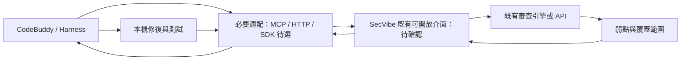

# SecVibe 安全審查能力接入 CodeBuddy：內部技術評估與候選方案

日期：2026-10-23。用途：CodeBuddy 內部研究。目前未取得正式介面文件，也未完成真實聯調；接入可行性及檢測效果均待驗證。本文不是要求 SecVibe 開發的新服務規格。對外使用獨立的[技術對接需求簡版](secvibe-integration-request.zh-TW.md)。

版本：[简体中文（默认）](secvibe-branch-mcp-integration-proposal.zh-CN.md) · [繁體中文](secvibe-branch-mcp-integration-proposal.zh-TW.md) · [English](secvibe-branch-mcp-integration-proposal.en.md)。

先前的[技術調研](secvibe-integration-research.zh-TW.md)與[HTTP API 設計](secvibe-api-integration-design.zh-TW.md)保持原樣作研究資料。其中路線、模組與首版建議不是現行決策；階段及範圍以本文為準，舊介面範例仍屬假設。

## 1. 目標、證據與目前阻塞

目標：CodeBuddy 生成或修改程式碼後，呼叫 SecVibe 既有安全審查能力，取得弱點位置、風險、證據及修復建議，再完成修復與複檢。

CodeBuddy 評估如何接入已有能力，不替 SecVibe 設計或重建服務。Harness 保留 Agent 執行、調度、權限、壓縮及完成權威。雙方負責人協調溝通及資源，技術團隊提供證據與方案。

| 分類 | 目前狀態 |
| --- | --- |
| 已確認 | 未取得正式 SecVibe 介面資料，未完成真實聯調 |
| 原始碼靜態事實 | 存在 MCP 傳輸、按需發現、Tasks 協商及憑證機制，不代表與 SecVibe 兼容 |
| 技術建議 | 已有兼容 MCP 優先評估；只有 HTTP API 則比較直連與封裝總成本 |
| 外部待確認 | 獨立呼叫、MCP/API/SDK、語言及檢測、輸入輸出、文件、測試環境、鑑權、聯絡人、部署、限制、資料處理、費用與維護 |
| 產品待確認 | 主動/自動模式、首版範圍、預算及失敗策略 |

**主要阻塞是外部能力與介面資訊不足，不是缺少我們設計的工具名稱。** 先取得上述資料，再驗證可行性與估算工作量。

### 兩種模式並列評估，首版待定

| 面向 | 使用者主動審查 | 生成或修改後自動審查 |
| --- | --- | --- |
| 觸發 | 明確請求及範圍，由 Harness 呼叫 | 經確認的流程事件/節點；頻率及合併策略待定，不能只靠模型提醒 |
| 成本 | 單次上傳、延遲與費用 | 重複呼叫會放大耗時及配額，需評估快照去重與預算 |
| 權限 | 當次上傳與修復分開核對 | 可撤銷持續授權、專案及費用限制；不自動取得修改權 |
| 異常 | 顯示失敗/未完成及可用重試 | 重試、告警、繼續或阻止完成均待確認 |
| 驗收 | 請求、範圍、結果、授權修復、複檢 | 無需再次請求即按節點觸發，停用/撤銷有效、不重複、成本延遲與故障行為符合約定 |

主動模式不是預設全部交付，自動模式也不是預設首版必做。自動觸發、自動修復及強制完成門檻是三項不同決策。

## 2. API 與 MCP 比較

MCP 本身也是介面協定。此處比較直接呼叫業務 HTTP API，與透過標準 MCP 工具使用同一服務。

| 面向 | HTTP API 直連 | MCP |
| --- | --- | --- |
| 使用對象 | 後端、CI、管理平台及 Agent | 支援 MCP 的 Agent/客戶端 |
| CodeBuddy 團隊改動 | 業務用戶端、工具包裝、結果映射 | 重用連線、發現、呼叫；仍需快照及恢復驗收 |
| 工具說明 | CodeBuddy 團隊維護模型可見 Schema | 由 SecVibe 工具清單提供 |
| 大型程式碼傳輸 | 上傳 API/物件儲存較直接 | 可配合受控上傳，不將整個專案放進模型參數 |
| 長任務 | 業務任務查詢、取消合同 | 協商 Tasks，或以普通 MCP 工具操作持久任務 |
| 權限 | 服務認證與專案授權 | 同樣需要，協定不代替業務授權 |
| 效能 | 主要受上傳、排隊、引擎影響 | 不保證更快，也不消除模型推理時間 |
| 最適條件 | 已有成熟 API、短期不提供 MCP | 雙方已有或願意交付兼容 MCP |
| 目前定位 | 平等比較的選項，不只是備選 | 已有兼容服務時優先評估，不預設新建 |

決策：已有 MCP 先核對兼容並驗證；只有成熟 API 比較直連與封裝的開發、部署、維護、認證、測試及重用收益；已有 SDK 核對環境、授權與分發；只有網頁先詢問可開放條件，由雙方決定資源，不擅自要求新建服務。封裝位置與負責方待比較後決定，不填寫假工期。工具機制參照[官方 Tools 規範](https://modelcontextprotocol.io/specification/2025-11-25/server/tools)，不代表 SecVibe 已支援。

## 3. 部署與分工



圖示為期望資料流，不表示外部介面已存在。先核對既有部署：遠端網路及認證，或 SDK 執行及分發。遠端服務不會因收到本機路徑就取得程式碼。若選 MCP 再依現有服務選擇傳輸，不預設 `/mcp` 或部署方式。[官方傳輸規範](https://modelcontextprotocol.io/specification/2025-11-25/basic/transports)

| 項目 | SecVibe | CodeBuddy 團隊 |
| --- | --- | --- |
| 審查能力 | 引擎、規則、語言及覆蓋 | 依真實能力顯示，不補造結果 |
| 介面 | 提供既有介面、文件、版本、認證及樣例 | 比較路線與必要適配，不預定 MCP |
| 輸入 | 格式、大小、保存與刪除 | 授權檔案、快照、最小化上傳 |
| 任務 | 說明既有同步/非同步、恢復及取消限制 | 按真實能力適配並記錄缺口 |
| 結果 | 位置、嚴重度、證據及錯誤 | 校驗、報告、Harness 修復與複檢 |
| 資料 | 租戶/專案隔離、處理合同 | 保護憑證、出站授權、脫敏紀錄 |
| 驗收 | 真實樣本及能力說明 | 產品內端到端、功能及跨平台回歸 |

SecVibe 對審查服務內部排隊的管理，不改變 Harness 對 CodeBuddy 團隊 Agent 的權威。

## 4. 內部候選合同：取得真實資料後映射

以下名稱、欄位及生命週期僅保留作內部研究，不是已確認介面，也不是 SecVibe 開發要求。優先映射實際介面；同步呼叫、SDK 或不同結果格式可調整或捨棄不適用範例。

| 工具 | 輸入 | 輸出 |
| --- | --- | --- |
| `security_review_start` | `requestId/projectId/snapshot/checks` | `reviewId/snapshotId/status` |
| `security_review_status` | `reviewId` | 真實狀態、進度（如有）、錯誤及覆蓋摘要 |
| `security_review_result` | `reviewId`、分頁游標 | 結構化問題、覆蓋、報告引用及下一頁 |
| `security_review_cancel` | `reviewId` | 是否接受取消、終態或待確認狀態 |

此例假設已有持久任務；若支援冪等，保存請求編號並依真實合同處理重放與衝突。若不支援，提交逾時應標示結果未知，不盲目重試造成重複收費。權限須核對認證主體，不僅信任專案參數。這些能力先詢問，不假設存在。

另提供能力表：語言、檢查類型、格式、大小、並發、保留時間、結果版本。首版不強制增加能力查詢介面。

選定 MCP 且有長任務需求時才協商 Tasks，兼容就重用客戶端並避免重複輪詢。不支援則沿用既有同步/非同步合同；四個工具僅是已有持久任務時的包裝選項，不要求補建。現有 MCP 預設 300 秒逾時不是供應商 SLA 或總審查時限，超出能力時記為缺口。

2025-11-25 規範將 Tasks 標示為實驗性，必須協商而非僅靠 SDK 型別判定支援。[官方 Tasks 規範](https://modelcontextprotocol.io/specification/2025-11-25/basic/utilities/tasks)

使用 Tasks 也需要持久業務記錄，確保應用重啟可查回結果；握手成功不代表恢復已完成。

### 結果格式範例

建議提供 `inputSchema/outputSchema` 及 `structuredContent`，不僅是一段自然語言或 PDF。

```json
{
  "schemaVersion": "1",
  "reviewId": "REVIEW_ID",
  "snapshotId": "sha256:SNAPSHOT_DIGEST",
  "status": "completed",
  "coverage": {"analyzedFiles": ["src/login.ts"], "skippedFiles": [], "partial": false},
  "findings": [{
    "id": "FINDING_ID", "ruleId": "RULE_ID", "severity": "high",
    "path": "src/login.ts", "startLine": 42,
    "title": "範例：缺少權限檢查", "evidence": "對應快照的證據", "recommendation": "修復方向"
  }],
  "nextCursor": null,
  "errors": []
}
```

使用專案相對路徑、一基行號，約定編碼及列號。未知位置保留未知；發現弱點表示審查成功回傳問題，不代表工具執行失敗。零發現不保證安全，部分覆蓋不算完整通過。分頁須綁定同一結果版本。

## 5. 程式碼輸入、認證與資料

輸入方式依真實合同選擇：若支援檔案集合，可用小型脫敏樣本；若支援上傳引用，可由宿主提交獲准快照並使用標識。是否已有 API/物件儲存仍未知；若只有儲存庫引用或 SDK，依其合同評估，不另造上傳通道。通用快照上傳未經驗證，是否需要開發也待確認。

快照記錄基準提交、未提交與新增檔案，必要時包含呼叫鏈、配置及相依清單；預設排除 `.git`、相依套件、產物及憑證，記錄覆蓋限制。只傳 Git 提交號會漏掉剛生成的程式碼。使用者繼續修改時舊報告標示舊快照，修復後新建快照複檢。

上傳位址需限制來源、大小、有效期及憑證傳遞，服務端不得任意抓取 URL。壓縮包需防越界、符號連結及解壓後大小超限。報告存取需鑑權，其文字不具有宿主指令權限。

SecVibe 提供正式認證方式；HTTP MCP 可參考[官方授權規範](https://modelcontextprotocol.io/specification/2025-11-25/basic/authorization)。CodeBuddy 團隊現有橋接支援配置請求標頭，但不等於任意 OAuth 登入和續期均已可用，必須聯調。若使用公司認可的受限服務憑證，只存後端受保護設定，限制專案、期限並可撤銷。不使用瀏覽器 Cookie 或上游模型金鑰替代審查憑證。

雙方確認內網/證書、租戶隔離、是否轉交模型服務商、留存刪除、費用配額、日誌及維護責任。雙方仍需落實資料邊界；本方案不要求操作生產環境。

## 6. CodeBuddy 團隊可重用與待完成工作

核對來源：`main / 09b0219`，含既有未提交修改。

| 現有檔案 | 重用能力與待驗項目 |
| --- | --- |
| `runtime/harness/mcp-bridge.mjs` | 連線與呼叫；待驗 SecVibe 認證及結果兼容 |
| `runtime/harness/tool-discovery.mjs` | 按需發現；待驗可搜尋且不常駐大量規則 |
| `runtime/harness/mcp-tasks.mjs` | 協商 Tasks；待驗真正取消、恢復與錯誤 |
| `runtime/settings.mjs`、`runtime/secrets.mjs` | 配置及憑證；新增服務設定及上傳範圍 |
| 既有桌面工具紀錄與報告展示 | 待驗快照、狀態、報告可讀性 |

選 MCP 時重用橋接；選 HTTP 直連再評估原用戶端方案；選 SDK 核對執行與分發。只補真實缺口，不複製調度、權限或上下文管理。以上為靜態證據，不是 SecVibe 兼容測試。

## 7. 聯調與簽收

1. 取得獨立呼叫方式、文件、認證、樣本、環境及聯絡人；比較 MCP/API/SDK，形成可驗證路線，不宣稱已通過。
2. 以真實 CodeBuddy 對話審查已知弱點、修復版及正常樣本，核對位置並記錄誤報漏報。
3. Harness 修復、執行功能測試、提交新快照複檢；舊結果不冒充新結果。
4. 測試排隊、斷線、重啟、壓縮、取消競態，確認不重複建任務且狀態真實。
5. 測試過期憑證、越權、部分失敗、大輸入及限流，交付可追溯證據。

先自動化，再真實服務與桌面端到端；Windows/macOS 分別驗收，檢測效果與接入品質分開記錄。證據分為目前的資料/靜態研究、待測的小型介面驗證，以及納入範圍後各自驗收的主動與自動模式；一層通過不能代表另一層完成。

主動模式驗證請求、範圍、結果及授權修復複檢；自動模式另測無需再次請求即可觸發、停用/撤銷、去重、範圍外不傳、舊報告及故障策略。效能/費用門檻取得實際限制後約定。恢復與取消只在支援時驗證，不支援則記錄。強制完成門檻另行確認並沿用既有權威，不能用模型自然語言充當控制事實。

## 8. 下一步與對外邊界

使用[對外技術對接需求](secvibe-integration-request.zh-TW.md)收集資料。雙方負責人協調聯絡人、文件、測試資源及模式/首版範圍。技術團隊取得資料後比較總成本，選小型脫敏專案驗證，再確認路線、缺口、工作量及計畫。資訊缺失時不繼續細化假想介面，也不要求新建 MCP Server。

本次未修改應用程式、發信、連線服務、上傳程式碼或執行真實審查。既有技術研究保留，候選合同不作對外開發承諾。

## 9. 引用核對

2026-10-23 已讀取四個引用的 MCP 官方頁面（Tools、Transports、Tasks、Authorization），內容可存取；本機文件與原始碼路徑另作存在性檢查。協定資料不證明 SecVibe 提供對應能力。
