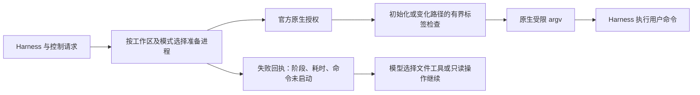

# ADR-002：Windows 沙箱准备的隔离、期限与失败恢复

## 状态与范围

2026-11-25，按用户本轮修复授权实施。Harness 继续拥有执行、权限模式、取消和工具回执；本地适配仅隔离权限准备。没有新增 ACP 协议、持久化状态或更宽权限，没有升级依赖。实现分支为 `codex/fix-windows-sandbox-recovery-20261125`，开发基线为 `fc940ffacc94cf19b1feaa04aa4dc918f9ce2eef`；精确提交身份以 Git 历史为准。本次保存故障隔离检查点，尚不满足发布条件。

## 问题与要求

真实安装版的工具调用在 13:32:52.524 发出，13:49:35.108 才返回“120000ms 超时”；等待中 Node 原生栈位于 `SetNamedSecurityInfoW` 的权限继承处理。停止、排队输入及导出请求随之等待。另有 CodeBuddy 标签助手每次全树检查、约 30 秒后失败，重启后小命令同样失败。

模型负责选择命令；宿主必须在命令选得很差、权限准备很慢或辅助进程失败时，及时给出真实结果，让模型能够继续选择其他工具。超时后的晚到 argv 不得执行，失败不得退回完全权限。

## 来源与职责

- 当前锁定的 DSH `0.2.1-alpha.2` 原生授权缓存、能力 SID、受限 runner、锁与真实执行继续复用。公开源码的 `confine → runnerArgv → materializeAclGrant` 仍包含同步原生调用；不能把 `async` 签名当作主线程可取消的保证。
- CodeBuddy 的 `WorkspaceLabelAccess.cs` 是补齐已有文件标签的适配，不属于 DSH 自带组件。其对象身份固定、所有权、保护 DACL、显式标签、链接排除及临时权限还原规则保持原义。
- 对未加载任何 CodeBuddy 补丁的本地 DSH `0.2.1-alpha.2` 做真实原生锁实验：锁保持 1500ms，原计划 100ms 的定时器到 1578.7ms 才运行，50ms 后发出的 IPC 请求到 1580.0ms 才响应。原生 DSH 同样存在同步准备堵住控制面的风险；这不是对原始 17 分钟事故每个阶段的重新归因。
- 进程准备在返回 argv 前发生；准备失败可以确证“用户命令未启动”，但不代表准备期间没有修改工作区权限。

## 决定

1. 原生准备按工作区和模式隔离，保留每个准备进程内部的官方缓存及串行调用。最多 4 个准备进程，同一进程最多 16 个排队调用；空闲进程按需回收。资源满时返回明确错误，不无限排队。只读操作无需等待同工作区的写权限准备。
2. 准备阶段的独立兜底为 120 秒，排队和进程获取也计入预算；Harness 原生工具从准备开始计时，其更短的期限和显式取消优先。真实模型复测证明，早期候选的固定 30 秒准备上限会过早打断大项目初始化，因此撤回这个默认值。取消、崩溃或期限到达后封存该进程的回执，不能派发晚到 argv。新调用可重新建立进程，不保留永久失败标志。
3. Windows Job 约束整个准备进程树。取消先请求协作退出，最多留 2 秒清理时间，再关闭 Job；宿主异常退出同样触发进程树终止。用户命令由 Harness 在父进程中另行启动，不属于准备 Job。
4. C# 标签检查保留原过滤及写入逻辑，在对象边界和互斥等待中检查预算/取消。扫描使用准备阶段剩余预算并留 2 秒清理窗口，撤回早期候选的固定 20 秒扫描上限；先完成当前对象 DACL 的 `finally` 还原，再返回状态和计数。普通取消通过私有取消文件传递，避免直接向正在写临时 DACL 的 PowerShell 发送终止信号。PowerShell 进程兜底晚于父进程期限及协作清理窗口。
5. 准备失败保留原生 `SANDBOX_UNAVAILABLE` 分类，消息明确阶段、实际等待时间、用户命令未启动及可选替代工具。原生工具自己先到期时，继续保留其 timeout、exitCode=null 和原结果形状，仅在原生 `attached.process() === undefined` 的准备超时分支补充“命令未启动”到既有 stderr。该兼容补丁对锁定的 `dsh-tool-pwsh` 源码核验 SHA256；不在下游另建执行状态、解析错误文案或改判授权/超时。升级上游保留同等事实后即可移除补丁。
6. 日志记录请求编号、阶段、起止及每 5 秒等待状态，不记录用户命令、模型输入或凭据。正常模型循环继续消费原生失败结果，不新增自动重试或完成判断。
7. 标签助手只在完整初始化成功后复用基线。宿主原生 `write/edit` 的成功回执提供已解析的绝对路径，经现有 `commandEvidence` 传给准备进程；不读取模型命令来猜测变更。Windows 原生递归目录通知补充外部新建/移动事件，不建立逐目录 watcher，也不扫描以建立监听。待处理路径最多 2048 个，溢出、无文件名通知、监听失败或检查失败均使完整基线失效；没有观察器时每次执行有界完整检查。目录身份以设备号和文件号核对，替换后回收整个原生 Provider，下一调用重新授权。
8. 定点检查在 C# 内先校验所有目标均在根目录内，再沿选中路径逐层固定句柄，复用完整检查的所有权、保护策略和链接规则。只有选中端点为目录时才扫描该子树，其他兄弟项不枚举。扫描期间收到的新事件留给下一批，在同一准备期限内处理；不写持久化缓存，也不修改标签继承规则。
9. C# 原有账户全局互斥会让无关工作区耗尽标签预算。改为当前账号、卷序号与目录文件 ID 组成的对象锁；每层目录锁随固定句柄保留到后代处理完毕。独立目录互不等待，重叠工作区在共同目录处串行；无链接遍历保证只从父到子获取锁。根目录 WRITE_OWNER 修复使用同一对象锁。没有把每个工作区简单换成互不认识的路径锁，也不允许重叠扫描同时借用同一后代的临时权限。

## 比较与边界

- **仅调大超时或限制模型命令**：不能解决接收超时/取消的线程被堵住，拒绝。
- **单个永久辅助进程**：恢复了主线程响应，但一个工作区仍可拖住其他 shell，助手失败还可能永久污染后续调用；由本决定补全。
- **仅用外部定时器杀 C#**：可能跳过临时 DACL 的 `finally`；改用对象边界协作退出，Job 仅作最终故障边界。
- **按路径名单排除 `.artifacts`、`.git` 或依据命令字符串判断修改范围**：会改变权限检查范围，且无法覆盖同类工作区，拒绝。
- **盲目缓存成功，或把文件监听当成权限权威**：拒绝。采用成功回执的确定性失效、原生目录通知和明确的全量回退；最终能否修改对象仍由相同的原生句柄检查与受限令牌判定。监听没有文件系统事务快照保证，外部操作与准备并发时仍可能先得到权限失败，不能据此扩大权限或保证所有外部写入立即可用。NTFS USN 需要额外平台和卷权限支持，本轮不引入。
- **给旧低完整性目录直接添加继承位**：本地 Modify 权限夹具证实能让后续宿主新文件可写，但旧显式低标签无法可靠区分用户策略和历史补丁来源；继承也可能覆盖原本跳过的子项。因此拒绝以这个兼容性风险替换原来的逐对象边界，采用定点补齐。
- **整体升级 DSH 或替换 Windows 后端**：需要一致依赖集及平台能力验收。公开 Codex MXC 后端避免宿主 ACL 修改，但要求 PSEC/MXC 环境，不是当前锁版 DSH 的直接替换。本轮不安装 SDK 或混用版本。
- **照搬 Claude Code 的 Windows 路径**：官方文档的 sandbox 支持 macOS、Linux 和 WSL2，原生 Windows 命令在 sandbox 外运行；不能把它当成当前 Windows 受限执行的等价替代。

## 限制

这解决的是准备阶段拖住控制面、无限等待、晚到执行、失败后无法恢复，以及成功初始化后仍逐命令全树检查的机制。它不会使任意规模的工作区在固定期限内准备完成；首次、观察失效和大量变化时仍可能收到明确的准备超时。未完成的初始化不缓存为成功。

Job 强制终止不等于权限事务回滚。官方工作区授权本来就持久保留；异常终止可能留下不会被新进程复用的随机临时授权。标签检查正常协作退出的 DACL 还原有回归覆盖；若单个系统调用本身无法及时返回，最终强制回收不能承诺完整回滚，因此回执保留“准备可能修改了权限”的边界。

## 验证场景

### 提交检查点审查发现的缺口

以下是对当前候选与锁定上游代码的静态审查结论，尚未通过新增运行用例固定；此前回归和真实模型成功结果不覆盖这些边界。后续按“先复现、后修复、再复核原场景”处理，不把本检查点当作最终修复。

- **准备进程与运行中命令的授权生命期不一致。** 准备成功后 `worker.active` 被清除，容量回收或取消该 worker 的后续准备会触发原生 Provider dispose；上游 dispose 会撤销私有 TEMP ACE 并删除目录，而之前已启动的命令仍可能使用它。准备任务结束不能作为命令资源结束的证据，正式交付前须修正此回收边界。
- **临时共享冲突可能被缓存为永久跳过。** 标签助手打开对象失败直接跳过，整体仍可报 complete；文件解锁未必产生命名变化通知。需要区分策略性跳过与暂时不可访问，在保留原权限边界的前提下允许后续重新检查。
- **成功 IPC 与到期定时器存在调度顺序缺口。** 父进程接收成功回执时没有再次检查实际期限；如果 IPC 先于已经到期的定时器被处理，可能交出过期 argv。该时序尚未实测，不能与已经验证的取消送达后的封存结果混为一谈。

真实原生锁等待下的跨工作区/模式隔离、独立准备期限、队列取消、助手崩溃后恢复、宿主退出清理；标签预算/取消后的 DACL 还原和再次执行；工作区外写入、受保护对象及链接边界；无变化基线复用、宿主和外部新文件的真实受限修改、定点检查不枚举兄弟项、监听溢出/失败和根目录替换后的失效恢复；模型收到 shell 超时后在同轮改用文件工具。自动回归、受控模型交互、源码预览启动和真实模型/桌面验收分别记录。

控制链路的核心验收可全程后台完成：`windows-sandbox-control.test.mjs` 使用真实 Compat/ACP、Harness、原生锁与受限准备，按原生 120 秒工具期限检查真实墙钟返回，同时检查会话/日志导出、新建会话及取消是否仍响应。`windows-label-concurrency.test.mjs` 覆盖独立目录不阻塞及重叠目录仍串行。CU 不参与这些断言，也不作为后端修复的验证门槛；前端停止文案回归属于独立的显示问题。

GLM-5.3 与 DeepSeek-v4.1-flash 的真实调用补充命令选择、参数纠错、失败回执理解、文件工具回退、取消后继续及权限往返观察；它们与脚本模型回归分开记录。18.1 万可见文件及深层子树的独立夹具用于大项目验证；原项目仅执行只读命令，不改变其 ACL。第一次完整初始化仍可能耗尽 120 秒，不能把后续缓存成功写成所有冷启动都已成功，也不能把模型报告文字提升为执行成功。

## 官方参考

- [DSH 沙箱职责与策略](https://github.com/deepseek-ai/deepseek-harness/blob/master/docs/subsystems/sandbox.md)
- [DSH LocalSandboxProvider](https://github.com/deepseek-ai/deepseek-harness/blob/master/packages/sandbox/sandbox-local/src/index.ts)
- [DSH ACL 授权与继承成本](https://github.com/deepseek-ai/deepseek-harness/blob/master/packages/sandbox/sandbox-windows-acl/src/acl.ts)
- [Node：不要阻塞事件循环](https://nodejs.org/learn/asynchronous-work/dont-block-the-event-loop)
- [Node 24.19 child_process](https://nodejs.org/download/release/v24.19.0/docs/api/child_process.html)
- [Microsoft：SetNamedSecurityInfoW 的继承传播](https://learn.microsoft.com/en-us/windows/win32/api/aclapi/nf-aclapi-setnamedsecurityinfow)
- [Microsoft：Job Objects](https://learn.microsoft.com/en-us/windows/win32/procthread/job-objects)
- [Microsoft：卷序号与文件 ID 的对象身份](https://learn.microsoft.com/en-us/windows/win32/api/fileapi/nf-fileapi-getfileinformationbyhandle)
- [Microsoft：增量 Change Journals](https://learn.microsoft.com/en-us/windows/win32/fileio/change-journals)
- [libuv：Windows 递归目录通知及溢出回调](https://github.com/libuv/libuv/blob/v1.x/src/win/fs-event.c)
- [Codex：原生 MXC 后端的要求与职责](https://github.com/openai/codex/blob/main/codex-rs/mxc-sandbox/README.md)
- [Claude Code：sandbox 平台支持与边界](https://code.claude.com/docs/en/sandboxing)
