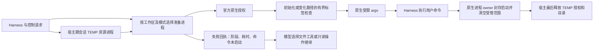

# ADR-002：Windows 沙箱准备的隔离、期限与失败恢复

## 状态与范围

2026-11-25，按用户本轮修复及分阶段对抗审查授权实施。Harness 继续拥有执行、权限模式、取消和工具回执；本地适配隔离权限准备，并保持会话 TEMP 的宿主生命期。没有新增 ACP 协议、持久化状态或更宽权限，没有升级依赖。实现分支为 `codex/fix-windows-sandbox-recovery-20261125`，开发基线为 `fc940ffacc94cf19b1feaa04aa4dc918f9ce2eef`；精确提交身份以 Git 历史为准。生命周期修复与首次初始化、编码优化分别验证；阶段一通过不表示整个问题簇可发布。

## 问题与要求

真实安装版的工具调用在 13:32:52.524 发出，13:49:35.108 才返回“120000ms 超时”；等待中 Node 原生栈位于 `SetNamedSecurityInfoW` 的权限继承处理。停止、排队输入及导出请求随之等待。另有 CodeBuddy 标签助手每次全树检查、约 30 秒后失败，重启后小命令同样失败。

模型负责选择命令；宿主必须在命令选得很差、权限准备很慢或辅助进程失败时，及时给出真实结果，让模型能够继续选择其他工具。超时后的晚到 argv 不得执行，失败不得退回完全权限。

## 来源与职责

- 当前锁定的 DSH `0.2.1-alpha.2` 原生授权缓存、能力 SID、受限 runner、锁与真实执行继续复用。公开源码的 `confine → runnerArgv → materializeAclGrant` 仍包含同步原生调用；不能把 `async` 签名当作主线程可取消的保证。
- CodeBuddy 的 `WorkspaceLabelAccess.cs` 是补齐已有文件标签的适配，不属于 DSH 自带组件。其对象身份固定、所有权、保护 DACL、显式标签、链接排除及临时权限还原规则保持原义。
- 对未加载任何 CodeBuddy 补丁的本地 DSH `0.2.1-alpha.2` 做真实原生锁实验：锁保持 1500ms，原计划 100ms 的定时器到 1578.7ms 才运行，50ms 后发出的 IPC 请求到 1580.0ms 才响应。原生 DSH 同样存在同步准备堵住控制面的风险；这不是对原始 17 分钟事故每个阶段的重新归因。
- 进程准备在返回 argv 前发生；准备失败可以确证“用户命令未启动”，但不代表准备期间没有修改工作区权限。

## 决定

1. 原生准备按工作区和模式隔离，保留每个准备进程内部的官方缓存及串行调用。最多 4 个准备进程，同一进程最多 16 个排队调用；空闲进程按需回收。资源满时返回明确错误，不无限排队。只读操作无需等待同工作区的写权限准备。
2. 准备阶段的独立兜底为 120 秒，排队和进程获取也计入预算；Harness 原生工具从准备开始计时，其更短的期限和显式取消优先。真实模型复测证明，早期候选的固定 30 秒准备上限会过早打断大项目初始化，因此撤回这个默认值。取消、崩溃或期限到达后封存该进程的回执，不能派发晚到 argv。新调用可重新建立进程，不保留永久失败标志。
3. Windows Job 约束整个准备进程树。取消先请求协作退出，最多留 2 秒清理时间，再关闭 Job；宿主异常退出同样触发进程树终止。用户命令由 Harness 在父进程中另行启动，不属于准备 Job。
4. C# 标签检查保留原过滤及写入逻辑，在对象边界和互斥等待中检查预算/取消。扫描使用准备阶段剩余预算并留 2 秒清理窗口，撤回早期候选的固定 20 秒扫描上限；先完成当前对象 DACL 的 `finally` 还原，再返回状态和计数。普通取消通过私有取消文件传递，避免直接向正在写临时 DACL 的 PowerShell 发送终止信号。PowerShell 进程兜底晚于父进程期限及协作清理窗口。
5. 准备失败保留原生 `SANDBOX_UNAVAILABLE` 分类，消息明确阶段、实际等待时间、用户命令未启动及可选替代工具。原生工具自己先到期时，继续保留其 timeout、exitCode=null 和原结果形状，仅在原生 `attached.process() === undefined` 的准备超时分支补充“命令未启动”到既有 stderr。该兼容补丁对锁定的 `dsh-tool-pwsh` 源码核验 SHA256；不在下游另建执行状态、解析错误文案或改判授权/超时。升级上游保留同等事实后即可移除补丁。
6. 日志记录请求编号、阶段、起止及每 5 秒等待状态，不记录用户命令、模型输入或凭据。正常模型循环继续消费原生失败结果，不新增自动重试或完成判断。
7. 标签助手复用已完成枚举的内存基线，并显式保留暂未能打开的目标；`hasBaseline` 不代表每个对象都可写。宿主原生 `write/edit` 的成功回执提供已解析的绝对路径，经现有 `commandEvidence` 传给准备进程；不读取模型命令来猜测变更。Windows 原生递归目录通知补充外部新建/移动事件，不建立逐目录 watcher，也不扫描以建立监听。新变更路径最多 2048 个，溢出、无文件名通知、监听失败或检查失败均使枚举基线失效；没有观察器时每次执行有界完整检查。目录身份以设备号和文件号核对，替换后回收工作区原生 Provider，下一调用重新授权。
8. 定点检查在 C# 内先校验所有目标均在根目录内，再沿选中路径逐层固定句柄，复用完整检查的所有权、保护策略和链接规则。只有选中端点为目录时才扫描该子树，其他兄弟项不枚举。扫描期间收到的新事件留给下一批，在同一准备期限内处理；不写持久化缓存，也不修改标签继承规则。
9. C# 原有账户全局互斥会让无关工作区耗尽标签预算。改为当前账号、卷序号与目录文件 ID 组成的对象锁；每层目录锁随固定句柄保留到后代处理完毕。独立目录互不等待，重叠工作区在共同目录处串行；无链接遍历保证只从父到子获取锁。根目录 WRITE_OWNER 修复使用同一对象锁。没有把每个工作区简单换成互不认识的路径锁，也不允许重叠扫描同时借用同一后代的临时权限。
10. 会话 TEMP 的随机目录和 SID 按原生 `(sessionId, canonicalWorkspaceRoot)` 语义复用，由独立的宿主期资源进程持有；工作区 worker 回收、取消或崩溃不撤销它们。仅使用官方 `AclWriteGrant`、`tempWriteSid` 与工作区外 TEMP 校验，不复制令牌或命令执行核心。工作区 worker 在锁版 `materializeAclGrant` 接缝仅负责 standing workspace grant，消费匹配规范工作区和会话的 TEMP 回执；原生 Provider 继续生成 argv。该私有接缝核对上游源码 SHA256，升级时必须重新审查。
11. Host 资源 owner 记录每一代实际 Windows subprocess owner，消费其唯一的原生 drain Promise。宿主关闭时先同步封存 `spawn`/terminal admission、中止未完成终端分配，再等待原生受管范围清空，最后清理 TEMP；不能只等待启动时的旧实例。单独重载 sandbox 不清理宿主资源，也不终止全局命令。排空失败或宿主异常退出时保留旧随机授权，下一代不认领旧目录；不扫描系统 TEMP 清残留。独立组件调用者仍负责先终止其消费者再销毁组件。
12. 同键 TEMP 申请合并，等待者取消只移除自身，不影响已有能力或其他等待者。未完成资源申请最多 16 个，独立资源操作看门狗为 120 秒；资源进程失去响应时以 Job 硬回收，保留可能仍被旧命令使用的授权。旧代退出前不再启动另一代，旧 IPC 不进入新缓存。已经成功的键不会排在其他键的新授权之后。故障回归采用持有 IPC，未故意挂死 Win32 内核调用。
13. Win32 32/33 共享/锁冲突返回结构化 `partial` 与 `DeferredPaths`，不把该对象缓存为已修复，也不阻断无关命令。最多保留 64 项、4096 个 UTF-16 字符；溢出使下一次调用重做完整枚举，不在本次自旋。延后路径与新变更队列分开，每次调用重试一次；用户命令仍由同一 OS 权限边界判定。结果经私有 control 目录的显式 UTF-8 文件传回，避免 Windows PowerShell stdout 编码破坏 Unicode 路径。取消、期限和真实检查错误仍不交出 argv。
14. 父进程在派发与最终成功交接时都检查同一个单调时钟期限，不能仅依赖到期定时器先运行。跨进程预算以剩余时间交给子进程，成功 IPC 先于到期 timer 被处理也不能绕过最终交接检查。
15. 已固定句柄的最终路径检查使用 `[Out] char[]`，按本次期望路径的 UTF-16 长度加 NUL 分配；不足时依据 Win32 返回的 required size 有界重试，仍拒绝失败、截断、超出原上限或完整路径不匹配。替代逐对象 32768 字符 `StringBuilder`，不改变句柄、访问掩码、链接/所有者/保护策略、对象锁或 DACL 还原。短路径 501 对象回归先测出约67.3MB累计分配，再降到约1.6MB；独立4041对象实验约540.4MB降至9.7MB。它们是累计托管分配而非驻留峰值，也不是18万对象墙钟预测；原生通知溢出与首次初始化仍需单独验证。
16. Windows x64 原生 namespace observer 替代 `fs.watch`：后者锁版 libuv 同时订阅 SECURITY，标签写入可冲溢出4096字节缓冲，使已完成扫描被自己的写入反复否定。新适配复用已安装 Koffi，只订阅 FILE_NAME/DIR_NAME，64KiB缓冲，创建、删除、重命名仍保留。先同步成功 arm 再建立基线；复制完成批次后先 rearm 再分发。真实 overflow、无效记录、读失败仍使基线失效；不把安全通知丢失伪装成成功。未支持平台/不可用观察器回到有界完整检查，不改变对象权限。
17. Win32 overlapped 的 buffer 和 OVERLAPPED 使用稳定原生内存，不能让系统在调用返回后继续写可移动的 JS Buffer。取消后以非阻塞 GetOverlappedResult 确认真实完成才释放；一秒关闭期限不够时保留内存并拒绝 close，由准备进程 Job 负责最终隔离。timer不阻塞主线程；每次主动 drain有批次上限，持续变化使基线失效。上下文销毁等待同一 close Promise；根路径身份和链接状态在显式交接点复核，8.3通知候选展开为长路径，再由原helper固定句柄并裁决权限。
18. 真实标签结果后的最后异步身份/通知检查位于基线决策之前，已知的新路径仍由同次循环处理；根目录替换或消失返回 WORKSPACE_CHANGED，回收原生Provider及缓存。若在增量准备途中永久失去观察，本次补一次完整检查；没有可靠观察器的完整检查完成即返回，不在同次自旋。延后列表溢出仍保留下一次调用回退语义。监听器不提供文件系统事务快照，交接后并发外部操作仍可能先被OS拒绝。

## 比较与边界

- **仅调大超时或限制模型命令**：不能解决接收超时/取消的线程被堵住，拒绝。
- **单个永久辅助进程**：恢复了主线程响应，但一个工作区仍可拖住其他 shell，助手失败还可能永久污染后续调用；由本决定补全。
- **仅用外部定时器杀 C#**：可能跳过临时 DACL 的 `finally`；改用对象边界协作退出，Job 仅作最终故障边界。
- **准备调用引用计数或删除 sessionId 走 agentless**：调用完成不等于 argv 消费者或后台进程结束；agentless 会改变会话 TEMP 复用，并把工作区授权移回命令 runner。保留原生会话语义，拆开资源与准备生命周期。
- **共享冲突一律抛出并使全局基线失败**：独立反例证明一个无关 IDE/数据库文件可持续阻断整个工作区，拒绝。改为有界定点延后，解锁后无需重命名即可恢复。
- **按路径名单排除 `.artifacts`、`.git` 或依据命令字符串判断修改范围**：会改变权限检查范围，且无法覆盖同类工作区，拒绝。
- **盲目缓存成功，或把文件监听当成权限权威**：拒绝。采用成功回执的确定性失效、原生目录通知和明确的全量回退；最终能否修改对象仍由相同的原生句柄检查与受限令牌判定。监听没有文件系统事务快照保证，外部操作与准备并发时仍可能先得到权限失败，不能据此扩大权限或保证所有外部写入立即可用。NTFS USN 需要额外平台和卷权限支持，本轮不引入。
- **忽略 libuv 的无文件名回调**：会把真正丢失的 namespace 事件一并忽略，拒绝。单独 .NET FileSystemWatcher 进程也能过滤，但需要额外启动、IPC、存活和退出合同；现有准备进程内的 Win32 overlapped 适配能复用已有 Koffi/Job。保留真实通知丢失的完整回退。
- **给旧低完整性目录直接添加继承位**：本地 Modify 权限夹具证实能让后续宿主新文件可写，但旧显式低标签无法可靠区分用户策略和历史补丁来源；继承也可能覆盖原本跳过的子项。因此拒绝以这个兼容性风险替换原来的逐对象边界，采用定点补齐。
- **整体升级 DSH 或替换 Windows 后端**：需要一致依赖集及平台能力验收。公开 Codex MXC 后端避免宿主 ACL 修改，但要求 PSEC/MXC 环境，不是当前锁版 DSH 的直接替换。本轮不安装 SDK 或混用版本。
- **照搬 Claude Code 的 Windows 路径**：官方文档的 sandbox 支持 macOS、Linux 和 WSL2，原生 Windows 命令在 sandbox 外运行；不能把它当成当前 Windows 受限执行的等价替代。

## 限制

这解决的是准备阶段拖住控制面、无限等待、晚到执行、失败后无法恢复，以及成功初始化后仍逐命令全树检查的机制。它不会使任意规模的工作区在固定期限内准备完成；首次、观察失效和大量变化时仍可能收到明确的准备超时。未完成的初始化不缓存为成功。

Job 强制终止不等于权限事务回滚。官方工作区授权本来就持久保留；异常终止可能留下不会被新进程复用的随机临时授权。标签检查正常协作退出的 DACL 还原有回归覆盖；若单个系统调用本身无法及时返回，最终强制回收不能承诺完整回滚，因此回执保留“准备可能修改了权限”的边界。

## 验证场景

### 提交检查点缺口的复现与修复

`26d3b38d` 检查点的三处缺口已分别测红后修复。独立对抗审查又测出无关共享锁阻断、subprocess 重载后等待旧 owner，以及资源进程缺健康边界；这些反例也已固定或独立复核。自动用例是当前 worktree 的组件/后台合同证据，不是桌面验收。

- `windows-sandbox-lifecycle.test.mjs`：真实受限命令跨 worker 回收、取消、准备崩溃保持 TEMP；资源 owner 崩溃或 IPC 无响应后旧命令继续、新代使用新目录；同键等待者独立取消；跨期限成功 IPC 被拒绝；已取得 argv 的新启动在 drain 后被拒绝；真实 Host 后台命令及 subprocess 替换后的进程均先退出，才删除 TEMP。
- `windows-label-incremental.test.mjs`：持锁时无关受限命令可运行，Unicode/emoji 长路径保留，解锁后定点恢复；有界列表溢出不在当前调用自旋，下一调用恢复完整基线。原生目录通知丢失可能要求额外全量检查，因此不把具体 watcher 回调次数当作合同。
- namespace 回归：4000个无外部变化的真实 Modify 文件先测出两次全扫，修复后一次建立并复用；真实外部批量创建冲溢出仍执行全量回退；增量期间真实关闭观察器、移入策略合格文件，原版runner EPERM，补一次全查后同一runner写入成功。单元覆盖500次真实安全写无namespace事件、Unicode/create/rename/移树、真实overflow恢复、根替换/权限拒绝及pending read关闭；独立审查补测256个通知、8.3、junction外部隔离和200次关闭句柄净增0。
- 独立审查实际复核双会话 TEMP 写隔离、单独重载 sandbox 后原 TEMP 复用，以及给替换后的原生进程排空注入 750ms 延迟时的清理顺序；未制造系统内核死锁，未做桌面、大项目冷启动或安装包验收。

真实原生锁等待下的跨工作区/模式隔离、独立准备期限、队列取消、助手崩溃后恢复、宿主退出清理；标签预算/取消后的 DACL 还原和再次执行；工作区外写入、受保护对象及链接边界；无变化基线复用、宿主和外部新文件的真实受限修改、定点检查不枚举兄弟项、监听溢出/失败和根目录替换后的失效恢复；模型收到 shell 超时后在同轮改用文件工具。自动回归、受控模型交互、源码预览启动和真实模型/桌面验收分别记录。

控制链路的核心验收可全程后台完成：`windows-sandbox-control.test.mjs` 使用真实 Compat/ACP、Harness、原生锁与受限准备，按原生 120 秒工具期限检查真实墙钟返回，同时检查会话/日志导出、新建会话及取消是否仍响应。`windows-label-concurrency.test.mjs` 覆盖独立目录不阻塞及重叠目录仍串行。CU 不参与这些断言，也不作为后端修复的验证门槛；前端停止文案回归属于独立的显示问题。

GLM-5.3 与 DeepSeek-v4.1-flash 的真实调用补充命令选择、参数纠错、失败回执理解、文件工具回退、取消后继续及权限往返观察；它们与脚本模型回归分开记录。18.1 万可见文件及深层子树的独立夹具用于大项目验证；原项目仅执行只读命令，不改变其 ACL。第一次完整初始化仍可能耗尽 120 秒，不能把后续缓存成功写成所有冷启动都已成功，也不能把模型报告文字提升为执行成功。

## 官方参考

- [DSH 沙箱职责与策略](https://github.com/deepseek-ai/deepseek-harness/blob/master/docs/subsystems/sandbox.md)
- [DSH LocalSandboxProvider](https://github.com/deepseek-ai/deepseek-harness/blob/master/packages/sandbox/sandbox-local/src/index.ts)
- [DSH ACL 授权与继承成本](https://github.com/deepseek-ai/deepseek-harness/blob/master/packages/sandbox/sandbox-windows-acl/src/acl.ts)
- [Node：不要阻塞事件循环](https://nodejs.org/learn/asynchronous-work/dont-block-the-event-loop)
- [Node 24.19 child_process](https://nodejs.org/download/release/v24.19.0/docs/api/child_process.html)
- [Microsoft：SetNamedSecurityInfoW 的继承传播](https://learn.microsoft.com/en-us/windows/win32/api/aclapi/nf-aclapi-setnamedsecurityinfow)
- [Microsoft：Job Objects](https://learn.microsoft.com/en-us/windows/win32/procthread/job-objects)
- [Microsoft：卷序号与文件 ID 的对象身份](https://learn.microsoft.com/en-us/windows/win32/api/fileapi/nf-fileapi-getfileinformationbyhandle)
- [Microsoft：最终路径缓冲长度与 required size](https://learn.microsoft.com/en-us/windows/win32/api/fileapi/nf-fileapi-getfinalpathnamebyhandlew)
- [Microsoft：StringBuilder P/Invoke 拷贝与 Out 数组](https://learn.microsoft.com/en-us/dotnet/standard/native-interop/best-practices#string-parameters)
- [Microsoft：增量 Change Journals](https://learn.microsoft.com/en-us/windows/win32/fileio/change-journals)
- [libuv：Windows 递归目录通知及溢出回调](https://github.com/libuv/libuv/blob/v1.x/src/win/fs-event.c)
- [Microsoft：ReadDirectoryChangesW 的过滤与丢失回退](https://learn.microsoft.com/en-us/windows/win32/api/winbase/nf-winbase-readdirectorychangesw)、[CancelIoEx 完成边界](https://learn.microsoft.com/en-us/windows/win32/api/ioapiset/nf-ioapiset-cancelioex)
- [Koffi：stable pointers](https://koffi.dev/output#stable-pointers)
- [Codex：原生 MXC 后端的要求与职责](https://github.com/openai/codex/blob/main/codex-rs/mxc-sandbox/README.md)
- [Claude Code：sandbox 平台支持与边界](https://code.claude.com/docs/en/sandboxing)
