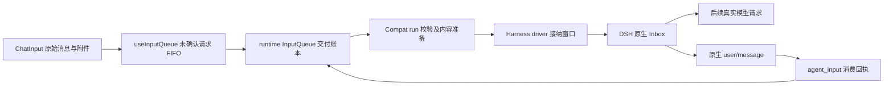

# 插话与排队交接：供组长的 Codex 接手

日期：2026-11-27。用户最新指令为“插话这部分验收，推送，写好交接”。该验收不扩大为所有流式性能、代码导航或完整恢复路径均通过。

## 1. 分支、范围和提交

- 仓库：`gcsagroup/CodeBuddy-v1`。
- 工作目录：`C:\Users\admin\Documents\ChatGPT\codebuddy-v1`。
- 交付分支：`codex/steering-mode-20261127`；不直接合并或推送 `main`。
- 分支起点：`24020efeb19c2f57a0592612a9453e243688c586`。
- 功能提交：`520e6a87`，`feat(chat): add durable steering and native follow-up queue delivery`，56 个文件。
- 展示提交：`990c1562`，`style(chat): simplify execution and elapsed-time labels`，4 个文件。
- 本文与 TXT 另作为交接文档提交；文档本身的提交号从该分支日志读取，避免自引用哈希。
- 预合并目标：本次读取的 `origin/main` 为 `73e5718ac192bdaad5fd4b001adadcf7eb952cb4`，比起点多 `d464cc3e` 工作区权限快照和 `73e5718a` TTS 两笔提交。未来 main 再更新时需要重新检查。

这是源码功能分支交付，不是 release、安装包或已合并 main。推送结果以该分支远端 ref 为准。

### 没有包含的工作

工作区开始时及验收时已有独立导航、流式 Markdown、滚动渲染改动。这次按文件和 hunk 拆分，未把整个 dirty worktree 一起提交：

- 未提交代码导航连接复用：`runtime/assets/code-navigation.py`、`runtime/development-tools.mjs`、`runtime/harness/mcp-bridge.mjs`、两个新增 navigation 模块及导航测试/fixture、README 导航说明。
- `runtime/harness/driver.mjs` 的导航 import、连接 owner、配置退役、context 查询绑定四块均未提交；PROVENANCE 和事实文档的导航段也未纳入。
- 未提交 `GooseMessage.tsx`、`ThinkingContent.tsx`、`MarkdownContent.tsx`、`streamingMarkdown.ts`、`scroll-area.tsx` 及其相关测试的性能切片；`LoadingGoose.tsx` 的无用状态更新优化也保留在工作区。
- 未提交 `.local`、`.agents`、`.workbuddy`、测试 profile、模型请求、图片、凭据或本地调查资料。

后续用户已要求另外开分支，先调查流式输出/视野跟随顿挫，以及代码导航审批和执行失败。不要把这份交接当作这两项已经修好。

## 2. 最终产品行为

| 操作 | 最终语义 | 不应误解为 |
| --- | --- | --- |
| 引导，默认选中 | 把原输入交给当前执行；原生入箱后抢占当前模型请求，后续采样读到新输入 | 取消整轮、杀长工具、另起第二个聊天模型 |
| 排队 | 当前 ACP 执行结算后，按队列顺序逐条开启后续 turn | 把多条正文和图片合成一个新 query |
| 纸飞机“优先发送” | 活动执行时下一步骤接入，preempt=false；空闲时所选项提前，其余相对顺序不变 | “立即秒回”、旧 stop-and-send |
| Stop | 原独立取消操作，暂停宿主未交付队列，按原合同处理真实在途工作 | 引导的隐式实现 |
| Enter / Ctrl+Enter | Enter 按设置；Ctrl+Enter 使用相反模式 | 改写已有队列项的目的地 |

模式设置在聊天设置中，默认 `steer`，读取失败不静默回退。正常引导在持久暂存成功后尽早显示原 ID 用户气泡，不短暂出现普通队列 UI。模型可以合并回应连续补充，不强制每条都写“收到”。

队列是一个有限高卡片：普通行 32px，上限 min(104px,20vh)，约三行；更多条目内部滚动。默认跟随最新，用户向上阅读时保持位置。普通行只有优先发送、编辑、删除，点状把手用于拖排。无展开收起、全发、清空、更多菜单或底部说明。纸飞机提示“当前步骤结束后发送，不中断当前任务。”

## 3. 输入到模型的链路与权威



1. 桌面冻结每条完整请求：commandId、原 revision、消息 ID、正文、图片、模式和目标 run。同步持久追加成功后才 staged、清相应草稿。
2. 一个前端 worker 串行 POST 队首。首 ACK 慢时仍可追加 enqueue；编辑/排序等控制不与发送混跑。
3. 宿主 InputQueue 持有正式交付账本。ACK 只证明操作被接受，`admitted` 只表示原生接纳，`consumed` 由原生 `user/message` 对应的 `agent_input` 回执确认。
4. 是否进入模型上下文还须看后续真实请求；是否已经回答另看真实文本，不能用 ACK 或模型自述代替。
5. Compat 不通过用户自由文本判断是否取消、换 run 或重放。默认引导保留目标执行，普通优先发送不抢占模型请求。

早显气泡必须与原 ID 回显对齐。三个 ACP 文件要一起保留：adapter、store、notification adapter。追加新本机气泡不能重建整个 adapter，否则会重置旧气泡正在积累的流式文本；图片/文本分块回显也不能重复追加预览内容。

## 4. 核心修复及容易回归的点

### 4.1 密集发送与 v2 journal

原单 pending 会在首 ACK 未回来时挡住后续 Enter，造成文字串接。v2 保存 `commands:[完整不可变请求,...]`；嵌套附件也深拷贝。一个 worker 提交，确认后先持久删除当前队首，再推进内存。

- GET(A) 只能结算捕获的 A，不能删除后来成为队首的 B；GET 不能释放尚未完成的 POST。
- 切换会话/卸载后旧 owner 不再写存储或推进尾部。
- 刷新恢复只 GET 核对已应用前缀，不自动 POST 未确认尾部；显式重试沿原完整请求、原 ID、原 revision。
- 明确拒绝后，用户可改投 queue：新 commandId、原消息 ID/附件。未知结果不能自动改投。
- v1 先完整写 v2，再删除旧键；冲突保留，不覆盖。sessionStorage 窗口身份的发现范围没有扩大。
- 本机未确认普通消息只读展示，不能冒充服务器快照；原生已接纳、未知交付的项不能随意编辑/重发。

### 4.2 原生收尾与慢图片准备

旧 run.steers 跟踪的是 admission Promise。admission 已完成但 flush 还没完成时，收尾循环可能反复等待已完成 Promise，饿死 I/O。现在集合跟踪包含准备、入箱、preempt、flush 的完整 delivery；没有靠 sleep 绕过。

真实图片补测发现另一个竞态：先等待备用识图，原短任务可能先结束；随后再调用 steer 会得到 PROMPT_IDLE。现在 driver 同步捕获/校验原 run 并登记 delivery，再让 Compat 的内部 prepareContent 回调完成 VisionRouting 和 bindAgentInput；准备后复核同 run、acceptingInput、cancelRequested 和原信号。失败原样返回，Stop 后晚准备完成不得入箱，不另起 prompt 或重放。

若图片准备期间原生 turn 已自然结束，DSH 可以在同 ACP owner 下开后续原生 turn。这一结果不等于丢消息，也不能声称永远同一个 native turn。新 run 不能接收过期的非空 expectedRunId。

### 4.3 正式历史和长工具

- 抢占前已闭合的原生块、或真正成功 finish 确认的内容才进入正式助手历史。半截保留在已显示界面和 attempt 审计，不回填正式历史。abort 清理补出的块结束不是成功证据。
- 已运行工具和子任务继续真实结算；未派发提案用原生 cancellationResult 配对。引导不代答审批。
- job_output / 前台 PowerShell 只解除原 Job 的等待；生产者、真实退出码和 Stop 保留原 owner。releaseReason=steer、preparing 区分引导、超时和尚未确认命令启动。
- 媒体 status 和可选完成图像检查可让出；提交、共享刷新/下载、job_id、取消和 240 秒预算不变。wait_release_reason 仅描述本次调用，不存入 Job。
- CU 仅撤回未派发时的前驱/lease 等待；原 tail 继续等待真实前驱。已派发动作及视觉收尾不提前伪结算；首次窗口范围在真实派发元数据边界提交。
- 普通同步 MCP/Tasks 没有通用安全后台化合同，不能把任意 Promise 提前返回来追求“秒回”。

### 4.4 附件与普通界面

附件尚在压缩/加载时，按钮、键盘队列入口和普通提交共用 loading 门禁，保持正文与附件，准备好后完整发送。控制命令先解析，Stop 独立。

展示独立提交只去掉模型调用次数、最近返回工具副标题、重复“已停止”前缀；保留真实停止状态、思考状态和用时。不要借此改终止状态机或恢复逻辑。

## 5. 全部改动文件分组

下列路径相对仓库根。`git show --stat 520e6a87` 与 `git show --stat 990c1562` 是最终文件清单权威。

| 分组 | 文件 |
| --- | --- |
| 交付/执行 | `runtime/input-queue.mjs`、`runtime/compat.mjs`、`runtime/harness/driver.mjs` |
| 长工具/CU/媒体 | `runtime/desktop-coordinator.mjs`、`runtime/comfyui-tool.mjs` |
| 锁版扩展 | `runtime/harness/steering-patch.mjs`（新增）、`runtime-context-contract.mjs`、`windows-preparation-contract.mjs`、`PROVENANCE.json`（后三项同目录） |
| 后端回归 | `runtime/harness/test/steering.test.mjs`；`runtime/tests/` 下 `input-queue.test.mjs`、`steering-delivery.test.mjs`、`steering-desktop.test.mjs`、`steering-desktop-queue.test.mjs`、`steering-media.test.mjs`、`steering-subagents.test.mjs`、`comfyui-tool.test.mjs`、`comfyui-video-tool.test.mjs`、`generated-image-observation.test.mjs` |
| 桌面消息身份 | `ui/desktop/src/acp/inputQueue.ts`、`adapter/messages.ts`、`chatSessionStore.ts`、`sessionNotificationAdapter.ts`、`__tests__/chatSessionStore.test.ts`（后四项同一 acp 目录） |
| 桌面队列 | `ui/desktop/src/components/ChatInput.tsx`、`MessageQueue.tsx`、`ChatInput.queue.test.tsx`、`followUpMessages.ts`（后三项同目录） |
| 设置和前端交付 | `ui/desktop/src/hooks/useInputQueue.ts`、`useInputQueue.test.tsx`、`useFollowUpMode.ts`、`useFollowUpMode.test.tsx`；`components/settings/chat/ChatSettingsSection.tsx`、`FollowUpSettings.tsx`、`FollowUpSettings.test.tsx`；`ui/desktop/src/main.ts`、`preload.ts`、`utils/settings.ts` |
| 翻译 | `ui/desktop/src/i18n/messages/` 下 de/en/es/fr/hi/id/it/ja/ko/ms/pt/ru/tr/vi/zh-CN/zh-TW 16 份。每份 19 个新增、20 个旧队列键删除、1 个等待文案修改；无其他 key 的语义变更，整理提交时保留了原有无关格式。 |
| 展示独立提交 | `ui/desktop/src/components/BaseChat.tsx`、`ProgressiveMessageList.tsx`、`codepro/useWorkStatus.ts`、`codepro/useWorkStatus.test.tsx` |
| 职责与交接 | `documentation/codebuddy/CODEPRO_FACT_AUTHORITY_ZH_CN.md`、`decisions/ADR-004-follow-up-steering.md`；本 Markdown 和同目录 TXT |

没有 Rust、依赖版本、锁文件、node_modules 或系统 PATH 修改。

## 6. 实际验证与证据范围

### 自动检查

以下 Node 目标在仓库根执行；前端命令在 `ui/desktop`。均使用已有依赖，没有临时安装工具。日志只保留在本机 `.local`，未上传模型请求或 profile。

```powershell
node --test runtime/tests/input-queue.test.mjs runtime/tests/steering-delivery.test.mjs runtime/harness/test/steering.test.mjs runtime/tests/steering-desktop.test.mjs runtime/tests/steering-desktop-queue.test.mjs runtime/tests/steering-media.test.mjs runtime/tests/steering-subagents.test.mjs runtime/tests/vision-routing-acp.test.mjs runtime/tests/vision-routing-harness.test.mjs
# exit 0：74 pass、1 skip（仅供独立子进程运行的夹具入口）。

node --test runtime/tests/comfyui-tool.test.mjs runtime/tests/comfyui-video-tool.test.mjs runtime/tests/generated-image-observation.test.mjs
# exit 0：75 pass、0 skip。本次提交前补跑。

node ../node_modules/vitest/vitest.mjs run --maxWorkers=1 src/components/ChatInput.queue.test.tsx src/hooks/useInputQueue.test.tsx src/hooks/useFollowUpMode.test.tsx src/components/settings/chat/FollowUpSettings.test.tsx
# exit 0：95 pass。

node ../node_modules/vitest/vitest.mjs run --maxWorkers=1 src/acp/__tests__/chatSessionStore.test.ts src/components/codepro/useWorkStatus.test.tsx src/components/settings/chat/ChatSettingsSection.test.tsx
# exit 0：105 pass。本次提交前补跑。

node ../node_modules/typescript/bin/tsc --noEmit
node scripts/i18n-check.js
node scripts/i18n-validate-locale.js
# 均 exit 0；locale 为3436条、15个翻译目录。正常入口也完成 i18n-compile。

git diff --cached --check
# exit 0。拆除导航后的 staged driver 另做 ESM 语法检查，exit 0。
```

不要把上述分组相加为全新用户场景数。Node 子集另补跑过 20 pass/1 skip，不再累计。新增的红灯/反向检查包括：首 ACK 延迟十条、过期目标、延迟 flush watchdog、Compat 先准备后接纳的竞态，以及 loading 附件 Enter。反向变异捕获预期失败后，产品源码按字节恢复。

### 真实模型

| 模型 | 十条引导 | 十条自然排队 |
| --- | --- | --- |
| GLM-5.3 | 每个原 ID 各一次 | 严格在后续 turn 2–11 逐条消费 |
| DeepSeek-v4.1-Flash | 每个原 ID 各一次 | 同左述顺序 |
| Kimi-K2.7-Code | 每个原 ID 各一次 | 同左述顺序 |

共60条，未见丢失、重复、正文拼接或任务级取消。引导发出至 native 消费约84–431ms；这不是“已生成文字回应”的延迟承诺。queue 等待包含前序轮次正常执行。

GLM纯文件和图文各三路径（自然、优先、引导）均通过。模型实际 read 后答对只存在于便签中的“青鹭/周五下午三点”；图像通过 Gemma4:31b 的真实能力元数据及像素语义探针后，才在全新 Temp profile 配置备用识图。像素发给 Gemma，主 GLM 收到辅助观察和文件引用；用户日常配置未改变。图文优先/引导覆盖了原短任务先结束的竞态，仍是原 ACP owner、原 ID 一次，没有追加新的 native.prompt。

早期图片能力门禁、原 PROMPT_IDLE、GLM长回答180秒内只处理8/10，以及测试助手导出错误均保留，没有混入最终通过矩阵。代码导航没有计作本次验证交付。

### 身份和产品验收

- 用户已明确验收插话部分。
- 自动检查、模型矩阵运行于上述同一 worktree 的候选源码，且含当时未提交的独立导航/性能切片。拆分提交后，driver/文档字节 hash 与原 evidence identity 不同；不能把旧 hash 写成发布提交 hash。已独立审查拆分依赖，导航四块移除后无残留引用，语法通过；本次未在另一 checkout 冒充验收。
- 原生 Electron GLM 引导曾完成实际十键发送，ID各一次。组件视觉覆盖320/760px，无按钮越界。全部桌面编辑/拖放/冷恢复矩阵并未由 Agent 独立全测。
- 用户授权重启后，同一源码预览收到 React ready；runtime sourceHash/currentHash 均为 `623fe58207879d73900a2c67bbd3f8479f7f29813d1f1fb70fbec848ed4a423e`。它是 dirty worktree 预览身份，不是纯提交构建证明。
- 代表性本机记录：`.local/ui-feedback-20261127/排队与引导本批交付记录.md`、`.local/steering-e2e-20261127/fifo-final-matrix-summary-20261127.{md,json}`。共享仓库只有脱敏总结，实际请求/图片/profile不随 Git 分发。

## 7. 与最新 main 合并：已确认冲突和保留要求

在 `990c1562` 上执行只读 `git merge-tree --write-tree HEAD origin/main`，目标 `73e5718a`，退出码1。它没有修改工作区、没有产生合并提交，也没有更新 main。

### 唯一实际文本冲突

`documentation/codebuddy/CODEPRO_FACT_AUTHORITY_ZH_CN.md` 文件开头：

- 本分支新增排队/引导所有权与最新语义。
- main新增最终回复播报、语音通话的所有权及早期方案替换说明。
- 两组内容职责不同，应都保留。插话最新节继续覆盖文件下方旧 stop-and-send 描述；语音的新节继续覆盖其旧 Haru 方案。
- 不要整文件选择 ours/theirs；不把本地未提交导航段顺手带进来。

### 自动合并但仍需核对的接口

- `runtime/compat.mjs`：main为 ConversationEditing 增加 `folderSnapshot: (cwd,id) => this.workspaces.sessionFolderConfig(cwd,id)`，必须保留；本分支的 InputQueue/steer/prepareContent 是另一链路，也必须保留。当前文本能自动合并，不表示跨模块验证已经完成。
- main的 `runtime/conversation-driver.mjs` 修改要继续正常透传 steer 的 options，尤其 prepareContent/preempt，不得因解冲突重写而丢掉。
- main的 TTS 在 `GooseMessage.tsx` 增加 speakable。这个文件不在本次插话提交中，不应拿本机未提交 streaming hunk 覆盖远端版本；如随后接入流式性能切片，需要另外复审该文件。
- main已有工作区权限快照/过期 UI 响应保护，本分支未调整权限边界。不要为接入 guide 而放宽目录或审批。

如果组长还有未推送的队列/聊天布局版本，本机看不到其最终树，不能预报它的冲突数量。重点共同文件是 ChatInput、MessageQueue、InputQueue协议/Hook、ACP气泡三个文件和i18n。不能恢复旧 stop-and-send，不能丢失新版队列与实际执行绑定。

### 合并后建议验证

仅在组长明确执行合并后，按该 checkout 的现有入口启动。重跑本节相关 Node/UI/type/locale 目标，并补工作区快照相关回归；用真实主模型各做一次引导/自然排队，检查原 ID、附件和长工具。所有权文档冲突只需内容/格式核查，不为文档单独构建整个产品。本文不授权自动合并、改 main 或发布安装包。

## 8. 仍未解决的事项和恢复约束

1. **普通 idle 首发草稿边界**：首条 prompt 接纳前仍保留已提交文本，紧接键入可能从1变11。它不推翻严格从已接收、编辑器已空开始的运行中矩阵，但阻断“所有连续发送场景均根治”的结论。修复需同时处理新/已提交草稿及首 prompt 发出屏障，不能只提前清空或让后续抢先发出。
2. **媒体收尾偶发测试**：集中首遍有一次共享 refresh 释放后三秒 receipt仍queued，过滤与集中诊断重跑通过。queued可覆盖下载/磁盘检查/独占写PNG/receipt原子替换阶段，未证明生产者失效，也未证实负载原因。没有增大门限或盲改产品。再现时记录history释放、HTTP finish/close、observation_error_info与真实文件落盘时间。
3. **流式输出/视野跟随**：正文开始较顺，越长越卡；思考经常忽快忽慢，正文或工具已有内容但视野仍落后。用户已要求下一分支对照DSH及可获取的成熟实现调查。本提交不声称解决。
4. **代码导航**：用户仍反馈频繁审批且基本未成功；默认不应反复询问的只读导航需求纳入下一分支研究。本次未改变它的审批或交付其连接复用切片。
5. **恢复**：真正Stop、冷启动和未知交付保守暂停。原生已接纳的输入不能自动重发；现有窗口身份范围、全部外部同步MCP、跨Provider推理项重放未全面覆盖，不承诺永久exactly-once。

回滚应在没有活动任务且未确认记录已核对处理后进行。v2尾部旧版本读不到；只回退UI或loader会让消费者和协议不匹配。生产/重要会话的备份、迁移或删除另需明确对象和授权，本交接不触碰这些数据。

## 9. 下一位 Codex 的执行顺序

1. 先核对实际分支、HEAD、dirty列表；不要对整个目录执行add/cleanup，不吸收导航/性能的未提交内容。
2. 以本分支提交和该时刻main进行预合并检查，按第7节处理冲突；只有收到合并授权才实际合并。
3. 复核锁版模块版本及SHA，不通过手改预期hash绕过加载失败。
4. 按第6节相关目标复验，并区分自动检查、真实模型、用户验收和未覆盖桌面路径。
5. 单独研究流式/导航问题。优先拆“数据到达→store发布→React渲染→Markdown处理→布局/滚动→屏幕呈现”时间，按累计内容增长测量，保留原Job与执行状态所有权，不继续堆UI计时器或按正文猜状态。

给组长的人话版在同目录《给组长-插话改动交接.txt》。

## 10. 2026-11-28 追加：流式展示、导航和权限修复的合并交接

本节追加本批状态，不抹去前文当时的交付事实。第8节第3、4项和“导航/渲染仍dirty”的说明是11月27日快照；本节及所链接的11月28日报告是新的处理结果。用户授权本批审查、测试与本地提交，**没有授权推送、合并main或发布**。

### 10.1 来源和提交依赖

- 工作目录：`C:\Users\admin\Documents\ChatGPT\codebuddy-v1`；分支：`codex/fix-streaming-navigation-20261128`。
- 起点：`bcc6ab77731cc6f1c67985a83f71f1ecb0e41d15`，包含此前插话功能/文案/交接提交，保留当时未提交的导航与前端候选。本批不恢复旧Rust执行核心。
- 已有权限修复：`7d8a3e32f856dddc234c63acee4d5f278c64a91a`。它修复never策略下补充输入把已允许的写入提升为ask，继而因不可审批而失败；不放宽显式ask/deny、只读根、工作区范围或Auto安全检查。
- 本轮提交清单将在收齐门禁后写在10.7。接收方应按祖先顺序取完整行为切片；不要只复制大文件或跳过其新增模块、测试、固定来源清单。
- 本地`.local`夹具、profile、归档与生成的语言服务目录不提交；`.agents`、`.workbuddy`及11月9/10日无关报告不吸收。

### 10.2 前端改变了什么，哪些状态仍归原owner

1. `AnswerFilesProvider.tsx`按会话、轮次和实际key/path词汇稳定Context；`ProgressiveMessageList.tsx`接入。真实文件事实仍来自原工具回执ledger，不把模型文本变成证明。新增、撤销、歧义、key变更或切会话仍使链接失效重算。
2. `MarkdownBlocks.tsx`复用现有ReactMarkdown、remark/rehype、KaTeX和streaming frontier，完成块保留ReactElement。组件state中的Map只保留当前文档块；没有全局缓存、新计时器、第二套Markdown协议或持久化。
3. `MarkdownContent.tsx`统一增量与静态呈现；跨块引用/脚注仍交原完整文档转换，再按源位置归属块。保留原URL检查、真实文件链接、选择与焦点。`streamingMarkdown.ts`继续拥有解析frontier及回滚规则；不要把已完成块按任意固定字符数切断。
4. `ThinkingContent.tsx`显式传实时状态；`GooseMessage.tsx`用`streaming`表达正文流式状态，不再为了逐词淡入生成大量动画span。通用`animateIncoming/revealAt`调用仍保留，流中代码plain、结束后高亮。`LoadingGoose.tsx`只在显示阶段耗时时重设起点，避免无关流式文字触发额外state更新。
5. `ScrollArea`仍独占跟随/阅读意图与折叠锚点，合并几何更新按帧贴近真实末尾，处理viewport变化和Selection；上滚/选字不被新内容抢回，显式回底可恢复。没有给后台伪造尚未到达的文字，也没有新增WBD合帧层。
6. 侧栏仅改两个CSS：标签增加主题边框/背景/圆角，选中边框区分更强并移除旧阴影；不改切换、关闭、文档加载或通知逻辑。DOCX打不开的已证实原因另见10.5，不能把CSS说成转换修复。

### 10.3 导航：正常只读免询问，隔离可执行项目缓存

`development-tools.mjs`的固定工厂提供可信只读事实；driver/Compat继续检查实际定义身份、显式ask/deny和安全复审。**不是按工具名称全局放行，也不是采信任意远端MCP的readOnlyHint。** 外层facade只接收overview/definition/references，realpath验证具体源文件位于工作区，目录请求给出纠正信息。

- `code-navigation-connection.mjs`、`mcp-bridge.mjs`复用官方MCP SDK与DSH scope。按Agent/真实工作区/运行配置惰性复用一个私有连接，原始工具/资源/指令不投影模型。Windows x64由唯一Job拥有该Python/LSP范围；`code-navigation-job.mjs`观察SDK根退出。排队取消不杀健康实例；在途取消、超时或不确定结果退役旧实例，关闭获证才允许下一次显式查询重建，失败请求不重放。
- `code_navigation_runtime.py`沿固定Serena选择拟启动的全部语言服务，预检全部载荷，再用同一`RegisteredProject`内存快照。当前只审查Python/Pyright及TypeScript pair；缺失或其他语言明确未准备，不在查询或桌面启动时安装。TypeScript禁用ATA，使用已核的宿主tsserver；项目activation和自定义LS命令不生效。
- 对抗审查实证：上游读项目`.serena/cache/python/*.pkl`时，`pickle.load`会在版本校验之前执行归档内容。只读查询夹具中只写无害marker，旧实现确实写出，回归为红。这是本批自动allow必须关闭的边界，不能靠让每次正常导航都审批来掩盖。
- 修复复用上游YAML默认值/兼容/local覆盖解析，无base时`autogenerate(save_to_disk=False)`；不调用会补写项目的`ProjectConfig.load()`。支持local-only配置，拒绝配置链接越界；不创建、迁移或修改原项目YAML/旧缓存。
- 每个服务进程在导入Serena前取得全新工作区外临时`SERENA_HOME`，派生目录先创建，防止上游fallback到项目`.serena`；不导入旧pickle或旧全局注册项目列表。静态语言服务载荷仍按原宿主state定位。正常关闭清理，强杀可能留不再复用的临时派生目录；没有扫描/清理用户Temp。
- 固定Serena `1.7.1.dev0`，`mcp.py`与`config/serena_config.py`的SHA及工厂合同见`PROVENANCE.json`。升级上游须重新检查纯配置helper、factory二次读全局配置、缓存fallback和LSP启动约束；不要只改预期hash绕过门禁。

### 10.4 载荷准备和接收方环境

`runtime/assets/typescript-runtime.json`固定官方`typescript@5.9.3`与`typescript-language-server@5.1.3`、来源和SHA-512。`scripts/prepare-typescript-runtime.cjs`是显式准备入口，校验后解包，不运行npm install或包脚本；已存在pair先校验，不联网。`stage-harness-distribution.cjs`只校验pair/provenance，缺失、替换或present-null metadata不能绕过；不触发准备。

Git不带`runtime/assets/serena`、`pyright`、`typescript`生成目录。组长的机器若缺载荷，须按README与其授权准备；本机已有pair不等于干净机器/安装包已经通过。混合语言仍沿Serena选择规则：需要时在项目`.serena/project.local.yml`列出语言并新建聊天，当前连接不自动重载语言配置。不要为了跑过验收自动给任意语言安装服务。

### 10.5 本机修正、已验收范围和保留限制

- 用户分别明确授权仅将`runtime/py/dependencies/python/python.exe`、`runtime/harness/node_modules/@deepseek-ai/libreoffice-kit-win32-x64/bin/libreoffice-kit.exe`的Low完整性标签恢复为Medium；核对内容、所有者和普通ACL不变。**这些是本机安全元数据修正，Git不传递，也没有新增自动改ACL代码。** 接收方若再现必须先查其实际标签/进程身份，不可全树改权限。
- 权限修复已有81个不同自动用例和GLM四轮真实文件/子Agent写入回执；原Aegis失败写入未自动重放。Exa仍按原模块审批策略，未发现本批需要变更的机制证据，按用户要求先不动。
- 前端已有同源码四核心hash的原生Electron十轮GLM长思考/正文/代码/表格/阅读/回底/重载记录；累计正文27445、思考88703 UTF16。不是逐字符DOM hash、paint/FPS或heap泄漏证明。报告保留一次坐标回底是否命中不明的观察，不把它算通过或缺陷。
- 受控A/B中完成块缓存和移除聊天逐词span显著降低渲染/接收积压，详见完成块报告；单个巨大未闭合块、全局引用、完整历史store/list、模型真实输出空窗仍有成本，不承诺所有模型/吞吐均匀速。WBD私有实现未声称掌握，不增加补字动画遮盖接收空窗。
- 图片附件黑缩略图后闪退按用户要求仍搁置。此次不涉及模型连接面板、代理/TUN或安装包。

### 10.6 最终核对、执行入口和合并边界

本轮最终前端17个Vitest目标共384项通过，exit0；TypeScript noEmit exit0。新增导航安全回归先红后绿，最终Node门禁与正式TS实际查询的退出码、skip原因将在10.7结算。Node真实Harness/MCP/LSP查询不是模型调用或桌面E2E；不能用它替代用户前台验收。

使用已有依赖，未安装/下载新依赖、重建node_modules或改PATH；未跑Rust全套或发行安装包。已有TypeScript显式载荷下载是此前用户单独批准的固定两包，本轮只复用。原始本地日志在`.local/final-review-20261128`，性能/窗口证据位置见各实施报告；不提交profile或凭据。

2026-11-28重新fetch后`origin/main`仍为`73e5718ac192bdaad5fd4b001adadcf7eb952cb4`，只是读远端，没有合并工作树。最终提交树的预合并结果会记录10.7。第7节的旧冲突结论只适用于旧树，不能套到本批；组长未推送源码仍不在本机可见范围。

不论文本是否冲突，接收方都要核对这些共同文件/职责：

- `GooseMessage.tsx`：保留main的`speakable`/TTS接线，同时接入这里的`streaming`，不要恢复正文逐词span。
- `ProgressiveMessageList.tsx`：保留新版布局、停止绑定真实轮次和文件回执owner，同时用`AnswerFilesProvider`传session/turn scope；不能因文件数组等价而冻结children。
- `runtime/harness/driver.mjs`：保留`7d8a3e32`的never修复与原所有权限门禁，接入私有导航连接；不把显式ask/deny改成allow。
- `mcp-bridge.mjs`：私有导航分支与普通扩展分支分开；保留普通MCP版本协商、重连、模块审批、CU真实回执和task合同。
- `CODEPRO_FACT_AUTHORITY_ZH_CN.md`：插话、私有导航、前端展示、权限、main语音与多项目目录说明各自保留；不要整文件ours/theirs。
- `runtime/compat.mjs`、`conversation-driver.mjs`虽不是本轮新增修改，合并祖先插话切片仍须保留main项目目录快照与steer options透传。

完成正式合并后，复跑本节受影响门禁及目录快照/TTS相关目标，按目标checkout的README入口`powershell -ExecutionPolicy Bypass -File .\start-preview.ps1`启动，并以其launch.json/sourceHash确认加载的代码。进程启动不是产品PASS。回滚先确认无活动任务，按完整依赖切片操作，不删除用户缓存或自动重放不确定输入；本交接不授权实际合并或回滚。

### 10.7 本轮最终提交、预合并与验证结算

所有产品切片已本地提交，独立审查无剩余Required；本节随文档提交交付。前文历史提交/测试不重复算作本轮新运行。

| 顺序 | 提交 | 内容/涉及文件 |
| --- | --- | --- |
| 前置 | `7d8a3e32`（此前本地提交） | never审批修复；driver、native-permissions/supplement-review回归、ADR-004、所有权与权限报告 |
| 1 | `f4a4f1b9` | 完成块/稳定Context共13文件：AnswerFilesProvider及测试、MarkdownBlocks、MarkdownContent及streaming/普通测试、streamingMarkdown及测试、GooseMessage及stream测试、ProgressiveMessageList、ThinkingContent、remarkDeliveredFileLinks |
| 2 | `829247c4` | ScrollArea及其6项回归，包含跟随/选区/viewport/历史与折叠锚点 |
| 3 | `15fd99c3` | LoadingGoose可见耗时更新；ProgressiveMessageList.process旧用时断言与已接受产品文案对齐 |
| 4 | `ace75ebb` | desktop-shell.css + workspacePanel.css；仅侧栏标签外观 |
| 5 | `545e3ac2` | 固定TS准备/打包6文件：gitignore、typescript-runtime.json、prepare-typescript-runtime及测试、stage-harness-distribution、distribution-credentials测试；生成pair不在Git |
| 6 | `51edbd31` | 导航14文件：README、所有权、PROVENANCE；Python入口及bootstrap；development-tools；driver/MCP bridge；私有connection/Job模块；native connection测试和fault-server夹具；code-navigation Node与Python合同 |

本次文档还完整纳入ADR-005、11月27日研究、11月28日streaming-navigation/completed-blocks/docx-tabs报告以及本交接MD/TXT。精确文件与逐行差异以`git show --stat <commit>`、`git show <commit>`为准。六个源码切片加文档提交均未推送；前置7d8也仅本地。`git ls-remote --heads`确认远端旧插话分支停在bcc6ab77，当前fix-streaming-navigation分支没有远端head；没有把“本地commit”写成已推送。

最终检查结算：

- 前端：17文件/384用例通过；现存TypeScript noEmit exit0。jsdom仅有既有HTMLMediaElement.pause未实现提示，没有失败。
- 导航/权限身份/Job/打包：集中6目标38个Node用例，37pass/1skip/0fail、exit0。Python10合同嵌套在1个Node目标，不重复加为47。细化错误文案与Temp范围检查后重跑导航：11pass/同1skip；追加旧全局注册项目不回写断言后，只重跑该目标1pass、exit0，不重复加总。
- TS skip原因：未设置专用`CODEBUDDY_TEST_TS_LSP`夹具，非查询失败；本轮另用正式固定pair在无旧缓存的全新Temp项目/profile完成overview/definition/references，7362/99/199ms，0审批，isolated staging与sourceUnchanged通过、exit0。没有新下载或干净机器安装验收。
- 红/绿与变异：项目pickle marker旧实现确实执行，新增测试先红；当前fallback/native均成功且marker未执行，YAML/原全局/其他项目配置不变，junction越界拒绝。目录条件的内存副本反转使10合同出现5个error、exit1，实际产品源文件从未改写；正常候选的10合同在绿色Node目标中通过。
- 用户指定的后续真实模型仅官方`deepseek-flash`、低思考：3轮，5个导航回执成功、0审批，随后write说明.md成功；实际12个上游请求逐个硬断言model/effort，sourceUnchanged=true，exit0。本地脚本第一次在三轮后误用同步cancel的Promise接口导致清理失败，保留失败日志，不计完整通过；只修本地脚本后有界重跑。没有修改产品来适配测试。
- 独立Agent只读复核了19个UI文件、35项性能源码身份、4核心与十轮窗口见证，另复核了导航新安全边界、所有最新测试退出码和Flash/TS源码hash，无剩余Required。没有声称这是两位Agent独立重跑；实际执行由主Agent串行完成。
- 未执行：Rust全套、发行构建、安装包、干净机器或合并main后验证。已有预览保持打开未重启；同SHA既有十轮前端窗口证据可复用，不能据此说旧导航连接已加载最新修复。Flash本轮是新driver真实后端集成，不冒充桌面CU。

**本轮源码预合并**：`git merge-tree --write-tree 51edbd31 origin/main`对刚fetch的73e5718a返回exit1；只生成Git对象，没有切分支/修改工作树/正式合并。结果树`75be95179a73d75005702f3d563d387066c8e732`有且只有1个冲突文件`CODEPRO_FACT_AUTHORITY_ZH_CN.md`：本分支新增插话/权限/导航/展示说明，与main新增最终回复播报/通话说明在文件顶部同一区域冲突，双方按owner保留，删除冲突标记，不能整文件选择一方。

该预合并树中`GooseMessage.tsx`已同时保留`streaming={isStreaming}`和两处`speakable`；`compat.mjs`同时保留InputQueue、prepareContent、main的folderSnapshot。它们是**文本检查**，不是已合并构建或跨模块产品验证。原始输出`merge-tree.log`和全部本轮账本在`.local/final-review-20261128`。组长实际目标revision或私有dirty不同，必须重做预合并，不套用本次“1个文件”。
