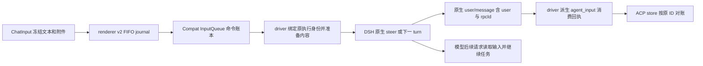

# CodeBuddy 完整技术交接：插话、流式展示、权限与代码导航

> 2026-11-28 统一交付入口。面向接手合并的 Codex，按原因、职责、依赖和验收边界整理。此前报告保留其当时状态；其中“未提交/未推送/导航待做”等历史文字不能代替本文的最终范围。本文不授权自动合并 main、安装依赖、改安全元数据或发布。

## 1. 先核对交付对象

| 项目 | 本次核对值 |
| --- | --- |
| 仓库 | `https://github.com/gcsagroup/CodeBuddy-v1.git` |
| 实施 worktree | `C:\Users\admin\Documents\ChatGPT\codebuddy-v1` |
| 交付分支 | `codex/fix-streaming-navigation-20261128` |
| 与当前 main 的共同起点 | `24020efeb19c2f57a0592612a9453e243688c586` |
| 本交接前分支 HEAD | `c0176b3c282e3a878053b4374a67e089ed2687f5` |
| 本轮 fetch 后 `origin/main` | `73e5718ac192bdaad5fd4b001adadcf7eb952cb4` |
| 旧插话远端分支 | `codex/steering-mode-20261127`，停在 `bcc6ab77731cc6f1c67985a83f71f1ecb0e41d15`，已经是本交付分支祖先 |
| 完整已有交付范围 | `24020ef..c0176b3c`：12 提交、105 文件，8785 行增加、2217 行删除；之后只追加本次统一交接文档 |
| 本次操作边界 | 用户已授权推送本功能分支；没有授权合并或推送 main，没有发行安装包 |

不要重复合入旧插话分支。本文末尾给出上述 105 个文件的 Git 生成清单；本次统一交接新增的两份文件另列，历史交接顶部增加入口。最终推送 HEAD 是包含本文的文档提交，须用远端 ref 核对，不能把上表的产品验收/文档快照 hash 混成同一个概念。

开始本次交接时没有 tracked dirty；以下未跟踪目录属于本地资料，不纳入提交：`.agents/`、`.local/`、`.workbuddy/`、`documentation/codebuddy/reports/2026-11-09/`、`2026-11-10/`、`ui/desktop/.local/`。不要 `git add .`、清理这些目录，或把 profile/请求/凭据打包给同事。

## 2. 合并前最需要知道的冲突

### 2.1 已实际做的预合并

在本交接前 HEAD 对刚 fetch 的 main 执行：

```powershell
git merge-tree --write-tree HEAD origin/main
```

退出码 **1**，原因是下述唯一文本冲突；仅生成 Git 对象，没有修改工作树或 index，没有切分支，没有实际 merge。结果树为 `ce9cd1018f4f0e22612673261bf4305eb29f9e95`，原始输出保留在本机 `.local/final-handoff-20261128/merge-tree.log`。这不是合并后编译或产品验收。

### 2.2 实际冲突文件：所有权文档

`documentation/codebuddy/CODEPRO_FACT_AUTHORITY_ZH_CN.md` 顶部同时有双方插入。

| 来源 | 必须保留的内容 | 原因/优先关系 |
| --- | --- | --- |
| 本分支 | 11 月 27 日引导/排队、下一 turn/step 的最新职责；后续输入的身份、接纳、消费、恢复规则 | 最新段覆盖下方旧 stop-and-send/“立即切换”历史说明，不得按旧段恢复行为 |
| 本分支 | 私有代码导航及 11 月 28 日缓存/配置隔离、可信只读范围 | 免询问与安全启动约束是一套边界，不能只保留前者 |
| 本分支 | 前端 AnswerFiles/ScrollArea 展示职责；补充后 never 权限修复 | 下游不得从文案重判状态，也不得把安全门整体删掉 |
| main | “最终回复按需语音播报” | 与插话/Markdown streaming 共存 |
| main | “独立语音通话改用 GemmaE2B 与 QwenTTS”及早期 Haru 替换说明 | 最新语音段继续覆盖其旧方案 |
| 双方共同基线 | 多项目工作区、只读优先和原有职责 | 不因顶部冲突丢失既有权限与目录规则 |

处理方式是按职责保留两组新段、去掉冲突标记、核对下方覆盖关系。**不能整文件 ours/theirs。** 文档中“候选/早期”有历史含义，不能一概删成只剩最新标题。

### 2.3 自动合并也必须逐项核对

| 文件/链路 | 本分支必须保留 | main/接收方必须保留 | 避免的错误 |
| --- | --- | --- | --- |
| `runtime/compat.mjs` | InputQueue、steer、`prepareContent` 和执行身份 | `ConversationEditing` 的 `folderSnapshot: (cwd,id) => this.workspaces.sessionFolderConfig(cwd,id)` | 用本分支整文件覆盖而丢目录权限快照 |
| `runtime/conversation-driver.mjs` 与 `runtime/server.mjs` | wrapper 原样传递 steer options，尤其 `prepareContent`、`preempt` | main 的 `productSessionId(actual)` native→product 映射与 server 调用方，找不到身份应明确失败 | 这两个文件未在本分支 105 文件差异中，也不能拿旧版本覆盖；否则权限事实会绑定错会话 |
| `GooseMessage.tsx` | `MarkdownContent streaming={isStreaming}`，聊天正文不恢复逐词淡入 | main 两处 `MessageCopyLink` 的 `speakable`，以及相应 MessageCopyLink/MessageSpeechButton 实现 | 只选语音或 streaming 一边，或恢复大量 wordfade span |
| `ProgressiveMessageList.tsx` | session/turn scope 的 `AnswerFilesProvider`，真实文件回执 owner | 同事新版布局、停止状态绑定实际执行轮次、历史窗口行为 | 文件投影等价时冻结整个 children；未完成原生取消就显示已停止 |
| `ChatInput`、`MessageQueue`、`useInputQueue`、ACP 三处气泡链路 | durable FIFO、原消息 ID、附件冻结、guide/queue 模式、卡片限高、优先/编辑/删除 | 接收方合法布局与过期响应保护 | 只改按钮名，底下还调用旧 stop-and-send；重建 adapter 导致流式正文重置 |
| `runtime/harness/driver.mjs` | never 修复、完整 steer 生命周期、私有导航 owner | 原生只读/目录/显式 ask/deny/安全复审/任务取消门禁 | “完全访问”变成任意工具豁免；把原生准入回执当模型已消费 |
| `runtime/harness/mcp-bridge.mjs` | 私有导航连接分支及确定关闭后重建 | 普通 MCP 协商/重连/授权、CU 回执、Tasks 合同 | 为导航复用而重写全部扩展连接，或把原始 Serena 工具暴露给模型 |
| patch/contract/`PROVENANCE.json` | 锁定上游版本、源码 SHA、受审查的替换点作为整体 | 后续上游升级的真实合同 | 为通过加载而单独修改预期 hash；只挑只读 annotation 不挑 bootstrap/cache 修复 |
| main/preload/settings、16 语言 JSON | 设置持久化、默认引导、所有新 key | 同事其他设置/文案 | HMR 当成已加载主进程修改；整份语言文件覆盖 |

当前预合并树已静态确认 Goose 同时有 `streaming` 与两处 `speakable`，Compat 同时有目录快照和输入处理。没有因此宣称合并后的 TTS/目录权限已运行通过。

main 的独立语音通话走单独内存 LLM/WS 链路，不进入 Agent 的 InputQueue；本文的引导语义不能自动推广到语音通话。组长若还有未推送的队列/布局/状态改动，本机看不到其最终树，**“只有 1 个冲突文件”只对上述两个 revision 成立**。

## 3. 全部提交、动机和依赖

| 顺序 | 提交 | 为什么需要/交付内容 | 合并依赖 |
| --- | --- | --- | --- |
| 1 | `520e6a87` | 运行中补充响应迟、旧停止发送与排队混淆、连发/附件竞态：durable steering + 原生 follow-up queue | 输入 UI、journal、ACP 身份、InputQueue、driver、锁版补丁、Job/media/CU 边界一起看 |
| 2 | `990c1562` | 用户要求去掉模型调用次数/最近工具提示/重复已停止；保留真实状态和用时 | 不能照旧文本断言回滚状态机 |
| 3 | `bcc6ab77` | 已验收插话的旧交接和合并边界 | 已在旧远端，不重复 cherry-pick |
| 4 | `7d8a3e32` | 补充后原本允许的 MD/子 Agent 写入被提升为不可交互 ask | 只修 supplementReview；不放宽其他门禁 |
| 5 | `f4a4f1b9` | 完成 Markdown 重处理、文件 Context 引用漂移、动画节点使长输出成本增长 | AnswerFiles + completed blocks + streaming 调用方；不是仅加 memo |
| 6 | `829247c4` | 固定速度/加速度追尾会落后于实际页面增长，阅读和选区又不能被抢 | 同一 ScrollArea owner 与其相关回归 |
| 7 | `15fd99c3` | 不显示阶段耗时时仍因流式更新重设起点 | LoadingGoose 与已接受用时断言对齐 |
| 8 | `ace75ebb` | 右侧多标签缺少可见边界 | 仅两个 CSS 文件，不是 DOCX 解析修复 |
| 9 | `545e3ac2` | TS 原先依赖旧缓存，无法证明新环境正式载荷可用 | 固定 manifest + 显式准备 + staging 校验/测试，不提交生成目录 |
| 10 | `51edbd31` | 导航反复启动/审批/失败；新增可信只读必须关闭可执行项目缓存与启动配置风险 | facade、Python bootstrap、私有连接/Job、门禁、来源和测试作为完整切片 |
| 11 | `ac3b8c01` | 补完整流式/导航验证和冲突说明 | 产品源码最终窗口验收采用此 revision |
| 12 | `c0176b3c` | 记录重启后 Flash 六轮真实窗口及未覆盖项 | 仅文档，产品源码同上 |
| 13 | 本次统一交接提交 | 两份独立完整交接、旧报告入口；不改产品 | 推送后核对实际远端 HEAD |

按顺序合入最容易保持合同一致。若只挑部分提交，需重新证明依赖闭合；尤其不能独立挑“只读免审批”、队列 `next-step` 命令或原生 request preemption。线上动作名是 `next-step`，不是 `send_next`；旧 `send` 明确返回 QUEUE_INVALID，不能只换按钮文案还沿用旧动作。

## 4. 插话与排队：最终语义和职责

### 4.1 用户看到的行为

- 默认 **引导**。Enter 按当前设置，Ctrl+Enter 使用相反方式；存量用户若已有明确选项，保留其设置。
- 引导是将补充交给当前任务并尽快纳入原生输入；可打断当前模型请求，**不等于取消任务/工具**，不强迫模型逐条回复“收到”。连续几条可由模型合并回应。
- 排队默认等当前 turn 自然结束，然后按 FIFO 逐条新原生轮发送。**目前不合并文本或附件。**
- 卡片每项只有优先发送、编辑、删除，另有拖动手柄；限高约三行（单行 32px，容器上限结合 104px/20vh），更多在内部滚动。不保留 bulk 菜单、展开折叠或“本轮结束自动发送”脚注。
- **优先发送 = 下一安全 step 接纳，`preempt=false`。** 不是旧“停止当前任务后发送”；真正 Stop 仍独立。idle 优先动作沿现有顺序/恢复机制处理，其他项相对顺序保留。
- 引导成功暂存后尽早出现原 ID 的用户气泡，不闪现排队 UI。附件尚未完成准备时，键盘/按钮入口均保留草稿与附件，不提前发半份内容。
- 展示删掉“第 N 次模型调用”、最近返回工具副标题、顶部重复“已停止”，真实工具结果/停止状态/elapsed 不删除。

### 4.2 谁接收、做什么、输出什么



| owner | 输入/处理 | 输出和禁止越权 |
| --- | --- | --- |
| `ChatInput`/`followUpMessages` | 冻结完整命令、文本、附件、模式、预期 run，保存成功后仅清除对应草稿 | 新气泡身份固定；不能从“模型说收到了”推断投递成功 |
| `useInputQueue` | renderer 本地 FIFO journal，一个 worker；写入先于清草稿，确认先持久化移除队首再推进 | 未确认尾部保持；GET 不能删掉后续 B 或释放尚未完成的 POST A |
| `runtime/input-queue.mjs` | 执行命令 revision/身份/幂等账本、选择下一项、保持目标 run | native admission 前的交付事实 owner；不把传输 ACK 直接当已消费 |
| `compat`/driver | 同步捕获 run，执行 `prepareContent`，再次检查 run/signal/acceptingInput；跟踪整个 steer Promise | 原 ACP owner 持续有效，不因慢图片准备而向旧执行晚注入 Stop、丢输入或另起重复 prompt |
| DSH 与 driver 事件适配 | 原生输入接纳、请求 preemption、工具结算、历史构建 | 原始 `user/message` 的 `data.source.kind === 'user'` 且 `data.source.rpcId` 存在时，driver 才派生 `{type:'agent_input', requestId:rpcId, seq:event.seq}`；不是 raw source 枚举叫 agent_input。Compat 消费这个派生回执；工具回执/turn 完成仍由原生决定 |
| ACP messages/store/notification | 原 ID 合并暂存气泡与正式事件，保留已经显示的流式内容 | 追加气泡不能重建 adapter 或重置既有正文 |

必须区分 **命令已接受、原生已接纳、原生已消费、模型生成回应**。它们不是一个状态。数百毫秒原生消费不等于数百毫秒正文，前端不能替模型写“收到”冒充回应。

`run.steers` 跟踪准备、接纳、preempt、flush 的完整 Promise。旧的只等“接纳已登记”会让外层驱动重复循环而阻塞实际进展；修复没有靠额外 sleep。

### 4.3 长工具如何让出等待，而不误杀

| 场景 | 采用的既有机制 | 不变的事实 |
| --- | --- | --- |
| PowerShell、`job_output` | 在真实 Job registry 上释放前台等待，回执区分 `releaseReason=steer` 与 preparing | 同一后台 Job 继续；未确认命令已启动就明确 preparing；读原 Job 结果，不能重跑命令 |
| 生图/视频 | status/可选图像观察等待可让出；同一 ACP owner 继续接收新要求 | 提交、下载、共享 refresh、job_id、取消、原 240 秒预算不改；`wait_release_reason` 不是持久化作业状态 |
| CU | 仅派发前 predecessor/lease 等待可让出 | 已派发操作不杀；真实视觉回执、scope commit 的派发证据、其他聊天 lease 不改 |
| 普通同步 MCP/Tasks | 保留原有同步合同；未虚构通用后台化 | 不保证所有工具都能立即纳入引导，不按模型文字猜完成 |
| 模型正在输出 | 锁版 native request preemption，只终止本次采样请求 | task signal、已启动工具/子任务不随之取消；尚未派发的提案由原生生成取消回执 |

选择性复用 DSH 原生 queue/steer/Job/SDK 生命周期，而不是照抄不可验证的 Codex 私有客户端。Codex 公开源码/本机观察用于确定目标，不能据此声称私有桌面所有效果已经 1:1 或所有调用均能抢占。

### 4.4 半截回复、持久化和恢复

- 被中断的未完成 assistant 项可留在 UI 和 attempt 审计；**不能当成完成的正式历史继续喂给模型**。只有闭合并确认的块/成功完成项进入 canonical history，abort cleanup 的结束标记不构成成功依据。已完成内容、真实工具回执保留。
- renderer journal **version 2**、backend InputQueue **version 1**、`followUpMode` 设置是三件事；不要全局替换 version 或当成服务端 schema 升级。
- journal 冻结 `commandId`、revision、`userMessageId`、完整内容/附件/模式/expected run；重载先 GET 对账已应用前缀，不自动 POST 不确定尾部。旧 owner/unmount 的回执不得推进新会话 worker。
- 明确拒绝可经规定路径重新定向排队，使用新 commandId、保留 userMessageId；**unknown 不能自动重发**。原生已接纳输入不能因 UI 还没回执就重送。
- 旧 v1 记录完整写入 v2 成功后才删除旧项；冲突保留原始记录。旧产品版本看不懂 v2 未确认尾部，所以回滚前必须先对账，不可删 localStorage“修好”。
- 包含 main/preload/settings 的变更要正常重启应用；仅 renderer HMR 不能证明设置和主进程已加载新版。

## 5. 权限修复：为什么写 MD 和子 Agent 会失败

### 5.1 已复现的因果链

补充输入到来 → `call.supplementReview` 生效 → Compat 已判 `allow` 的调用被额外改成 `ask` → 原生有效审批策略是 `never`，不能询问 → 宿主返回不可用/拒绝 → 主 Agent 或子 Agent 写不出 MD。

`never` 的职责是“不弹交互审批”，不是“不受沙箱约束”。修复在 driver 只收窄额外提升条件：

```js
if (call.supplementReview && gate.kind === 'allow' &&
    ctx.get('approval')?.effectivePolicy(exec.agent.session) !== 'never') {
  // 保留可交互策略原来的 supplementReview 询问。
}
```

有效 never 下保留既有 allow，随后仍经过原生执行门。已有 ask/deny、安全复审、取消、工作区身份、只读/参考根、真实区外限制均不放行。没有新增权限协议、持久化 grant 或工具名白名单。不可把这一条件抄成“never 一律 allow”。

### 5.2 验证边界

- 读→真实 steer→写新 MD 的缺陷用例改前 exit1，修后通过；子 Agent 工作区内写的新增矩阵也先红后绿。
- 检查主/子 Agent、readonly/workspace-write/full access、真正区外、显式 ask/deny、外部 MCP、CU、媒体/业务能力等既有边界；去重共 **81 用例、16 文件通过**。并非所有平台/工具穷举。
- 区外负例必须查原生 writable roots：OS Temp 本来可能可写，不能把 Temp 兄弟目录当真区外，然后为测试强行收紧产品。
- 真实 GLM 四轮：读时引导后创建 MD、后续 edit、实际子 Agent write、带 queuedWhileBusy 来源的下一原生轮写文件，0 审批不可用；核了实际 child ID/回执和文件内容，未用主 Agent 自写冒充子 Agent。
- 该 GLM 运行早于用户后来限定“只用 Flash low”。原 Aegis 失败动作没有自动重放。
- Exa 取证见首次模块授权后复用、完全访问会话共 7 次调用无询问，未证实每次都问；仍保持现有策略。远端 readOnlyHint 不能单独授予所有 MCP 权限。

细节及失败夹具纠正在 [权限修复记录](permission-approval-fix.zh-CN.md)。

## 6. 流式与下滚：证据、采用方案和未做的事

### 6.1 为什么不能只给文字加动画

对接收、store/日志发布、Markdown/React、布局与滚动分开取证。已证实的重要放大因素在前端：每个 delta 使文件数组/Context 引用变化，完成 Markdown 内容被重新处理；正文逐词动画制造更多 span；旧滚动速度上限落后实际增长。后端/提供方的真实空窗仍可能存在，不能用补字计时器把“还没收到”伪装成平稳输出。

复用 DSH 已完成块方向和项目现有 Markdown/scroll owner。受控比较见完成块报告；尚无证据证明再加 WBD 式合帧层收益大于延迟/重复状态风险，所以本批没有叠加新流缓冲层。WBD 私有实现没有被宣称完全掌握。

### 6.2 各文件如何协作

| 模块 | 处理与输出 | 重要边界 |
| --- | --- | --- |
| `AnswerFilesProvider` | 对实际用到的 key/path 建立同 session/turn scope 稳定投影 | 不改变真实文件 ledger；实际回执变化仍能更新冻结 JSX 内的消费者；不冻结 children |
| `MarkdownBlocks` | 将完成 ReactElement 保留于不可变组件 state；Map 只保留当前 key | 不在 render 中改跨次 mutable ref，不用全局无限 cache；回退/空文档/StrictMode 有回归 |
| `streamingMarkdown`/`MarkdownContent` | 复用现有 frontier、ReactMarkdown、remark/rehype、KaTeX、URL transform；只继续处理活动边界 | 全局引用/脚注需整文编译，再按源码 owner 归块；owner 必须在 KaTeX 丢位置前确定，包装在 DOM 前清除；sanitizer 只克隆归属块，不能每块克隆整树 |
| `GooseMessage`/`ThinkingContent` | 显式传 streaming 状态，思考和正文接同一机制；流中代码 plain、结束高亮 | streaming 与 animateIncoming 分开；通用 revealAt/animate API 不删，但聊天正文不恢复 wordfade |
| `ScrollArea` | 仍独占跟随/阅读意图；content + viewport ResizeObserver，最多一个 rAF 读取真实末尾 | 去掉固定 480px/s 上限与持续积分追赶；上滚/选区暂停，显式回底可越过旧 selection 恢复，之后新选区再次暂停；历史 prepend/折叠锚点不破坏，空闲不循环 |
| `LoadingGoose` | 只在实际展示阶段耗时时重设起点 | 无关 stream 变化不多触发 state；不用文案推断停止状态 |

覆盖了引用/脚注晚定义、文件回执、source rewrite、文本回退、选区、焦点、session scope、viewport 变化等真实边界。不是简单的相同输入断言缓存命中。

### 6.3 已验证到什么程度

- 最终相关 UI 集中运行 **17 文件、384 pass，exit0**；TypeScript `--noEmit` exit0。
- 受控 v3 有 35 项源身份核对、6 次运行：4 次 regular 节奏匹配 A/B（思考、正文各一对），另 2 次 original 节奏只测候选 B，没有 original 对应 A。A 是同当前共享依赖下恢复旧三个模块的反事实，不能当成另一个纯旧提交全产品；B 四核心 hash 跨组稳定。长思考 render P95 样例约 **40→9.3ms**，正文约 **25.3→6.5ms**，后者是完成块缓存与取消 wordfade 的联合效果，不能全归因于缓存。是特定夹具下 worker 接收/rAF/渲染采样，不是 paint/FPS 或普遍延迟保证。
- 既有同四核心源码十轮 Electron GLM 长输出记录：正文 **27445**、思考 **88703 UTF16**；后面最终 Flash 六轮另列，不把重复证据累加成新的独立执行。
- 模型输出空窗、单个巨大未闭合块、全局引用处理、完整历史 store/list CPU、极高吞吐仍有成本；不承诺“所有场景匀速”或无内存泄漏。未改后端流/日志语义，未缩短/删除思考内容。

参见 [完成块记录](completed-markdown-blocks.zh-CN.md)、[流式与导航最终记录](streaming-navigation-fix.zh-CN.md)、[ADR-005](../../decisions/ADR-005-streaming-presentation-reuse.md)。

## 7. 代码导航：只读免询问与隔离必须一起迁移

### 7.1 暴露给模型的能力

`runtime/development-tools.mjs` 固定工厂提供 `overview`、`definition`、`references`，查询具体源文件，realpath 核对位于当前工作区。传目录会得到明确纠正，不递归猜遍整个项目。driver/Compat 根据真实定义身份接收可信 readonly/non-destructive 事实，继续检查显式 ask/deny、安全复审与 scope。

这不是依据工具名称放行，也不采信任意远端 annotations。此处是 **host facade 参数 realpath 限制 + Compat 能力/显式 ask/deny/安全复审 + 进程实际 OS ACL**；Serena/LSP 是宿主侧进程，不能因为只读 annotation 或 Windows Job 就声称它进入了 DSH 原生文件沙箱。Job 负责生命周期，不提供文件访问隔离。外层查询路径受工作区约束，也不等于 LSP 内部读取依赖时的每一次 IO 都由 DSH 文件沙箱仲裁；可信载荷与禁止项目命令/缓存执行仍是本批只读边界的必要条件。

### 7.2 连接、取消和进程所有权

- Windows x64 使用 `code-navigation-connection.mjs` 复用官方 MCP SDK、DSH 私有 scope，按 Agent/真实工作区/运行配置惰性持有连接。同聊天跨轮可复用；不同 Agent/scope 不混用。
- 原始 Serena 工具、resources、instructions 不加入模型 catalog，外层仍是三个固定查询。普通 MCP 分支协商/授权/重连和 Tasks/CU 合同保持原状。
- `code-navigation-job.mjs` 持有唯一不可继承的 Windows Job，`KILL_ON_JOB_CLOSE`；Python 在 import Serena 前加入并关闭 assignment handle。SDK 根进程以 SYNCHRONIZE handle 观察真实退出，不能靠“已经发 kill”假定全部后代已关闭。
- 排队取消不派发、不杀健康实例；在途取消/timeout/结果不确定退役该 generation。只有确认关闭后，后续**显式新查询**才可重建；原失败查询不自动重放。
- 未知关闭事实不会因为 handle 释放就变成成功，仍阻止替代实例，避免遗留后代与新实例同时读写。

### 7.3 为什么增加私有缓存和配置读取边界

独立审查发现固定 Serena/SolidLSP 读取项目 `.serena/cache/<language>/*.pkl` 时，**先 pickle 反序列化，后检查版本**。项目可让普通只读查询执行内容；另 `ProjectConfig.load()` 会补写 YAML，链接目录还可能写到工作区外。它们不是通过 readonly annotation 就能消失的风险。

已通过实际工具入口构造只写无害 marker 的隔离夹具：旧实现确实执行 marker，新增测试先红；新 fallback/native 查询成功且 marker 不执行，项目 YAML、旧全局 profile、其他已注册项目 YAML 逐字不变，junction 越界拒绝。没有把“每次都问用户”当成根治。

最终复用方式：

1. Python 在导入 Serena 前创建全新工作区外 `TemporaryDirectory` 作为 `SERENA_HOME`，每服务进程一份；先建私有派生项目目录，避免上游 fallback 到项目 `.serena`。
2. 不迁入旧项目 pickle、旧全局注册列表，不加载项目 prompts/modes，不执行项目 activation 或自定义 LS command。静态可信语言载荷仍按原宿主 state 定位。
3. `code_navigation_runtime.py` 使用上游纯 YAML/default/local helper；无 base 时 `autogenerate(save_to_disk=False)`，不用会回写的 `load()`。local-only 配置可用，配置真实路径必须在真实工作区内。
4. 对拟启动的**全部**语言服务先完成载荷检查，用同一 `RegisteredProject` 内存快照启动；不能只检查第一个语言再让其他语言隐式安装。
5. Python/Pyright 与固定 TypeScript pair 是当前审查范围。其他/缺失语言明确 NOT PREPARED；禁用 TS ATA，使用已核宿主 tsserver。查询/桌面启动都不调用包管理器下载。
6. 正常关闭清理临时派生目录；强杀/崩溃可能留下永不复用的临时目录，不把清理成功当关闭证据。本批没有扫描/删除用户 Temp。

### 7.4 锁版、载荷与混合语言

| 对象 | 固定值/合同 |
| --- | --- |
| DSH | `0.2.1-alpha.2` |
| Serena | `1.7.1.dev0`，最后 MIT revision `74c38a65f03fc0764d7ee4b3016ef6a07572ed64`；不是声称 1.7.0 正式版 |
| `serena/mcp.py` SHA256 | `7b5aab7dcf91503be850ce580aa101d3713fccfe8bdfe32f8aa53ab33f130daa` |
| `serena/config/serena_config.py` SHA256 | `0149cbafedb537f769a00a8e1ee69f70cb7976657e419ffd1df9a736d16289e3` |
| TS pair | `typescript@5.9.3` + `typescript-language-server@5.1.3` |
| TS 来源/完整性 | `runtime/assets/typescript-runtime.json` 的 npm 官方 URL、SHA-512、许可证 |
| 显式准备 | `scripts/prepare-serena-runtime.cjs`、`prepare-pyright-runtime.cjs`、`prepare-typescript-runtime.cjs`，按 README 和各脚本参数，需要下载授权 |
| 打包 | `stage-harness-distribution.cjs` 验完整 pair/provenance，present-null metadata 同样拒绝；不触发 fetch/准备 |

Serena 工厂受保护 hook、两处 SHA、纯配置 helper、二次全局配置读取和缓存 fallback 一起构成受审查合同。升级应重审真实上游，不通过改预期 hash 绕过失败。

TS 准备脚本下载并校验后本地解包，不执行 npm install/包脚本，不改 PATH。**目标 `runtime/assets/typescript` 已存在时，准备命令直接拒绝并要求先保全旧载荷，不会在该命令中验证/复用或覆盖。** 对已有 pair 的验证属于 bootstrap/staging/`validateTypeScriptPayload`；这些检查不下载。缺失目标时显式准备命令才联网。本机此前固定两包的下载有用户单独授权，不能把这当成接收方所有环境的下载许可，也不能为消除拒绝擅自删除/移动旧目录。

Git 不包含生成的 `runtime/assets/serena/`、`pyright/`、`typescript/`。开发可沿受控同宿主固定缓存；发行包必须有正式 pair 和来源标记。当前正式 pair 在全新 Temp 项目/profile、无旧 fallback cache 三查询 **7362/99/199ms、0 审批**，staging/sourceUnchanged 通过，但没有做干净机器安装包验收。

固定上游非交互语言探测通常只选主导语言，不代表所有已安装服务都启用。混合项目需要原生 `.serena/project.local.yml` 的 `language_servers`，例如同时列出 typescript、python；更改后用新聊天/新连接验证，既有连接不自动重载。不要为测试自动改用户项目配置或给所有语言下载服务。

## 8. 侧栏、DOCX 与本机安全元数据

- `workspacePanel.css`、`desktop-shell.css`：标签主题边框/背景、圆角 7→8、padding 6→5、选中边框增强、移除旧阴影；没有改标签选择/关闭、通知或文档解析器。
- DOCX 实际失败另查到 `libreoffice-kit.exe` 为 Low，启动后进程因此 Low，转换 IO 被拒。用户明确授权仅该文件恢复 Medium 后，最小文件及用户 DOCX 转换成功。Python 状态目录失败也有同类单文件 Low 标签证据。
- 精确对象：`runtime/py/dependencies/python/python.exe`；`runtime/harness/node_modules/@deepseek-ai/libreoffice-kit-win32-x64/bin/libreoffice-kit.exe`。事前核对硬链接，修前后核内容、所有者、普通 DACL 不变。
- **这是本机安全元数据修正，不在 Git diff，没有自动 ACL 修改代码。** 不要让合并者以为拉分支就会修好同事机器，也不可全树 `icacls`。如再现，先查该机器真实文件/进程标签与运行时来源，再按明确授权处理精确对象。

参见 [DOCX/标签记录](docx-tabs-and-thinking-status.zh-CN.md)。

## 9. 自动验证账本与可复验命令

下表按证据批次列出，**用例有交集，禁止直接相加成独立覆盖总数**。所列通过是实际回执；建议合并后执行的目标另列。所有测试使用现存依赖；没有通过失败后重装依赖、换入口、改 toolchain 来制造通过。

| 批次 | 实际结果 | 限制 |
| --- | --- | --- |
| 旧插话 Node 综合 | 74 pass / 1 fixture skip，exit0 | skip 保留，不称零 skip |
| 媒体回归 | 75 pass，exit0 | 某集中首遍有共享 refresh 释放后 3 秒 receipt 仍 queued，诊断/过滤重跑通过；未定根因，不隐藏 |
| 输入/设置 UI | 95 pass，exit0 | 4 目标，非全部桌面交互 |
| store/工作状态/设置 UI | 105 pass，exit0 | 3 目标，与后续有重复 |
| 类型、两项 locale 脚本 | exit0 | 现存 TypeScript/Vitest 入口有用户授权 |
| 权限切片 | 81 个不同用例 / 16 文件通过；语法检查 exit0 | 分批去重，不称一次 81 综合运行；报告保留夹具纠正 |
| 最终流式/侧栏 UI | 384 pass / 17 文件，exit0；tsc exit0 | jsdom 有既有 media pause 未实现提示，无失败 |
| 导航/Job/可信权限/打包集中 | 37 pass / 1 skip，exit0 | Python 10 合同嵌在一个 Node 目标，不加算成 47；受控 TS 缓存夹具未设置 |
| 最后导航收尾 | 11 pass / 同一 skip，exit0；追加旧全局项目不回写后该目标 1 pass | 局部重跑不重复计数 |
| 正式 TS pair | 全新项目/profile 三查询和隔离 staging 通过，exit0 | 不是干净机器安装；正式测试不等于跳过目标已执行 |
| 安全红绿/变异 | 旧 pickle marker 执行，新增回归 exit1；当前不执行。目录条件内存副本反转使 Python 合同 5 error、exit1 | 没改运行中的产品源；正常候选合同绿色 |
| 官方 Flash low 后端三轮 | 5 次 TS/Python 导航成功、0 审批，真实 MD 写入；12 请求均 Flash/low，exit0 | 第一次本地 helper 清理把同步 cancel 当 Promise 导致 exit1，保留失败；只修 helper 后重跑，不冒充窗口 E2E |

### 9.1 插话/媒体 Node（仓库根）

```powershell
node --test runtime/tests/input-queue.test.mjs runtime/tests/steering-delivery.test.mjs runtime/harness/test/steering.test.mjs runtime/tests/steering-desktop.test.mjs runtime/tests/steering-desktop-queue.test.mjs runtime/tests/steering-media.test.mjs runtime/tests/steering-subagents.test.mjs runtime/tests/vision-routing-acp.test.mjs runtime/tests/vision-routing-harness.test.mjs
node --test runtime/tests/comfyui-tool.test.mjs runtime/tests/comfyui-video-tool.test.mjs runtime/tests/generated-image-observation.test.mjs
```

### 9.2 输入 UI（cwd `ui/desktop`）

```powershell
node ../node_modules/vitest/vitest.mjs run --maxWorkers=1 src/components/ChatInput.queue.test.tsx src/hooks/useInputQueue.test.tsx src/hooks/useFollowUpMode.test.tsx src/components/settings/chat/FollowUpSettings.test.tsx
node ../node_modules/vitest/vitest.mjs run --maxWorkers=1 src/acp/__tests__/chatSessionStore.test.ts src/components/codepro/useWorkStatus.test.tsx src/components/settings/chat/ChatSettingsSection.test.tsx
node ../node_modules/typescript/bin/tsc --noEmit
node scripts/i18n-check.js
node scripts/i18n-validate-locale.js
```

### 9.3 最终 17 个 UI 目标（cwd `ui/desktop`）

```powershell
node ../node_modules/vitest/vitest.mjs run --maxWorkers=1 src/components/MarkdownContent.streaming.test.tsx src/components/MarkdownContent.test.tsx src/components/streamingMarkdown.test.ts src/components/AnswerFilesProvider.test.tsx src/components/ProgressiveMessageList.process.test.tsx src/components/GooseMessage.stream.test.tsx src/components/GooseMessage.test.ts src/components/GooseMessage.handoff.test.tsx src/components/ui/scroll-area.test.tsx src/components/LoadingGoose.test.tsx src/components/ThinkingContent.test.tsx src/components/ProgressiveMessageList.test.tsx src/components/ProgressiveMessageList.files.test.tsx src/components/WorkHistoryWindow.test.tsx src/workspace-panel/WorkspacePanel.test.tsx src/workspace-panel/WorkspaceDocument.test.tsx src/hooks/useFollowUpMode.test.tsx
node ../node_modules/typescript/bin/tsc --noEmit
```

### 9.4 导航最终集中门禁（仓库根）

```powershell
node --test --test-concurrency=1 runtime/tests/code-navigation.test.mjs runtime/tests/development-tools.test.mjs runtime/tests/session-approval-contract.test.mjs runtime/harness/test/code-navigation-connection.test.mjs scripts/prepare-typescript-runtime.test.cjs scripts/distribution-credentials.test.cjs
```

权限用例的 16 文件分批日志见权限报告；核心入口是 `runtime/tests/native-permissions.test.mjs`、`runtime/tests/supplement-review.test.mjs`、`runtime/tests/project-folders.test.mjs`。不把三者命令误标为完整 81 项运行。

本次最后只整理文档，执行内容/引用/范围核对与 `git diff --check`，不再为 docs-only 变更重复构建、跑模型或关闭用户预览。

## 10. 真实模型与最终源码窗口：和自动检查分开看

### 10.1 旧插话验收

用户已验收插话。三模型 GLM/DeepSeek/Kimi，guide/queue 各连续十条，共 60 条运行中输入：未见丢失、重复、正文拼接或 task 级取消；原生消费样例约 84–431ms，**不是正文响应延迟承诺**。当时还未有后续“只许 Flash low”限制，本次没有再调其他模型。

GLM 纯文件/图文各覆盖自然、优先、引导。图像经真实能力元数据/像素探针后使用隔离 profile 辅助识图，主 GLM 接收观察与文件引用；用户日常配置未改。图文准备慢于原任务的竞态仍核原 ACP owner、原 ID 一次，无额外 native.prompt。没有把全部编辑/拖放/冷恢复路径写成 Agent 独立全测。

### 10.2 最终重新启动的来源

最终窗口采用产品源码 `ac3b8c014f7f8e627f51dfc7262d25d36f74b10f`；其后 `c0176b3c` 与本交接只改文档。启动前核旧 profile 的 20 个 native 会话无未结束 turn，正常退出后，沿 README 的根入口重启：

```powershell
powershell -ExecutionPolicy Bypass -File .\start-preview.ps1
```

同一隔离 profile `.local/steering-desktop-20261127`，未动安装版或用户业务数据。实际收据 launcher/runtime/desktop PID **14408/33080/32772**；backend `http://127.0.0.1:49828`，Vite `http://127.0.0.1:5173`。这些是该次启动快照，不是接手时必然仍有效的固定端口/PID。

runtime sourceHash/currentHash 均为 `36cfe6ce7bde259f670fdc47a1b38ea21a1fb9587e2460727ab24c0ef5dac082`，restartRequired=false，artifactCheck passed。通过实际 Vite source-map 的 sourcesContent 核对四核心字节及 SHA，匹配当前文件；不能仅据 runtime hash 推断 Python/TS 载荷身份。

### 10.3 六轮实际结果

会话 `3ed06709-1c50-4ce0-b910-12b836d10da0`，标题“定位 add 与 multiply 调用”，工作区“流式与导航验收”。测试项目仅为 `.local/fix-streaming-navigation-20261128/acceptance-project`，混合语言已经用原生 local 配置声明；没有写 Aegis 或其他业务项目。

| 轮次 | 场景 | 正文/思考 UTF16 | native start→end |
| --- | --- | ---: | ---: |
| 1 | TS/Python 定义与引用 | 753 / 111 | 24.933s |
| 2 | 离线协作长方案/表格/案例 | 6535 / 13201 | 55.109s |
| 3 | 长思考与对抗反例，展开/滚动/吸附/收起 | 12169 / 14870 | 75.457s |
| 4 | 12 节工程指南/状态表/三段 TS 代码 | 20412 / 4467 | 54.046s |
| 5 | 热导航、实际写 Markdown 并回读 | 677 / 833 | 22.365s |
| 6 | 累积历史后的状态机长分析、再次重载 | 8520 / 7468 | 52.477s |

合计正文 **49066**、思考 **40950 UTF16**。6 轮 completed，提交/接纳/prompt_finished 各 6，finished 均 accepted 且 first_output_received=true。第 1/5 轮分别有 4/6 条 assistant 消息，其余各 1，ID 唯一；不要误写“每轮只有一条”。native 耗时含模型/工具，不是 render 时长。

硬证据与窗口观察：

- 8 个真实导航 tool/result 均非空且 isError=false，覆盖两语言、三操作；首四次约 8425/5477/581/2311ms，热四次 742/921/1109/915ms；本 runtime 只有一条私有连接 ready，证明该会话跨轮复用。
- 没出现审批卡，native 无 approval/asked。但窗口沿用户已有**完全访问**设置，不能替代默认工作区权限测试。
- 第 5 轮 MD 最终 1439bytes/869UTF16，SHA256 `a58403ec956746e3953de8f80b0b91cceff347af73fbeaaf27aed4522f2092cd`，异常 C0（除 TAB/CR/LF）为 0。模型先用双引号 here-string 让反引号被转义，读回后改为单引号重写；真实错误与修正保留，不叫权限失败，也不只看 exit0。
- 折叠思考预览会变化；**完成后**长思考展开、滚动、标题吸附遮挡、收起锚点已观察。自动化有延迟，未完整观察“全文展开状态持续接收直到结束”，不能以静态展开充当此项专项 PASS。
- 第 4 轮从底部发送后正文/表格持续增长，视野跟到第 5 节；流中手工上滚后约 34s/49s 两快照同段代码/第 8 节位置保持，没有被抢回。流中 plain、完成后高亮。
- 一次坐标回底跨过完成，命中未知；后来使用最新 AX 的按钮确认回到“指南结束”、完成区且按钮消失。**没有凭此证明流中恢复连续跟随的全过程**。自然跟随、阅读保护、完成后显式回底分开记录。
- 五轮/六轮后重载，六个轮次入口齐全、末尾可见、输入空闲，没有 Stop/回底按钮；模型设置保留。最后重载 store_ready573ms/history_dom_committed1379ms/visible_commit2258ms，只是这次加载样本。
- 6 条 ui_first_token_received、5 条 ui_first_token_committed 原样保留，不能据此编造六轮首字上屏时延；没有持续 FPS/paint/heap 或逐字符 DOM hash 证明。

**模型配置偏差必须明示：**主任务 14 次实际请求均 `deepseek-flash/low`；另有一次自动标题请求为 Flash/off，结构化 `purpose=session-title` 与 native 标题事件相符。初次“所有请求都 low”严格审计 exit1，失败日志保留；最终按主任务/标题的真实用途分别核对后 exit0，`allRequestsFlashLow=false` 仍保留。没切其他模型/提高主任务档，也没为此改标题机制；不能写成“全部 API 都低思考”。

独立 Agent 只读重算 journal、回执、长度/hash/状态，并核源码身份；不是另外独立跑了六轮。当前源窗口不为这次 docs/push 再次关闭或重启。

## 11. 接收方的合并与验收顺序

以下是交接建议，**不是本次已经执行，也不代替接收方 merge 授权**。

1. 核本地 cwd、分支、HEAD、dirty、真实远端 ref；保护同事未提交布局，不跨 checkout 用旧二进制验证。本分支含旧插话祖先，不重复 cherry-pick。
2. 重新 fetch 目标并在实际两端做 `merge-tree`；按第 2 节保留所有权两边段落、目录权限身份/TTS/streaming。main 或私有树变了就重新评估，不套用“一处冲突”。
3. 在有授权的目标分支实际集成后，检查差异无冲突标记/无误加 profile/生成载荷/凭据；确认 main 的语音实现没有被旧文件覆盖，guide 没被旧 stop-and-send 替换。
4. 按受影响链重跑第 9 节相关目标、tsc/locale。额外关注 main 的 `runtime/tests/project-folders.test.mjs`、`runtime/tests/speech-playback.test.mjs` 和 `MessageSpeechButton.test.tsx`。若改到独立语音通话，才扩到其 voice-call/VoiceInputStatus/SpeechSettings/VoiceCall/utterance 相关测试；本文没有运行合并后这些目标。
5. 核 Node 24.x、锁版 DSH、运行时/语言载荷完整性；缺依赖先报告，不自动安装、不清 node_modules、不改 loader/hash 绕过。需准备载荷时按 README 明确授权和参数执行，不把测试命令当下载入口。
6. 正常重启含待测改动的源码预览，核 launch/sourceHash、served sources、工具载荷来源；main/preload 修改不能靠 HMR。隔离 profile/项目写入，别拿用户生产会话反复试。
7. 真实产品最小交叉验收：运行中引导/排队/优先各一次，原 ID/附件顺序正确；长命令继续且读原 Job；长思考/正文随增量增长、上滚/选字不抢、流中显式回底；两语言导航跨轮复用；MD/子 Agent 写入；main 的 TTS 按需播放、目录快照仍生效。
8. 之前 Flash 窗口未完整覆盖的实时展开思考/流中恢复持续跟随优先补观察，不拿本交接通过项当替代。如果遇到模型空窗，先看实际接收与工具回执，不立即加 UI 定时器。

## 12. 数据迁移、回滚与已知限制

### 12.1 回滚要保持哪些切片完整

- 没有活动任务、没有未核对输入时再操作；重要会话备份/迁移/删除另需精确授权。不要从运行中杀进程来“回到旧版”。
- renderer v2 journal 旧版不能消费，先用当前协议对账 native 已接纳/未知尾部；不得删记录或自动重发来让 UI 看起来为空。
- 引导回退必须看 UI/ACP/InputQueue/native patch/driver/media/CU 整链依赖；只回按钮或 loader 会造成协议与生命周期不匹配。保留原命令幂等和真实工具回执。
- 可信只读导航依赖 bootstrap、配置/缓存隔离、静态载荷、私有连接/关闭证据；不要回退安全启动而留下 autoallow。也不要只删临时目录生成，恢复读项目 pickle。
- 性能回退至少保持 streaming 调用方与完成块/AnswerFiles 合同一致；不得为了回退流式而抹掉 main 的 TTS props。
- 所有权文档随实际保留的行为更新，保留历史覆盖关系。本文没有执行或授权回滚。

### 12.2 尚未解决/不能承诺

| 项目 | 当前状态与边界 |
| --- | --- |
| 普通 idle 首发草稿 | 第一条 prompt 接纳前立即继续键入仍可能碰旧草稿边界；不等于运行中已接纳后的十连发。需同时处理草稿身份与首 prompt 屏障，不能只提前清空 |
| 媒体收尾偶发 | 共享 refresh 释放后一次 receipt 三秒仍 queued，重跑过；生产者失效/负载根因未知，不提高超时掩盖 |
| 长同步 MCP/CU | 没有安全后台合同的调用仍可能延迟；已派发 CU 操作不能为插话误杀，不保证即时正文 |
| 极端 Markdown/历史/索引 | 巨块、未闭合代码、全局引用、历史列表、冷导航索引有成本；不是全场景匀速/无泄漏证明 |
| 自动权限模式全组合 | 有相关静态/集成覆盖，未把全部 Auto profile/所有外部工具组合做成真实窗口全矩阵 |
| 实时展开/流中回底连续跟随 | 最终窗口专项观察不完整，见第 10 节；组件回归/既有窗口证据与此分开 |
| Python/LibreOffice Low 标签 | 本机精确修复，不随 Git；其他机器独立诊断，禁止全树改权限 |
| Exa | 保持原模块策略，未 blanket autoallow |
| 黑缩略图后闪退 | 用户要求搁置，未擅自继续调查/修补 |
| 网络/TUN/IPv4v6、模型连接面板 | 非本批，未改 |
| 发布/安装/跨平台 | 未跑 Rust 全套、release/安装包、干净机器、正式 main 合并后的验收 |

## 13. 证据索引与报告阅读顺序

提交到 Git 的是脱敏结论/做法；本地原始 profile、会话、图片和请求不随 Git。接收方没有这些本机文件时，应自行在授权夹具复验，不能假定仓库里附了完整原始会话。

| 资料 | 用途 |
| --- | --- |
| [ADR-004](../../decisions/ADR-004-follow-up-steering.md) | guide/queue、消费与恢复/安全工具边界 |
| [ADR-005](../../decisions/ADR-005-streaming-presentation-reuse.md) | 前端展示、完成块复用、未采纳方案 |
| [研究](../../research/2026-11-27-streaming-and-navigation-investigation.zh-CN.md) | 成熟实现比较、接收/同步/渲染证据拆分 |
| [历史完整交接](../2026-11-27/follow-up-steering-handoff.zh-CN.md) | 旧插话事实、§10 各阶段追加、§10.8 六轮原生窗口明细 |
| [权限](permission-approval-fix.zh-CN.md) | 81 回归、真实子 Agent、Exa 取证边界 |
| [完成块](completed-markdown-blocks.zh-CN.md) | 红绿、A/B、源码身份、渲染局限 |
| [导航/流式](streaming-navigation-fix.zh-CN.md) | 项目 pickle 红绿、缓存/config、正式 pair 与最终门禁 |
| [DOCX/标签](docx-tabs-and-thinking-status.zh-CN.md) | CSS 与本机完整性标签区分 |
| 本机 `.local/steering-e2e-20261127/` | 60 条与附件矩阵原始证据 |
| 本机 `.local/permission-approval-20261128/` | 权限红绿、GLM child 实际回执、失败夹具 |
| 本机 `.local/fix-streaming-navigation-20261128/` | 性能/原生窗口/正式 TS 验证与样例项目 |
| 本机 `.local/final-review-20261128/` | 最终 UI/Node/tsc、Flash 三轮、原审查与 merge-tree |
| 本机 `.local/preview-acceptance-20261128/` | launch、served-sources、六轮 audit，严格全 low 初次失败也保留 |
| 本机 `.local/final-handoff-20261128/` | 本次重新 fetch 后的预合并及交接内容核对 |

独立审查覆盖产品切片及这次交接的冲突/迁移遗漏，未剩 Required；“只读审查”与“重新运行测试”严格区分。本文列出的历史失败、skip、设置偏差和窗口缺口不是此次文档整理时新引入的产品错误。

## 14. 全部文件清单

以下清单由 `git -c core.quotepath=false diff --name-status 24020ef..c0176b3c` 及逐提交文件记录生成，列出每个文件由哪些提交触及，避免只按模块概述漏合测试/协议/locale。`A` 为相对共同起点新增，`M` 为修改；不是接收方合并后的状态。本文与人话 TXT 为额外新增两文件；旧 MD/TXT 本次补统一入口，旧 MD 另明确更正 TS 准备命令遇到既有目录的行为。

| 状态 | 仓库相对路径 | 触及该文件的提交 |
| --- | --- | --- |
| M | `.gitignore` | `545e3ac2` |
| M | `README.md` | `51edbd31` |
| M | `documentation/codebuddy/CODEPRO_FACT_AUTHORITY_ZH_CN.md` | `520e6a87`、`7d8a3e32`、`51edbd31` |
| A | `documentation/codebuddy/decisions/ADR-004-follow-up-steering.md` | `520e6a87`、`7d8a3e32` |
| A | `documentation/codebuddy/decisions/ADR-005-streaming-presentation-reuse.md` | `ac3b8c01` |
| A | `documentation/codebuddy/reports/2026-11-27/follow-up-steering-handoff.zh-CN.md` | `bcc6ab77`、`ac3b8c01`、`c0176b3c` |
| A | `documentation/codebuddy/reports/2026-11-27/给组长-插话改动交接.txt` | `bcc6ab77`、`ac3b8c01`、`c0176b3c` |
| A | `documentation/codebuddy/reports/2026-11-28/completed-markdown-blocks.zh-CN.md` | `ac3b8c01` |
| A | `documentation/codebuddy/reports/2026-11-28/docx-tabs-and-thinking-status.zh-CN.md` | `ac3b8c01` |
| A | `documentation/codebuddy/reports/2026-11-28/permission-approval-fix.zh-CN.md` | `7d8a3e32` |
| A | `documentation/codebuddy/reports/2026-11-28/streaming-navigation-fix.zh-CN.md` | `ac3b8c01` |
| A | `documentation/codebuddy/research/2026-11-27-streaming-and-navigation-investigation.zh-CN.md` | `ac3b8c01` |
| M | `runtime/assets/code-navigation.py` | `51edbd31` |
| A | `runtime/assets/code_navigation_runtime.py` | `51edbd31` |
| A | `runtime/assets/typescript-runtime.json` | `545e3ac2` |
| M | `runtime/comfyui-tool.mjs` | `520e6a87` |
| M | `runtime/compat.mjs` | `520e6a87` |
| M | `runtime/desktop-coordinator.mjs` | `520e6a87` |
| M | `runtime/development-tools.mjs` | `51edbd31` |
| M | `runtime/harness/PROVENANCE.json` | `520e6a87`、`51edbd31` |
| A | `runtime/harness/code-navigation-connection.mjs` | `51edbd31` |
| A | `runtime/harness/code-navigation-job.mjs` | `51edbd31` |
| M | `runtime/harness/driver.mjs` | `520e6a87`、`7d8a3e32`、`51edbd31` |
| M | `runtime/harness/mcp-bridge.mjs` | `51edbd31` |
| M | `runtime/harness/runtime-context-contract.mjs` | `520e6a87` |
| A | `runtime/harness/steering-patch.mjs` | `520e6a87` |
| A | `runtime/harness/test/code-navigation-connection.test.mjs` | `51edbd31` |
| A | `runtime/harness/test/fixtures/navigation-server.py` | `51edbd31` |
| A | `runtime/harness/test/steering.test.mjs` | `520e6a87` |
| M | `runtime/harness/windows-preparation-contract.mjs` | `520e6a87` |
| M | `runtime/input-queue.mjs` | `520e6a87` |
| M | `runtime/tests/code-navigation.test.mjs` | `51edbd31` |
| A | `runtime/tests/code_navigation_runtime_test.py` | `51edbd31` |
| M | `runtime/tests/comfyui-tool.test.mjs` | `520e6a87` |
| M | `runtime/tests/comfyui-video-tool.test.mjs` | `520e6a87` |
| M | `runtime/tests/generated-image-observation.test.mjs` | `520e6a87` |
| M | `runtime/tests/input-queue.test.mjs` | `520e6a87` |
| M | `runtime/tests/native-permissions.test.mjs` | `7d8a3e32` |
| A | `runtime/tests/steering-delivery.test.mjs` | `520e6a87` |
| A | `runtime/tests/steering-desktop-queue.test.mjs` | `520e6a87` |
| A | `runtime/tests/steering-desktop.test.mjs` | `520e6a87` |
| A | `runtime/tests/steering-media.test.mjs` | `520e6a87` |
| M | `runtime/tests/steering-subagents.test.mjs` | `520e6a87` |
| M | `runtime/tests/supplement-review.test.mjs` | `7d8a3e32` |
| M | `scripts/distribution-credentials.test.cjs` | `545e3ac2` |
| A | `scripts/prepare-typescript-runtime.cjs` | `545e3ac2` |
| A | `scripts/prepare-typescript-runtime.test.cjs` | `545e3ac2` |
| M | `scripts/stage-harness-distribution.cjs` | `545e3ac2` |
| M | `ui/desktop/src/acp/__tests__/chatSessionStore.test.ts` | `520e6a87` |
| M | `ui/desktop/src/acp/adapter/messages.ts` | `520e6a87` |
| M | `ui/desktop/src/acp/chatSessionStore.ts` | `520e6a87` |
| M | `ui/desktop/src/acp/inputQueue.ts` | `520e6a87` |
| M | `ui/desktop/src/acp/sessionNotificationAdapter.ts` | `520e6a87` |
| A | `ui/desktop/src/components/AnswerFilesProvider.test.tsx` | `f4a4f1b9` |
| A | `ui/desktop/src/components/AnswerFilesProvider.tsx` | `f4a4f1b9` |
| M | `ui/desktop/src/components/BaseChat.tsx` | `990c1562` |
| M | `ui/desktop/src/components/ChatInput.queue.test.tsx` | `520e6a87` |
| M | `ui/desktop/src/components/ChatInput.tsx` | `520e6a87` |
| M | `ui/desktop/src/components/GooseMessage.stream.test.tsx` | `f4a4f1b9` |
| M | `ui/desktop/src/components/GooseMessage.tsx` | `f4a4f1b9` |
| M | `ui/desktop/src/components/LoadingGoose.tsx` | `15fd99c3` |
| A | `ui/desktop/src/components/MarkdownBlocks.tsx` | `f4a4f1b9` |
| A | `ui/desktop/src/components/MarkdownContent.streaming.test.tsx` | `f4a4f1b9` |
| M | `ui/desktop/src/components/MarkdownContent.test.tsx` | `f4a4f1b9` |
| M | `ui/desktop/src/components/MarkdownContent.tsx` | `f4a4f1b9` |
| M | `ui/desktop/src/components/MessageQueue.tsx` | `520e6a87` |
| M | `ui/desktop/src/components/ProgressiveMessageList.process.test.tsx` | `15fd99c3` |
| M | `ui/desktop/src/components/ProgressiveMessageList.tsx` | `990c1562`、`f4a4f1b9` |
| M | `ui/desktop/src/components/ThinkingContent.tsx` | `f4a4f1b9` |
| M | `ui/desktop/src/components/codepro/useWorkStatus.test.tsx` | `990c1562` |
| M | `ui/desktop/src/components/codepro/useWorkStatus.ts` | `990c1562` |
| A | `ui/desktop/src/components/followUpMessages.ts` | `520e6a87` |
| M | `ui/desktop/src/components/remarkDeliveredFileLinks.ts` | `f4a4f1b9` |
| M | `ui/desktop/src/components/settings/chat/ChatSettingsSection.tsx` | `520e6a87` |
| A | `ui/desktop/src/components/settings/chat/FollowUpSettings.test.tsx` | `520e6a87` |
| A | `ui/desktop/src/components/settings/chat/FollowUpSettings.tsx` | `520e6a87` |
| A | `ui/desktop/src/components/streamingMarkdown.test.ts` | `f4a4f1b9` |
| M | `ui/desktop/src/components/streamingMarkdown.ts` | `f4a4f1b9` |
| M | `ui/desktop/src/components/ui/scroll-area.test.tsx` | `829247c4` |
| M | `ui/desktop/src/components/ui/scroll-area.tsx` | `829247c4` |
| A | `ui/desktop/src/hooks/useFollowUpMode.test.tsx` | `520e6a87` |
| A | `ui/desktop/src/hooks/useFollowUpMode.ts` | `520e6a87` |
| M | `ui/desktop/src/hooks/useInputQueue.test.tsx` | `520e6a87` |
| M | `ui/desktop/src/hooks/useInputQueue.ts` | `520e6a87` |
| M | `ui/desktop/src/i18n/messages/de.json` | `520e6a87` |
| M | `ui/desktop/src/i18n/messages/en.json` | `520e6a87` |
| M | `ui/desktop/src/i18n/messages/es.json` | `520e6a87` |
| M | `ui/desktop/src/i18n/messages/fr.json` | `520e6a87` |
| M | `ui/desktop/src/i18n/messages/hi.json` | `520e6a87` |
| M | `ui/desktop/src/i18n/messages/id.json` | `520e6a87` |
| M | `ui/desktop/src/i18n/messages/it.json` | `520e6a87` |
| M | `ui/desktop/src/i18n/messages/ja.json` | `520e6a87` |
| M | `ui/desktop/src/i18n/messages/ko.json` | `520e6a87` |
| M | `ui/desktop/src/i18n/messages/ms.json` | `520e6a87` |
| M | `ui/desktop/src/i18n/messages/pt.json` | `520e6a87` |
| M | `ui/desktop/src/i18n/messages/ru.json` | `520e6a87` |
| M | `ui/desktop/src/i18n/messages/tr.json` | `520e6a87` |
| M | `ui/desktop/src/i18n/messages/vi.json` | `520e6a87` |
| M | `ui/desktop/src/i18n/messages/zh-CN.json` | `520e6a87` |
| M | `ui/desktop/src/i18n/messages/zh-TW.json` | `520e6a87` |
| M | `ui/desktop/src/main.ts` | `520e6a87` |
| M | `ui/desktop/src/preload.ts` | `520e6a87` |
| M | `ui/desktop/src/styles/desktop-shell.css` | `ace75ebb` |
| M | `ui/desktop/src/utils/settings.ts` | `520e6a87` |
| M | `ui/desktop/src/workspace-panel/workspacePanel.css` | `ace75ebb` |

本次额外新增：`documentation/codebuddy/reports/2026-11-28/给同事-完整交接.txt`、`documentation/codebuddy/reports/2026-11-28/给同事Codex-完整交接.md`。最终独特文件范围为 107 个；两份旧交接本次补入口，旧 MD 另含上述标明日期的准备命令事实更正。
